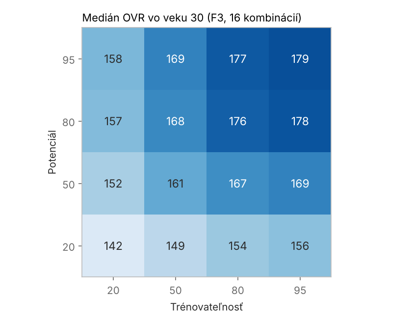
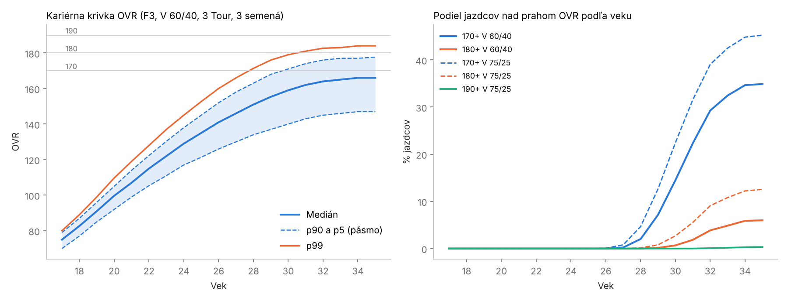

# Model F3 – Potenciál vs. Trénovateľnosť, Univerzál, únava, kalendár (výsledky simulácie na schválenie)

Stav: **iba experimentálna simulácia v izolácii. Produkčný kód, DB, migrácie ani herné pravidlá sa nezmenili. Nič nie je schválené.** Model F2 je pracovný základ.
Značenie: **PROD** = produkčný kód, **EXP** = experimentálne pravidlo/predpoklad, **VÝSLEDOK** = reálne spustený beh, **ODPORÚČANIE** = návrh.
Reprodukcia: `apps/web/src/lib/training/sim/career3/` (`modelF2.ts` rozšírený o F3 voľby a `DEF3`, `careerF3.cli.ts`). Hlavné varianty: seedy **20261116, 20261117, 20261118 × 10 000 kariér** (Rookie 17 → 35 rokov). Kontrolované porovnania (16 kombinácií, Univerzál, energia, kalendár) bežali na seede 20261116, na tých istých 10 000 štartových jazdcoch (rovnaké štartovné atribúty, rovnaký seed náhody). Výstupy: `careerF3_*.json`. Rozdiely medzi seedmi v mediáne OVR sú ≤ 1 bod.
Pracovný základ ostáva: cPhys 1,8, cTech 6,5, rozpočet 80/20, režimy základný (75 % + 25 % regenerácia) a plnohodnotný (100 %), V 60/40 pokiaľ nie je uvedené inak.

## 0. Zhrnutie

**Väzby plánov:** dokument design v3 stále nemám k dispozícii, preto ostávajú väzby z F2 (produkčné `SHAPES` + moje doplnky, tabuľka v kap. 1). Žiadny plán som nezmenil. Zmena väzieb je 1 tabuľka v kóde a prepočet trvá ~10 minút.

1. **Potenciál a Trénovateľnosť sú oddelené (F3):** Potenciál už nie je násobiteľom tréningu (`wPo` 0,10 → 0), určuje iba mäkký strop `130 + Potenciál`. Trénovateľnosť určuje rýchlosť rastu (`G`: ±0,30 pri 0–100). Bez vplyvu Potenciálu na rýchlosť sa kariérne rozdelenie zmení len málo (vek 30: medián 159 (159–159) vs. 159 (159–160) pri F2). Z 16 kombinácií plynie, že **oba parametre sú silné a vo veku 30 sa dá dosiahnuť 142 až 179 OVR**; Potenciál nad ~80 už pri silných atribútoch nepridáva, lebo ich mäkký strop (130 + Pot) prekročí tvrdý strop 200 (kap. 2).
2. **Univerzál:** nerovnosť (−6,5 OVR vo veku 30) vzniká zo **~60 % zo stropu −15** a z **~40 % z taktiky** (jeho rovnomerné váhy taktických typov dávajú nízku „najlepšiu taktiku“ 143 vs. 158–174). Štartový profil a vzorec V ju **nespôsobujú**. Plán rozloženia rastu na všetkých 7 atribútov ju zhoršuje. Bez umelých bonusov k OVR sa nerovnosť odstráni stropom −10 a jedným vedúcim taktickým typom (kap. 3).
3. **Únava a energia:** prísnejšia tabuľka účinnosti zníži kariérny rast (vek 33, 170+: 24,6 % vs. 32,7 %); po prekalibrovaní koeficientov o **+10 %** (cPhys 1,98 / cTech 7,15) sa výsledok vráti na úroveň produkčnej tabuľky. Prísna tabuľka robí rozhodnutie o režime zmysluplným. Hranica prepínania: základný režim, keď readiness < 70–80.
4. **Kalendár:** 4. Tour iba v Elite (pracovný návrh) výsledok nemení; 4 Tour vo všetkých ligách znižuje 170+ vo veku 33 z 32,7 % na 17,3 %. Výmena tréningového času za skúsenosti je takmer vyrovnaná v mediáne, no oslabuje vrchol; výsledok silno závisí od predpokladu rastu Skúseností a Taktiky z pretekov (EXP, kap. 5).
5. **200 a akumulátor:** fyzický atribút 200 dosiahne 13,3 % jazdcov (medián veku 27); akumulácia progresu na strope je v F3 opravená (neukladá sa).

**Čo je overené simuláciou a čo je predpoklad:** kap. 9.

## 1. Väzby siedmich plánov (rovnaké ako F2)
Pôvod: produkčné `SHAPES` (`lib/rider/config.ts`) + moje doplnky. Poradie koeficientov 1,15 / 0,95 / 0,75 (fyzika), 0,85 / 0,45 (technika), ostatné 4 fyzické 0,35.

| Plán | 1. fyz. | 2. fyz. | 3. fyz. | 1. tech. | 2. tech. | Pôvod |
|---|---|---|---|---|---|---|
| Vrchár | Stúpanie | Kopce | Akcelerácia | Zjazd | Zákruty | fyzika PROD, technika návrh |
| Šprintér | Šprint | Rovina | Akcelerácia | Jazda v balíku | Ovládanie bicykla | fyzika PROD, technika návrh |
| Časovkár | Časovka | Rovina | Vytrvalosť | Ovládanie bicykla | Zákruty | fyzika PROD, technika návrh |
| Puncheur | Kopce | Akcelerácia | Stúpanie | Zákruty | Ovládanie bicykla | Kopce, Akcelerácia PROD; Stúpanie z mapy RELATED; technika návrh |
| Klasikár | Rovina | Kopce | Vytrvalosť | Nerovný povrch | Jazda v balíku | technika PROD; fyzika návrh |
| Únikár | Vytrvalosť | Rovina | Časovka | Zjazd | Ovládanie bicykla | Vytrvalosť, Rovina PROD (rouleur); Časovka RELATED; technika návrh |
| Univerzál | Vytrvalosť | Rovina | Stúpanie | Jazda v balíku | Ovládanie bicykla | Vytrvalosť PROD; zvyšok návrh |

## 2. Potenciál a Trénovateľnosť
### 2.1 Pravidlá (EXP)
- **Rýchlosť rastu:** `G = clamp(1 + 0,30·(Trén−50)/50 + 0,15·(Prof−50)/50, 0,6, 1,5)` – Potenciál v `G` **nie je**. (F2: + 0,10·(Pot−50)/50.)
- **Dlhodobý strop:** mäkký strop atribútu `Cap = 130 + Potenciál − medzera(tvar)`, kde medzera = 0 (silný atribút tvaru) / 20 (neutrálny) / 45 (slabý) / 15 (Univerzál); tvrdý strop 200. Mäkký strop je logistický: účinnosť rastu klesá okolo `Cap − 10`.
- Trénovateľnosť zároveň určuje rýchlosť rastu Taktiky z pretekov (`tauE`).
- Kontrolované porovnanie: tých istých 10 000 štartových jazdcov, Potenciál a Trénovateľnosť nastavené pevne každému jazdcovi, ostatné skryté vlastnosti 50 (Prof, Reg, Vit), plán prirodzený, režim odporúčanie < 60.

### 2.2 16 kombinácií – medián OVR vo veku 30 / 33
| Potenciál \ Trénovateľnosť | 20 | 50 | 80 | 95 |
|---|---|---|---|---|
| **20** | 142 / 147 | 149 / 154 | 154 / 159 | 156 / 160 |
| **50** | 152 / 159 | 161 / 167 | 167 / 172 | 169 / 174 |
| **80** | 157 / 165 | 168 / 175 | 176 / 181 | 178 / 183 |
| **95** | 158 / 166 | 169 / 177 | 177 / 183 | 179 / 185 |

**Podiel jazdcov s OVR 170+ / 180+ vo veku 33 (%):**

| Potenciál \ Trénovateľnosť | 20 | 50 | 80 | 95 |
|---|---|---|---|---|
| **20** | 0 / 0 | 0 / 0 | 0 / 0 | 0 / 0 |
| **50** | 0 / 0 | 27 / 0 | 64 / 0 | 82 / 1 |
| **80** | 9 / 0 | 84 / 8 | 98 / 71 | 99 / 87 |
| **95** | 14 / 0 | 91 / 14 | 98 / 82 | 99 / 89 |

**Ø počet fyzických atribútov na 200 vo veku 30 a hlavný atribút vo veku 25:**

| Potenciál \ Trénovateľnosť | 20 | 50 | 80 | 95 |
|---|---|---|---|---|
| **20** | 0,00 / 143 | 0,00 / 146 | 0,00 / 149 | 0,00 / 150 |
| **50** | 0,00 / 160 | 0,00 / 168 | 0,00 / 173 | 0,00 / 175 |
| **80** | 0,33 / 165 | 0,99 / 179 | 1,50 / 190 | 1,64 / 194 |
| **95** | 0,51 / 165 | 1,29 / 180 | 1,98 / 192 | 2,19 / 196 |

**Čítanie (VÝSLEDOK):**
- Trénovateľnosť určuje rýchlosť: pri Potenciáli 50 stúpne hlavný atribút vo veku 25 zo 160 (Tr 20) na 175 (Tr 95), OVR vo veku 30 o 17 bodov.
- Potenciál určuje, kde sa rast zastaví: pri Trénovateľnosti 50 rozdiel Po 20 → 50 → 80 → 95 je 149 → 161 → 168 → 169. **Nad Potenciálom ~80 je prírastok už len ~1 bod**, lebo silné atribúty (medzera 0) majú strop 130 + 80 = 210 > 200 (tvrdý strop). Potenciál 80 a 95 sa líši hlavne v neutrálnych atribútoch a vo veku nad 33.
- Slabý Potenciál s vysokou Trénovateľnosťou (20 / 95: 156) rastie rýchlo, no zastaví sa okolo 150–160. Vysoký Potenciál s nízkou Trénovateľnosťou (95 / 20: 158) rastie pomaly, no vo veku 33 dobehne 166 (Tr 20, Po 20: 147).
- Obe vlastnosti sa **násobia** len nepriamo (strop × rýchlosť), preto jazdec s Po 95 / Tr 95 (179) vo veku 30 má 190+ (kariérne max) len v 0,76 % prípadov.

### 2.3 Kontrola: F3 vs. väzba z F2 (rovnaké štartovné atribúty a seed)
| Potenciál / Trénovateľnosť | F3 vek 30 | F2 (Pot v G) vek 30 | F3 190+ kariérne (%) | F2 190+ (%) |
|---|---|---|---|---|
| 20 / 20 | 142 | 141 | 0,00 | 0,00 |
| 20 / 95 | 156 | 155 | 0,00 | 0,00 |
| 50 / 20 | 152 | 152 | 0,00 | 0,00 |
| 50 / 95 | 169 | 169 | 0,00 | 0,00 |
| 80 / 20 | 157 | 160 | 0,00 | 0,00 |
| 80 / 95 | 178 | 179 | 0,07 | 0,61 |
| 95 / 20 | 158 | 162 | 0,00 | 0,00 |
| 95 / 95 | 179 | 181 | 0,76 | 5,13 |

Pri F2 mal vysoký Potenciál s nízkou Trénovateľnosťou rýchly rast navyše (95 / 20: 162 vs. F3 158) a Po 95 / Tr 95 dával 190+ až v 5,13 % (F3: 0,76 %). Oddelenie preto znižuje horný chvost.

### 2.4 Citlivosť (seed 20261116)
**Sila Trénovateľnosti `wTr`** (Potenciál 50, medián OVR vek 30; Tr 20 / 50 / 95):

| `wTr` | Tr 20 | Tr 50 | Tr 95 | Rozdiel 95 − 20 |
|---|---|---|---|---|
| 0,30 (základ) | 152 | 161 | 169 | 17 |
| 0,50 | 147 | 161 | 172 | 25 |
| 0,70 | 143 | 161 | 173 | 30 |

Základná sila 0,30 už dáva rozdiel 17 bodov medzi Tr 20 a 95; vyššia sila (0,5 – 0,7) rozdiel zväčší na 25 – 30 bodov a stlačí spodný koniec (Tr 20 klesne na 143–147), čo by pre jazdca s nízkou Trénovateľnosťou bolo príliš trestajúce. **Odporúčam ponechať 0,30.**

**Mapovanie Potenciálu na strop** (prirodzené rozdelenie skrytých vlastností N(50; 20), 3 Tour, cPhys 1,8, **bez prekalibrovania**):

| Strop = základ + sklon × Potenciál | Vek 30 medián / p90 | 170+ vek 33 (%) | 180+ vek 33 (%) | Ø atribútov na 200 (vek 30) |
|---|---|---|---|---|
| 130 + 1 × Pot | 159 / 171 | 32,7 | 4,9 | 0,16 |
| 110 + 1 × Pot | 152 / 166 | 11,6 | 0,8 | 0,02 |
| 100 + 1.2 × Pot | 152 / 167 | 14,0 | 1,5 | 0,05 |
| 120 + 0.8 × Pot | 152 / 164 | 8,7 | 0,4 | 0,01 |
| 90 + 1.3 × Pot | 150 / 166 | 11,8 | 1,3 | 0,04 |

Nižší strop (110 + Pot, 120 + 0,8·Pot, …) zníži medián o 7 až 9 bodov, bez zmeny koeficientov by sa ciele 170+ nedosiahli; mapovanie 130 + 1,0·Pot zodpovedá kalibrácii F2. Strmejší strop dáva väčší rozdiel medzi Potenciálmi, ale koeficienty by sa museli prekalibrovať. **Odporúčam ponechať 130 + 1,0 × Potenciál (pri Potenciáli 70 dosahuje mäkký strop 3 silných atribútov 200)**; ak chce hra, aby Potenciál rozlišoval aj hore, treba znížiť základ a zvýšiť cPhys – tento variant som nekalibroval.

### 2.5 Regenerácia (rýchlosť zotavenia; Pot 50, Tr 50)
Mapa rýchlosti zotavenia `rm`: úzka 0,75 + 0,5·Reg/100 (F2) vs. široká 0,60 + 0,80·Reg/100 (OVR vek 30 medián / 170+ vek 33):

| Regenerácia | Úzka mapa | Široká mapa |
|---|---|---|
| 20 | 158 / 4 % | 156 / 1 % |
| 50 | 161 / 27 % | 161 / 27 % |
| 80 | 162 / 42 % | 163 / 46 % |
| 95 | 163 / 46 % | 163 / 48 % |

Regenerácia 20 vs. 80 dáva pri úzkej mape 4 body OVR a pri širokej 7 bodov; pri produkčnej tabuľke účinnosti je rozdiel menší než vplyv Trénovateľnosti. **Odporúčam úzku mapu 0,75–1,25**, regeneračné rozdiely majú viac ukázať v pripravenosti na preteky než v raste (kap. 4).

## 3. Nerovnosť Univerzála
Univerzál (n ≈ 1 400 z 10 000): produkčný tvar `allrounder` (silná len Vytrvalosť), moje pravidlo **strop všetkých fyzických atribútov −15** oproti `130 + Potenciál`. Špecialisti majú 3 silné atribúty so stropom 0, ostatné −20 (slabé −45).

### 3.1 Čo spôsobuje rozdiel (vek 30, V 60/40; rozdiel = Univerzál − priemer 6 špecialistov; 170+ v %)
| Faktor, ktorý meníme (ostatné ostáva) | Medián Univerzál | Rozdiel | 170+ Univerzál | 170+ špecialisti |
|---|---|---|---|---|
| Základ (strop −15, plán Vytrvalosť/Rovina/Stúpanie, V 60/40) | 154 | -6,5 | 3,5 | 16,4 |
| *Mäkké stropy* | | | | |
| Strop 0 (bez zníženia) | 158 | -2,5 | 8,6 | 16,4 |
| Strop −10 | 156 | -5,0 | 4,9 | 16,4 |
| Strop −20 | 153 | -7,5 | 2,2 | 16,5 |
| *Tréningový plán* | | | | |
| Rovnomerný plán (rast rozložený na všetkých 7 atribútov) | 150 | -10,5 | 0,6 | 16,5 |
| Dynamický plán (Vytrvalosť + 2 najslabšie) | 150 | -10,5 | 0,3 | 16,4 |
| *Štartovný profil* (všetci jazdci dostanú plochý fyzický profil pri rovnakom štartovom OVR) | | | | |
| Plochý štart, strop −15 | 154 | -7,3 | 3,8 | 19,2 |
| Plochý štart, strop 0 | 158 | -3,3 | 9,6 | 19,2 |
| *Vzorec V* (každé V s vlastnou štartovnou populáciou) | | | | |
| V 40/60, strop −15 | 151 | -6,0 | 0,9 | 6,8 |
| V 40/60, strop 0 | 155 | -2,0 | 2,7 | 6,8 |
| V 75/25, strop −15 | 156 | -6,7 | 7,0 | 25,4 |
| V 75/25, strop 0 | 160 | -2,7 | 14,5 | 25,4 |
| V 80/20, strop −15 | 157 | -6,5 | 8,1 | 28,4 |
| V 80/20, strop 0 | 161 | -2,5 | 17,4 | 28,4 |
| V = len priemer 7, strop −15 | 147 | -4,0 | 0,0 | 0,1 |
| V = len priemer 7, strop 0 | 149 | -2,0 | 0,0 | 0,1 |

**Čítanie (VÝSLEDOK):**
- **Strop −15 vysvetľuje ~4 body z 6,5**: po jeho odstránení klesne rozdiel na −2,5 a podiel 170+ stúpne z 3,5 % na 8,6 %. Univerzál tým dosiahne priemer 7 atribútov 142 (špecialisti 135–138) a top 3 169 (špecialisti 158–175).
- **Štartovný profil takmer nezáleží:** plochý štart všetkých jazdcov rozdiel nemení (−7,3 vs. −6,5; so stropom 0 −3,3 vs. −2,5), t. j. rozhodujú stropy a plán, nie to, s akým profilom jazdec štartuje.
- **Vzorec V takmer nemení rozdiel**: 60/40 → 80/20 −6,5 → −6,5 (so stropom 0 −2,5 → −2,5). Zníži ho až V = len priemer 7 (−4,0), no vtedy mizne dôvod mať špecialistov v OVR (170+ nedosiahne takmer nikto). Pri vyššom váhe top 3 sa **absolútny podiel 170+ zvýši pre všetkých**, nie pre špecialistov na úkor Univerzála.
- **Plán:** rozloženie rastu na všetkých 7 atribútov alebo dynamický výber najslabších atribútov Univerzála **zhorší** (−10,5), pretože zníži top 3. Aktuálny plán (Vytrvalosť, Rovina, Stúpanie) je rozumný.
- **Zvyšných ~2,5 bodu je taktika (EXP predpoklad):** Univerzál má rovnomerné váhy taktických typov (0,6 pre všetkých 5), preto jeho **najlepšia taktika je 143 vs. 158–174** u špecialistov (OVR berie len najlepšiu taktiku, 15 %). Je to dôsledok mojich váh, nie pravidla z produkcie.

### 3.2 Návrh bez umelých bonusov k OVR (seed 20261116; V 60/40)
| Kombinácia | Univerzál medián (vek 30) | Rozdiel | 170+ Univ. / špec. (vek 30) | Rozdiel vek 33 |
|---|---|---|---|---|
| Strop −15, taktika pôvodná (základ) | 154 | -6,5 | 3,5 / 16,4 | -7,2 |
| Strop −5, taktika pôvodná | 157 | -3,5 | 6,7 / 16,4 | -3,7 |
| Strop 0, taktika pôvodná | 158 | -2,5 | 8,6 / 16,4 | -2,2 |
| Strop −15 + 1 vedúci taktický typ (1,0 / 0,6) | 159 | -1,5 | 11,7 / 16,4 | -2,2 |
| Strop −5 + vedúci taktický typ | 162 | 1,5 | 19,2 / 16,4 | 0,8 |
| Strop 0 + vedúci taktický typ | 163 | 2,5 | 22,8 / 16,4 | 2,8 |

**Kandidát (strop −10 + jeden vedúci taktický typ 1,0 a 4 typy 0,6), 3 semená:**

| V | Univerzál medián vek 30 (3 semená) | Rozdiel vs. špecialisti | 170+ Univerzál / špecialisti vek 33 (%) |
|---|---|---|---|
| 60/40 | 161, 161, 161 | 0,5, 0,8, 0,7 | 32,6 / 36,2 |
| 75/25 | 163, 163, 163 | 0,3, 0,1, 0,0 | 42,6 / 47,0 |
| 80/20 | 164, 163, 163 | 0,5, -0,7, -0,5 | 45,6 / 50,4 |

Kandidát vyrovná Univerzála so špecialistami (rozdiel okolo 0 ±1,5) **bez zmeny vzorca OVR a bez bonusov**; jeho profil zostáva plochší (viac atribútov vysokých, top 3 nižší než u špecialistov). Taktika je v tomto prípade EXP predpoklad: skutočné váhy typov v Race Engine nepoznám, takže ide o návrh, nie overené pravidlo. Samotné zníženie stropu na −10 rozdiel nevyrieši (−5,0).

## 4. Únava a energia
Porovnanie produkčnej tabuľky účinnosti (**PROD**: readiness ≥ 80 → 1,00; ≥ 60 → 0,95; ≥ 40 → 0,85; ≥ 20 → 0,70; inak 0,50) a prísnejšej experimentálnej z F2 (**EXP „steep“**: 1,00 / 0,90 / 0,70 / 0,45 / 0,25). Všetko ostatné je produkčné (Energy, Fatigue, readiness, intenzity `hard` pre plnohodnotný a `normal` pre základný režim). Záťaž Tour-u (7 energie / 8 únavy na etapu, 2 oddychové dni) je EXP predpoklad. „Stav po Tour-e“ je výsledkom záťaže: násobiteľ ×1,0 je štandard, ×1,4 ťažký Tour (veľa kopcovitých etáp), ×2,0 extrém.
**Pripravenosť na preteky** = readiness na štarte Tour-u (Ø) a podiel štartov Tour-u s readiness < 60 / < 40 (štart v zlej forme – v simulácii znižuje aj výsledok etapy, `kRace` 0,15 za bod pod 80).

### 4.1 Tabuľky pri štandardnej záťaži, Regenerácia 20 / 50 / 80 (kontrolovaný priemerný jazdec: Pot 50, Tr 50)

**Tabuľka produkčná**

| Nastavenie | OVR vek 30 medián / p90 | 170+ vek 33 (%) | Ø readiness | Ø readiness na štarte Tour-u | Štarty s readiness < 60 (%) | < 40 (%) | Podiel základných týždňov | Ø účinnosť |
|---|---|---|---|---|---|---|---|---|
| Reg 20 / plnohodnotný | 158 / 165 | 7,2 | 43 | 57 | 54,4 | 19,1 | 0,00 | 0,78 |
| Reg 20 / základný | 156 / 163 | 0,4 | 79 | 91 | 0,0 | 0,0 | 1,00 | 0,97 |
| Reg 20 / odporúčanie < 60 | 158 / 164 | 4,1 | 58 | 71 | 28,2 | 9,7 | 0,49 | 0,88 |
| Reg 20 / odporúčanie < 80 | 159 / 164 | 6,0 | 72 | 84 | 7,5 | 0,0 | 0,65 | 0,95 |
| Reg 20 / kalendárne 2 týždne po Tour-e | 158 / 164 | 5,2 | 77 | 89 | 5,2 | 0,0 | 0,82 | 0,96 |
| Reg 50 / plnohodnotný | 160 / 166 | 18,6 | 52 | 65 | 41,4 | 10,1 | 0,00 | 0,84 |
| Reg 50 / základný | 156 / 163 | 0,7 | 85 | 94 | 0,0 | 0,0 | 1,00 | 0,98 |
| Reg 50 / odporúčanie < 60 | 161 / 167 | 27,1 | 66 | 78 | 11,9 | 0,7 | 0,26 | 0,93 |
| Reg 50 / odporúčanie < 80 | 160 / 166 | 21,7 | 79 | 90 | 0,0 | 0,0 | 0,48 | 0,97 |
| Reg 50 / kalendárne 2 týždne po Tour-e | 158 / 165 | 9,3 | 85 | 94 | 0,0 | 0,0 | 0,82 | 0,98 |
| Reg 80 / plnohodnotný | 162 / 169 | 40,9 | 67 | 79 | 14,2 | 0,0 | 0,00 | 0,92 |
| Reg 80 / základný | 156 / 164 | 1,0 | 89 | 97 | 0,0 | 0,0 | 1,00 | 0,99 |
| Reg 80 / odporúčanie < 60 | 162 / 169 | 41,6 | 76 | 87 | 5,9 | 0,0 | 0,10 | 0,96 |
| Reg 80 / odporúčanie < 80 | 161 / 168 | 34,6 | 84 | 93 | 0,0 | 0,0 | 0,33 | 0,98 |
| Reg 80 / kalendárne 2 týždne po Tour-e | 158 / 165 | 10,7 | 90 | 97 | 0,0 | 0,0 | 0,82 | 0,99 |

**Tabuľka prísna (EXP)**

| Nastavenie | OVR vek 30 medián / p90 | 170+ vek 33 (%) | Ø readiness | Ø readiness na štarte Tour-u | Štarty s readiness < 60 (%) | < 40 (%) | Podiel základných týždňov | Ø účinnosť |
|---|---|---|---|---|---|---|---|---|
| Reg 20 / plnohodnotný | 151 / 157 | 0,0 | 43 | 57 | 54,5 | 19,0 | 0,00 | 0,58 |
| Reg 20 / základný | 155 / 162 | 0,1 | 79 | 91 | 0,0 | 0,0 | 1,00 | 0,94 |
| Reg 20 / odporúčanie < 60 | 155 / 160 | 0,5 | 58 | 71 | 27,9 | 9,5 | 0,49 | 0,77 |
| Reg 20 / odporúčanie < 80 | 158 / 163 | 1,7 | 72 | 84 | 7,5 | 0,0 | 0,65 | 0,90 |
| Reg 20 / kalendárne 2 týždne po Tour-e | 157 / 163 | 2,2 | 77 | 89 | 5,0 | 0,0 | 0,82 | 0,93 |
| Reg 50 / plnohodnotný | 156 / 160 | 0,3 | 52 | 65 | 41,5 | 9,8 | 0,00 | 0,69 |
| Reg 50 / základný | 156 / 163 | 0,3 | 85 | 94 | 0,0 | 0,0 | 1,00 | 0,96 |
| Reg 50 / odporúčanie < 60 | 159 / 165 | 8,6 | 66 | 78 | 11,8 | 0,7 | 0,26 | 0,85 |
| Reg 50 / odporúčanie < 80 | 160 / 165 | 14,0 | 79 | 90 | 0,0 | 0,0 | 0,48 | 0,94 |
| Reg 50 / kalendárne 2 týždne po Tour-e | 158 / 164 | 5,4 | 85 | 94 | 0,0 | 0,0 | 0,82 | 0,96 |
| Reg 80 / plnohodnotný | 161 / 166 | 19,6 | 67 | 79 | 14,2 | 0,0 | 0,00 | 0,84 |
| Reg 80 / základný | 156 / 163 | 0,4 | 89 | 97 | 0,0 | 0,0 | 1,00 | 0,97 |
| Reg 80 / odporúčanie < 60 | 161 / 168 | 32,7 | 76 | 87 | 5,8 | 0,0 | 0,10 | 0,91 |
| Reg 80 / odporúčanie < 80 | 161 / 167 | 30,6 | 84 | 93 | 0,0 | 0,0 | 0,33 | 0,96 |
| Reg 80 / kalendárne 2 týždne po Tour-e | 158 / 165 | 7,7 | 90 | 97 | 0,0 | 0,0 | 0,82 | 0,97 |

### 4.2 Ťažký Tour (záťaž ×1,4)

**Tabuľka produkčná**

| Nastavenie | OVR vek 30 medián / p90 | 170+ vek 33 (%) | Ø readiness | Ø readiness na štarte Tour-u | Štarty s readiness < 60 (%) | < 40 (%) | Podiel základných týždňov | Ø účinnosť |
|---|---|---|---|---|---|---|---|---|
| Reg 20 / plnohodnotný | 153 / 157 | 0,0 | 22 | 39 | 76,8 | 51,4 | 0,00 | 0,62 |
| Reg 20 / základný | 153 / 158 | 0,0 | 57 | 77 | 19,4 | 10,2 | 1,00 | 0,86 |
| Reg 20 / odporúčanie < 60 | 154 / 159 | 0,1 | 45 | 65 | 35,9 | 19,0 | 0,74 | 0,81 |
| Reg 20 / odporúčanie < 80 | 154 / 159 | 0,1 | 54 | 74 | 20,2 | 10,2 | 0,91 | 0,85 |
| Reg 50 / plnohodnotný | 156 / 162 | 0,5 | 35 | 52 | 56,8 | 33,6 | 0,00 | 0,72 |
| Reg 50 / základný | 154 / 161 | 0,0 | 68 | 85 | 12,2 | 5,9 | 1,00 | 0,92 |
| Reg 50 / odporúčanie < 60 | 157 / 162 | 1,9 | 54 | 72 | 22,9 | 10,3 | 0,60 | 0,86 |
| Reg 50 / odporúčanie < 80 | 157 / 162 | 1,0 | 66 | 84 | 11,9 | 5,6 | 0,80 | 0,91 |
| Reg 80 / plnohodnotný | 159 / 165 | 9,7 | 45 | 63 | 45,3 | 18,4 | 0,00 | 0,81 |
| Reg 80 / základný | 155 / 162 | 0,2 | 75 | 90 | 6,9 | 0,0 | 1,00 | 0,95 |
| Reg 80 / odporúčanie < 60 | 159 / 165 | 9,0 | 61 | 77 | 16,0 | 5,6 | 0,40 | 0,89 |
| Reg 80 / odporúčanie < 80 | 159 / 164 | 4,9 | 72 | 88 | 6,6 | 0,0 | 0,66 | 0,95 |

**Tabuľka prísna (EXP)**

| Nastavenie | OVR vek 30 medián / p90 | 170+ vek 33 (%) | Ø readiness | Ø readiness na štarte Tour-u | Štarty s readiness < 60 (%) | < 40 (%) | Podiel základných týždňov | Ø účinnosť |
|---|---|---|---|---|---|---|---|---|
| Reg 20 / plnohodnotný | 140 / 145 | 0,0 | 21 | 38 | 77,0 | 51,7 | 0,00 | 0,38 |
| Reg 20 / základný | 149 / 153 | 0,0 | 57 | 77 | 19,3 | 9,8 | 1,00 | 0,74 |
| Reg 20 / odporúčanie < 60 | 148 / 153 | 0,0 | 45 | 65 | 36,2 | 19,0 | 0,74 | 0,64 |
| Reg 20 / odporúčanie < 80 | 150 / 154 | 0,0 | 54 | 74 | 20,2 | 10,0 | 0,91 | 0,71 |
| Reg 50 / plnohodnotný | 147 / 151 | 0,0 | 35 | 52 | 56,9 | 33,6 | 0,00 | 0,50 |
| Reg 50 / základný | 152 / 157 | 0,0 | 68 | 86 | 12,0 | 5,8 | 1,00 | 0,84 |
| Reg 50 / odporúčanie < 60 | 153 / 157 | 0,1 | 53 | 72 | 22,9 | 10,1 | 0,60 | 0,72 |
| Reg 50 / odporúčanie < 80 | 154 / 159 | 0,1 | 66 | 84 | 11,8 | 5,5 | 0,80 | 0,83 |
| Reg 80 / plnohodnotný | 153 / 157 | 0,1 | 45 | 63 | 45,5 | 18,4 | 0,00 | 0,64 |
| Reg 80 / základný | 154 / 160 | 0,0 | 75 | 90 | 6,8 | 0,0 | 1,00 | 0,90 |
| Reg 80 / odporúčanie < 60 | 157 / 161 | 1,4 | 61 | 77 | 15,9 | 5,5 | 0,40 | 0,79 |
| Reg 80 / odporúčanie < 80 | 157 / 162 | 1,8 | 72 | 88 | 6,6 | 0,0 | 0,67 | 0,89 |

**Čítanie (VÝSLEDOK):**
- **Pri produkčnej tabuľke je rozhodnutie o režime málo dôležité pre OVR:** plnohodnotný režim vs. odporúčanie < 60 dáva pri Reg 50 160 vs. 161 a pri Reg 20 158 vs. 158. Základný režim je horší o 2 až 6 bodov (Reg 20 až 80).
- **Pripravenosť na preteky sa líši veľmi:** pri Reg 20 a štandardnej záťaži štartuje s readiness < 60 až 54 % Tour-ov (plnohodnotný), 28 % (odporúčanie < 60) a 7 % (< 80); základný režim 0 %. Tento rozdiel OVR neukáže, no ukáže ho výsledok a hráč ho pocíti.
- **Prísna tabuľka kariérny rast zníži:** plnohodnotný režim pri Reg 50 klesne z 160 na 156 a 170+ vo veku 33 pri odporúčaní < 60 z 27 % na 9 %. S prísnou tabuľkou sa rozhodnutie o režime stáva zmysluplným (pri Reg 20 plnohodnotný 151 vs. odporúčanie < 80 158).

### 4.3 Prekalibrovanie koeficientov pre prísnu tabuľku (transparentne: pred a po)
Obe škály sa násobia rovnakým koeficientom `k` (cPhys = 1,8·k, cTech = 6,5·k), prirodzené rozdelenie skrytých vlastností, odporúčanie < 60, seed 20261116.

| Variant | cPhys / cTech | Vek 30 medián / p90 / p99 | 170+ vek 30 / 33 (%) | 180+ vek 33 (%) |
|---|---|---|---|---|
| **Produkčná tabuľka (referencia)** | 1,80 / 6,50 | 159 / 171 / 179 | 14,5 / 32,7 | 4,9 |
| Prísna tabuľka, k = 1,00 (pred prekalibrovaním) | 1,80 / 6,50 | 157 / 169 / 177 | 8,8 / 24,6 | 2,5 |
| Prísna tabuľka, k = 1,05 | 1,89 / 6,83 | 159 / 170 / 178 | 12,1 / 29,2 | 4,0 |
| Prísna tabuľka, k = 1,10 **(odporúčané)** | 1,98 / 7,15 | 160 / 172 / 179 | 15,6 / 33,9 | 5,5 |
| Prísna tabuľka, k = 1,15 | 2,07 / 7,47 | 161 / 173 / 180 | 19,1 / 38,2 | 7,5 |
| Prísna tabuľka, k = 1,20 | 2,16 / 7,80 | 162 / 174 / 181 | 22,6 / 42,1 | 9,7 |

Prekalibrovanie o **+10 % (cPhys 1,98 ≈ 2,0 / cTech 7,15)** vráti rozdelenie na úroveň produkčnej tabuľky (medián 160 vs. 159, 170+ vo veku 33 33,9 % vs. 32,7 %). Pri ťažkom Tour-e (×1,4) sú obe tabuľky pod cieľom (produkčná 170+ vo veku 33: 16,9 %, prísna s k 1,10: 12,8 %) – to je vlastnosť záťaže (EXP), nie tabuľky.

### 4.4 Výsledky prísnej tabuľky po prekalibrovaní (k = 1,10; Pot 50, Tr 50 kontrolované, ak nie je uvedené inak)
**Hranica prepínania režimov (odporúčanie: základný režim, ak readiness < prah); prirodzené rozdelenie skrytých vlastností:**

| Nastavenie | OVR vek 30 medián / p90 | 170+ vek 33 (%) | Ø readiness | Ø readiness na štarte Tour-u | Štarty s readiness < 60 (%) | < 40 (%) | Podiel základných týždňov | Ø účinnosť |
|---|---|---|---|---|---|---|---|---|
| prah 30 | 157 / 168 | 21,8 | 52 | 65 | 38,7 | 10,3 | 0,00 | 0,69 |
| prah 40 | 158 / 170 | 26,7 | 55 | 68 | 33,7 | 4,4 | 0,11 | 0,74 |
| prah 50 | 158 / 171 | 29,0 | 59 | 72 | 25,4 | 3,7 | 0,21 | 0,79 |
| prah 60 | 160 / 172 | 33,9 | 66 | 78 | 13,0 | 2,1 | 0,27 | 0,85 |
| prah 70 | 160 / 172 | 35,5 | 72 | 84 | 8,2 | 0,2 | 0,32 | 0,89 |
| prah 80 | 161 / 172 | 36,9 | 79 | 89 | 2,7 | 0,0 | 0,50 | 0,94 |
| prah 90 | 159 / 171 | 32,6 | 83 | 93 | 0,5 | 0,0 | 0,72 | 0,96 |
| vždy plnohodnotný | 157 / 168 | 21,4 | 52 | 65 | 39,0 | 10,7 | 0,00 | 0,69 |
| vždy základný | 157 / 169 | 24,3 | 85 | 95 | 0,6 | 0,0 | 1,00 | 0,96 |
| kalendárne (2 týždne po Tour-e) | 159 / 171 | 32,7 | 85 | 94 | 1,0 | 0,1 | 0,82 | 0,96 |
| náhodne 50 : 50 | 159 / 171 | 30,4 | 75 | 87 | 9,2 | 1,7 | 0,50 | 0,90 |

**Záťaž Tour-u a Regenerácia po prekalibrovaní (kontrolovaný jazdec v riadkoch Reg; záťaž s prirodzeným rozdelením):**

| Nastavenie | OVR vek 30 medián / p90 | 170+ vek 33 (%) | Ø readiness | Ø readiness na štarte Tour-u | Štarty s readiness < 60 (%) | < 40 (%) | Podiel základných týždňov | Ø účinnosť |
|---|---|---|---|---|---|---|---|---|
| záťaž ×0,6 / plnohodnotný | 164 / 177 | 49,7 | 86 | 93 | 3,6 | 0,1 | 0,00 | 0,98 |
| záťaž ×0,6 / základný | 158 / 171 | 29,3 | 96 | 99 | 0,0 | 0,0 | 1,00 | 1,00 |
| záťaž ×0,6 / odporúčanie < 60 | 164 / 177 | 50,5 | 86 | 93 | 0,3 | 0,0 | 0,00 | 0,98 |
| záťaž ×1,4 / plnohodnotný | 148 / 159 | 4,3 | 34 | 52 | 58,0 | 36,8 | 0,00 | 0,50 |
| záťaž ×1,4 / základný | 153 / 163 | 9,2 | 67 | 86 | 13,4 | 4,3 | 1,00 | 0,83 |
| záťaž ×1,4 / odporúčanie < 60 | 154 / 165 | 12,8 | 53 | 72 | 23,9 | 9,7 | 0,60 | 0,72 |
| záťaž ×2 / plnohodnotný | 138 / 149 | 0,5 | 18 | 38 | 65,4 | 55,9 | 0,00 | 0,33 |
| záťaž ×2 / základný | 144 / 153 | 1,0 | 41 | 69 | 32,6 | 19,7 | 1,00 | 0,59 |
| záťaž ×2 / odporúčanie < 60 | 144 / 156 | 2,7 | 38 | 66 | 36,6 | 22,4 | 0,88 | 0,56 |
| Reg 20 / plnohodnotný | 153 / 159 | 0,1 | 43 | 57 | 54,5 | 18,9 | 0,00 | 0,58 |
| Reg 20 / základný | 158 / 164 | 3,5 | 80 | 91 | 0,0 | 0,0 | 1,00 | 0,94 |
| Reg 20 / odporúčanie < 60 | 158 / 163 | 3,0 | 58 | 71 | 27,8 | 9,4 | 0,49 | 0,77 |
| Reg 50 / plnohodnotný | 158 / 163 | 2,8 | 52 | 65 | 41,5 | 9,7 | 0,00 | 0,69 |
| Reg 50 / základný | 158 / 165 | 8,2 | 85 | 94 | 0,0 | 0,0 | 1,00 | 0,96 |
| Reg 50 / odporúčanie < 60 | 162 / 167 | 32,6 | 66 | 78 | 11,7 | 0,7 | 0,26 | 0,85 |
| Reg 80 / plnohodnotný | 163 / 168 | 44,1 | 67 | 79 | 14,2 | 0,0 | 0,00 | 0,84 |
| Reg 80 / základný | 158 / 166 | 11,9 | 89 | 97 | 0,0 | 0,0 | 1,00 | 0,97 |
| Reg 80 / odporúčanie < 60 | 164 / 170 | 50,9 | 76 | 87 | 5,8 | 0,0 | 0,10 | 0,91 |

**Čítanie (VÝSLEDOK):**
- Optimum prahu je široké **60 – 80** (medián 160–161, 170+ vo veku 33 34–37 %). Prah 30–40 je takmer to isté ako „vždy plnohodnotný“ (157), prah 90 už stojí rast (základný režim v 72 % týždňov).
- **Prah 80** dáva najvyššie OVR (161) aj najlepšiu pripravenosť (štarty s readiness < 60 len 2,7 %, pri prahu 60 13,0 %), za cenu základného režimu v polovici týždňov. Prah 60 je jednoduchšie vysvetliteľný („kondícia je pod dobrou“).
- **Rozhodnutie sa oplatí najviac pri nízkej Regenerácii a ťažkom Tour-e:** pri Reg 20 odporúčanie 158 vs. plnohodnotný 153; pri ťažkom Tour-e (×1,4) 154 vs. 148. Pri vysokej Regenerácii (80) je plnohodnotný režim takmer rovnaký (163 vs. 164), ale s horšou pripravenosťou na preteky (14 % štartov pod 60).
- Pri veľmi ľahkom Tour-e (×0,6) je plnohodnotný režim aj odporúčanie rovnaké (164); základný režim stojí 6 bodov.

**Obnova po Tour-e (deterministický výpočet s produkčnými konštantami; Energy 75 / Fatigue 32 po 5-etapovom Tour-e, readiness 72):** základný režim (`normal`) vráti readiness na ≥ 80 za 1 týždeň (Reg 50), plnohodnotný (`hard`) ju za 5 týždňov vráti na 79 (Reg 50), pri Reg 20 sa zhoršuje (72 → 66). Platí rovnako ako v F2 (tabuľka v `OVR_MODEL_F2_OPRAVA_A_OVERENIE.md`, kap. 3).

## 5. Kalendár, skúsenosti a stropy
Rookie má 3 Tour-y za sezónu. Štvrtá Tour (týždeň 9) je samostatný scenár, nie plošné pravidlo: porovnanie 4. Tour-u iba v Elite (pracovný návrh `calendar()` v kóde), od Pro, od Continental a vo všetkých ligách. **Tréningové koeficienty sú rovnaké (cPhys 1,8) vo všetkých scenároch.** Seed 20261116, V 60/40.

### 5.1 Výsledky

| Scenár (vek 30) | Medián | p90 | p99 | Max | ≥160 | ≥170 | ≥180 | ≥185 | ≥190 | ≥195 |
|---|---|---|---|---|---|---|---|---|---|---|
| 3 Tour všade | 159 | 171 | 179 | 184 | 49,1 | 14,5 | 0,7 | 0,0 | 0,0 | 0,0 |
| kalendár: 4 Tour iba Elite (pracovný návrh) | 159 | 171 | 179 | 184 | 49,4 | 14,7 | 0,7 | 0,0 | 0,0 | 0,0 |
| 4 Tour od Pro | 159 | 171 | 178 | 183 | 49,8 | 14,1 | 0,4 | 0,0 | 0,0 | 0,0 |
| 4 Tour od Continental | 160 | 170 | 177 | 183 | 50,0 | 11,6 | 0,3 | 0,0 | 0,0 | 0,0 |
| 4 Tour všetky ligy | 158 | 168 | 176 | 183 | 41,5 | 6,4 | 0,2 | 0,0 | 0,0 | 0,0 |

| Scenár (vek 33) | Medián | p90 | p99 | Max | ≥160 | ≥170 | ≥180 | ≥185 | ≥190 | ≥195 |
|---|---|---|---|---|---|---|---|---|---|---|
| 3 Tour všade | 165 | 177 | 183 | 188 | 70,6 | 32,7 | 4,9 | 0,5 | 0,0 | 0,0 |
| kalendár: 4 Tour iba Elite (pracovný návrh) | 165 | 177 | 183 | 188 | 70,8 | 32,9 | 4,5 | 0,4 | 0,0 | 0,0 |
| 4 Tour od Pro | 165 | 176 | 182 | 187 | 71,1 | 31,9 | 3,5 | 0,3 | 0,0 | 0,0 |
| 4 Tour od Continental | 165 | 175 | 182 | 187 | 70,8 | 27,9 | 2,6 | 0,2 | 0,0 | 0,0 |
| 4 Tour všetky ligy | 162 | 173 | 181 | 187 | 61,7 | 17,3 | 1,9 | 0,2 | 0,0 | 0,0 |

### 5.2 Výmena tréningového času za pretekové skúsenosti (vek 30; zložky OVR: 0,60·V, 0,15·najlepšia taktika, 0,10·najlepšia technika, 0,15·Skúsenosti)

| Scenár | Etáp / sezónu | V | Taktika | Technika | Skúsenosti | OVR zložky V / Takt. / Tech. / Skús. | Štarty Tour-u s readiness < 60 (%) |
|---|---|---|---|---|---|---|---|
| 3 Tour všade | 10,0 | 155,6 | 163 | 150 | 171 | 93,3 / 24,5 / 15,0 / 25,6 | 13,1 |
| 4 Tour od Continental | 11,2 | 153,5 | 168 | 146 | 177 | 92,1 / 25,2 / 14,6 / 26,5 | 19,3 |
| 4 Tour všetky ligy | 12,6 | 148,1 | 178 | 137 | 188 | 88,9 / 26,7 / 13,7 / 28,1 | 21,6 |

**Čítanie (VÝSLEDOK):** 4. Tour vo všetkých ligách odoberie jeden z ~6 tréningových týždňov: V klesne o 7,5 (−4,5 OVR), technika o 14 (−1,4), no Skúsenosti rastú o 17 (+2,6) a Taktika o 14 (+2,1). Medián OVR sa preto zmení málo (159 → 158), no **vrchol sa zníži** (170+ vo veku 33 32,7 % → 17,3 %), lebo Skúsenosti a Taktika sa približujú ku stropu 200 (rast sa spomaľuje od 185) a odobraté tréningové týždne sa vo fyzike nenahradia. Štvrtý Tour zvyšuje aj podiel štartov s readiness < 60 (13 → 22 %). Scenáre „iba Elite“ a „od Pro“ sú v rámci šumu ako 3 Tour-y. **Vyšší tréningový koeficient kvôli 4. Tour-u som nepoužil**; ak sa 4. Tour zavedie plošne, treba najprv rozhodnúť, či je cieľom zachovať vrchol (potom je potrebné zvýšiť cPhys ~+10 %, čo F2 overil), alebo ho nechať klesnúť.

**Citlivosť na rast Skúseností a Taktiky z pretekov** (`expK` 14, `tactK` 12 sú EXP kalibrácie z C-075; vek 30 medián / 170+ vek 33 %):

| Predpoklad | 3 Tour | 4 Tour (všetky ligy) |
|---|---|---|
| rast z pretekov ×0,5 | 142 / 0 % | 141 / 0 % |
| rast z pretekov ×1,0 (základ) | 159 / 33 % | 158 / 17 % |
| rast z pretekov ×1,5 | 166 / 48 % | 161 / 24 % |

**Dôležité zistenie:** celkové OVR je **mimoriadne citlivé na to, ako rýchlo rastú Skúsenosti a Taktika z pretekov** (pri polovičnom raste medián vo veku 30 klesne zo 159 na 142). Tento rast je predpoklad kalibrovaný v C-075, nie údaj z hry. Pri pomalšom raste je 4. Tour výhodnejší (nahrádza fyziku skúsenosťami), pri rýchlejšom škodlivý. **Pred rozhodnutím o 4. Tour-e treba rýchlosť rastu Skúseností a Taktiky potvrdiť.**

### 5.3 Atribút 200 a akumulácia progresu na strope

- **Podiel jazdcov, ktorí dosiahnu aspoň jeden fyzický atribút 200:** 13 (13–13) %, v mediáne vo veku 27 (27–28); kumulatívne do 25 / 28 / 30 / 33 / 35 rokov: 2,7 / 8,8 / 12,1 / 13,3 / 13,3 %.
- Ø počet fyzických atribútov na 200: vek 30 0,16, vek 35 0,08. Pri Potenciáli 80 / 95 s Trénovateľnosťou 95 dosahuje vek 30 1,64 / 2,19 atribútov na 200 (kap. 2.2) – tvrdý strop sa dosahuje len pri vysokom Potenciáli aj Trénovateľnosti.
- **Akumulácia progresu na strope:** v F3 sa progres pri atribúte na 200 zahadzuje. Najvyšší uložený progres za kariéru (3 semená): 12,0 (prah 12). Jazdec so zbankovaným progresom po poklese: 0,0 %.

**Deterministický test (atribút na 200 trénovaný W týždňov, potom pokles o 3, potom tréning):**

| W | bez opravy: uložený progres → po 1 týždni | s opravou: uložený progres → po 1 / 4 týždňoch |
|---|---|---|
| 5 | 60 → +3 (späť na 200) | 0 → +0 / +1 |
| 20 | 240 → +3 (späť na 200) | 0 → +0 / +1 |
| 60 | 720 → +3 (späť na 200) | 0 → +0 / +1 |

**Produkcia:** `process_training_plan()` preskakuje akumuláciu pri fyzickom atribúte ≥ 200 (`v_primary_at_cap`); u techniky je `v_primary_at_cap := false` a strop 160, takže progres techniky nad 160 sa hromadí bez limitu (kód čítaný, nie spúšťaný; rovnaké riziko ako v F2).

## 6. Kariérne krivky, 170+ / 180+ / 190+

### 6.1 Rozdelenie OVR – F2 vs. F3 vs. varianty V (vek 30 a 33, 3 semená × 10 000)

| Variant (vek 30) | Medián (3 semená) | p90 | p99 | Max | ≥160 | ≥170 | ≥180 | ≥185 | ≥190 | ≥195 |
|---|---|---|---|---|---|---|---|---|---|---|
| F2 (Potenciál v G), V 60/40 | 159 (159–160) | 172 | 180 | 185 | 49,8 | 16,7 | 1,2 | 0,0 | 0,0 | 0,0 |
| **F3 základ, V 60/40** | 159 (159–159) | 171 | 179 | 184 | 48,6 | 14,5 | 0,7 | 0,0 | 0,0 | 0,0 |
| F3, V 75/25 | 162 (162–162) | 174 | 182 | 188 | 57,3 | 22,5 | 2,7 | 0,3 | 0,0 | 0,0 |
| F3, V 80/20 | 162 (162–163) | 175 | 183 | 189 | 59,9 | 25,0 | 3,7 | 0,6 | 0,0 | 0,0 |
| F3 základ, 4 Tour všade (bez zmeny koeficientov) | 158 (158–158) | 167 | 176 | 183 | 40,7 | 6,4 | 0,2 | 0,0 | 0,0 | 0,0 |

| Variant (vek 33) | Medián (3 semená) | p90 | p99 | Max | ≥160 | ≥170 | ≥180 | ≥185 | ≥190 | ≥195 |
|---|---|---|---|---|---|---|---|---|---|---|
| F2 (Potenciál v G), V 60/40 | 165 (165–165) | 178 | 184 | 189 | 69,6 | 34,3 | 6,6 | 1,0 | 0,0 | 0,0 |
| **F3 základ, V 60/40** | 165 (165–165) | 177 | 183 | 188 | 70,1 | 32,5 | 4,9 | 0,5 | 0,0 | 0,0 |
| F3, V 75/25 | 168 (167–168) | 180 | 187 | 191 | 76,0 | 42,5 | 10,8 | 2,7 | 0,2 | 0,0 |
| F3, V 80/20 | 168 (168–168) | 181 | 188 | 192 | 77,8 | 45,7 | 13,2 | 4,1 | 0,3 | 0,0 |
| F3 základ, 4 Tour všade (bez zmeny koeficientov) | 162 (162–162) | 173 | 181 | 187 | 60,9 | 17,0 | 1,8 | 0,2 | 0,0 | 0,0 |

**Kariérne maximum OVR (% jazdcov, 3 semená):**

| Variant | ≥170 | ≥180 | ≥185 | ≥190 | ≥195 | Max |
|---|---|---|---|---|---|---|
| F2, V 60/40 | 37,79 | 8,23 | 1,56 | 0,01 | 0,00 | 190 |
| F3, V 60/40 | 36,20 | 6,38 | 0,87 | 0,00 | 0,00 | 189 |
| F3, V 75/25 | 46,49 | 13,11 | 3,83 | 0,34 | 0,00 | 192 |
| F3, V 80/20 | 49,56 | 15,78 | 5,49 | 0,71 | 0,00 | 193 |
| F3, 4 Tour všade | 19,57 | 2,64 | 0,39 | 0,00 | 0,00 | 189 |

### 6.2 Krivka OVR podľa veku (F3 základ, V 60/40, priemer 3 semien)

| Vek | p5 | Medián | p90 | p99 | 170+ (%) | 180+ (%) | 190+ (%) |
|---|---|---|---|---|---|---|---|
| 17 | 70 | 75 | 79 | 80 | 0,0 | 0,0 | 0,00 |
| 20 | 92 | 100 | 105 | 110 | 0,0 | 0,0 | 0,00 |
| 23 | 111 | 122 | 130 | 137 | 0,0 | 0,0 | 0,00 |
| 25 | 121 | 135 | 145 | 153 | 0,0 | 0,0 | 0,00 |
| 27 | 130 | 146 | 158 | 166 | 0,2 | 0,0 | 0,00 |
| 29 | 137 | 155 | 168 | 176 | 7,2 | 0,1 | 0,00 |
| 31 | 143 | 162 | 174 | 181 | 22,4 | 1,8 | 0,00 |
| 33 | 146 | 165 | 177 | 183 | 32,5 | 4,9 | 0,00 |
| 35 | 147 | 166 | 178 | 184 | 34,9 | 6,0 | 0,00 |

### 6.3 Vývoj atribútov (F3 základ, priemer všetkých jazdcov, 3 semená)

| Vek | Hlavný 1 | Hlavný 2 | Hlavný 3 | Ostatné 4 | ø 7 fyz. | Top 3 | Technika 1 | Technika 2 | Najl. taktika | Skúsenosti | Atribúty = 200 (ø) |
|---|---|---|---|---|---|---|---|---|---|---|---|
| 17 | 90 | 90 | 85 | 74 | 80 | 90 | 70 | 70 | 77 | 30 | 0,00 |
| 20 | 128 | 121 | 110 | 85 | 100 | 120 | 92 | 82 | 96 | 58 | 0,00 |
| 23 | 154 | 145 | 130 | 95 | 116 | 143 | 112 | 92 | 119 | 91 | 0,00 |
| 25 | 165 | 157 | 141 | 100 | 123 | 154 | 125 | 99 | 133 | 115 | 0,01 |
| 28 | 173 | 167 | 152 | 108 | 132 | 164 | 141 | 108 | 153 | 150 | 0,09 |
| 30 | 176 | 171 | 158 | 112 | 136 | 168 | 150 | 114 | 163 | 171 | 0,16 |
| 33 | 176 | 172 | 160 | 114 | 138 | 169 | 160 | 121 | 174 | 187 | 0,14 |
| 35 | 174 | 170 | 159 | 112 | 136 | 168 | 165 | 126 | 178 | 192 | 0,08 |

### 6.4 Elite a ligy (F3 základ, vek 30 a 33, priemer 3 semien)

| Vek | Liga | n | Medián | p90 | Max | 170+ (%) | 180+ (%) |
|---|---|---|---|---|---|---|---|
| 30 | Rookie | 965 | 143 | 151 | 160 | 0,0 | 0,0 |
| 30 | Amateur | 2039 | 153 | 161 | 169 | 0,0 | 0,0 |
| 30 | Continental | 2854 | 161 | 169 | 177 | 7,0 | 0,0 |
| 30 | Pro | 2687 | 164 | 173 | 181 | 25,4 | 0,4 |
| 30 | Elite | 1455 | 167 | 177 | 184 | 39,1 | 3,8 |
| 33 | Rookie | 742 | 148 | 156 | 166 | 0,0 | 0,0 |
| 33 | Amateur | 1665 | 157 | 164 | 176 | 1,7 | 0,0 |
| 33 | Continental | 2625 | 164 | 172 | 180 | 19,3 | 0,1 |
| 33 | Pro | 2991 | 169 | 177 | 185 | 47,0 | 3,6 |
| 33 | Elite | 1977 | 173 | 182 | 188 | 66,0 | 19,1 |

*Liga je v simulácii určená kvótami postupu podľa výsledkov etáp (EXP), nie OVR; tabuľka ukazuje rozdelenie OVR, nie pravidlo hry.*

**Čítanie:** cieľ „kvalita ~170 vo veku 30–33, špička ~180, 190+ vzácne“ spĺňa V 60/40 pre 170+ (medián 165 vo veku 33), pre 180+ dáva 4,9 % a 190+ prakticky nikto. V 75/25 dáva 180+ ~11 % a 190+ ~0,3–0,4 % kariér – to je „vzácne“ bez umelého obmedzenia; V 80/20 ~0,7 %.

## 7. Odporúčané čísla (ODPORÚČANIE – nič neimplementované)
| Parameter | Odporúčaná hodnota | Základ |
|---|---|---|
| **Potenciál** | Určuje iba mäkký strop `130 + 1,0 × Potenciál − medzera tvaru`; nie je násobiteľom tréningu (`wPo` = 0). Potenciál nad ~80 už neovplyvňuje silné atribúty | kap. 2 |
| **Trénovateľnosť** | Rýchlosť rastu `G`: ± 0,30 pri 0–100 (pásmo 0,6 – 1,5); ovplyvňuje aj rast Taktiky z pretekov | kap. 2.4 |
| **Regenerácia** | Rýchlosť zotavenia `0,75 + 0,5 × Reg/100`; vplyv na OVR malý (4 body Reg 20 vs. 80), hlavný význam v pripravenosti na preteky | kap. 2.5, 4 |
| **Účinnosť tréningu pri únave** | Prísna tabuľka 1,00 / 0,90 / 0,70 / 0,45 / 0,25 pre readiness ≥ 80 / ≥ 60 / ≥ 40 / ≥ 20 / < 20 **spolu s +10 % koeficientov** (cPhys 1,98 ≈ 2,0, cTech 7,15). Ak sa ponechá produkčná tabuľka, ostáva cPhys 1,8 / cTech 6,5 a rozhodnutie o režime má malý význam | kap. 4.3 |
| **Hranica prepínania režimov** | Odporúčanie (nie automat): základný režim, keď readiness < 70 – 80 (jednoduchšie < 60 = „pod dobrou kondíciou“). Pri prahu 80 najvyššie OVR aj najlepšia pripravenosť | kap. 4.4 |
| **Univerzál** | Strop −10 namiesto −15 a jeden vedúci taktický typ (1,0 / 4 × 0,6); plán ponechať | kap. 3 |
| **V** | 75/25 (190+ ~0,3 % kariér, 180+ ~11 % vo veku 33); 60/40 190+ takmer vylúči; 80/20 190+ ~0,7 % | kap. 6 |
| **4. Tour** | Neurčovať plošne bez potvrdenia rastu Skúseností a Taktiky z pretekov; iba Elite nemení nič | kap. 5 |
| Koeficienty a rozpočet | cPhys 1,8, cTech 6,5, 80/20, režimy 75 % + 25 % regenerácia a 100 % (nezmenené) | F2 |

## 8. Čo je overené simuláciou a čo je predpoklad
| Téma | Stav |
|---|---|
| Oddelenie Potenciálu a Trénovateľnosti, 16 kombinácií | **Overené** v modeli (10 000 jazdcov, rovnaké štartovné atribúty a seed); sila `wTr` a mapovanie stropu sú EXP voľby |
| Príčiny nerovnosti Univerzála (strop, plán, štart, V) | **Overené** v modeli (rozklad); taktické váhy typov a mäkký strop −15 sú EXP |
| Prísna vs. produkčná tabuľka, prekalibrovanie k = 1,10 | **Overené** v modeli; konštanty záťaže Tour-u (7 / 8, 2 dni oddychu) sú EXP |
| Hranica prepínania režimov | **Overené** pre manažéra, ktorý odporúčanie dodrží; skutočné správanie hráčov nie je známe |
| Pripravenosť na preteky | **Overené** ako readiness na štarte Tour-u; vplyv na výsledok etapy je EXP (`kRace` 0,15) |
| 4. Tour a výmena času za skúsenosti | **Overené** pri danom raste Skúseností (EXP); výsledok je na tento rast veľmi citlivý |
| Atribút 200, akumulácia pri strope | **Overené** v modeli a deterministicky; produkčný kód čítaný, nie spúšťaný |
| Väzby plánov | **Predpoklad**: design v3 nie je dostupný, použité produkčné SHAPES a moje doplnky |
| Race Engine | **Nesimulované** – OVR sa v ňom nepoužíva |
