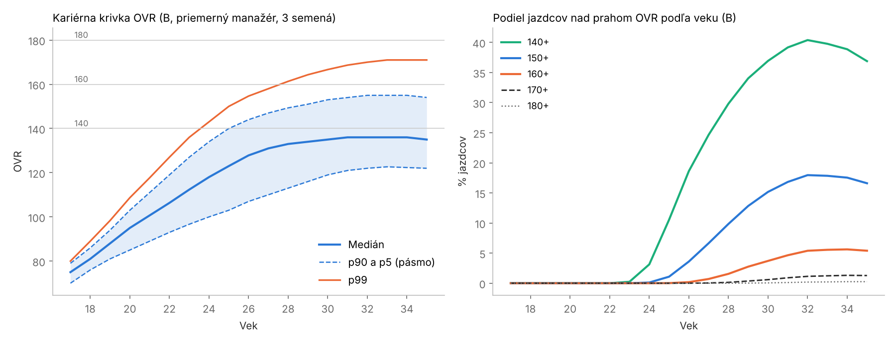
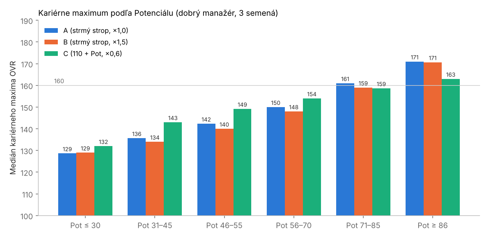

# Model F4 – kompletný kariérny rozvoj jazdca 17 – 35 (výsledky simulácie na schválenie)

Stav: **iba experimentálna simulácia v izolácii. Produkčný kód, DB, migrácie ani herné pravidlá sa nezmenili. Race Engine ani taktiku som neriešil.** F3 je uzavretý experiment.
Značenie: **PROD** = produkčný kód, **EXP** = experimentálne pravidlo/predpoklad, **VÝSLEDOK** = reálne spustený beh, **ODPORÚČANIE** = návrh.
Reprodukcia: `apps/web/src/lib/training/sim/career3/` (`modelF2.ts` s `PLANS4`, `DEF4`, `careerF4.cli.ts`). Hlavné varianty: **3 seedy (20261116, 20261117, 20261118) × 10 000 kariér** (Rookie 17 → 35 rokov). Rozbory stropov, rozdelení, citlivosti a energie: seed 20261116 × 10 000. Všetky porovnania používajú **tú istú štartovnú populáciu** (10 000 jazdcov, štartové OVR 70–80, Ø 75,1 pri V 60/40); mení sa len to, čo sa porovnáva. Výstupy: `careerF4_*.json`.

## 0. Zhrnutie a odporúčanie

**Hlavné zistenie, ktoré mení celý pohľad na OVR (VÝSLEDOK):** podľa existujúceho vzorca (60 % V, 15 % najlepšia taktika, 10 % najlepšia technika, 15 % Skúsenosti) má **fyzika a technika spolu strop iba ~140 bodov OVR** (0,6 · 200 + 0,1 · 200); zvyšok musia doplniť Skúsenosti a Taktika, ktoré rastú z pretekov. Bez ich rastu dosahuje medián OVR vo veku 30 iba 97 (p90 116) a **nikto nedosiahne 160**; pri našom predpoklade rastu pridajú Skúsenosti a Taktika k OVR ~41 bodov (z 16 na 57 z 60). **Vzácnosť vysokého OVR preto neurčuje len tréning a Potenciál, ale aj nepotvrdený predpoklad rastu Skúseností a Taktiky** (kap. 6). Tréningové koeficienty (cPhys 1,8, cTech 6,5) som nemenil.

Tri kompletné kandidátne konfigurácie (všetky: presné plány zo zadania, 80/20, základný 75 % + 25 % regenerácia / plnohodnotný 100 %, 10-týždňová sezóna, 3 Tour-y, prísna tabuľka účinnosti, rozdelenie skrytých vlastností N(50; 20), V 60/40, Univerzál so stropom −10 a jedným vedúcim taktickým typom):

| | A | **B (odporúčam)** | C |
|---|---|---|---|
| Strop atribútu | 90 + 125 × (Pot/100)² | 80 + 125 × (Pot/100)² | 110 + Pot |
| Rast Skúseností a Taktiky z pretekov | ×1,0 (expK 14, tactK 12) | ×1,5 (21 / 18) | ×0,6 (8,4 / 7,2) |
| Strop pri Pot 20 / 50 / 80 / 95 | 95 / 121 / 170 / 203 | 85 / 111 / 160 / 193 | 130 / 160 / 190 / 205 |
| **Priemerný manažér, náhodný jazdec** | | | |
| Medián kariérneho maxima OVR | 139 | 137 | 144 |
| Vek kariérneho maxima (medián) | 33 | 32 | 35 |
| Nikdy nedosiahne 140 / % | 52,5 | 58,5 | 34,3 |
| Nikdy nedosiahne 150 / % | 78,2 | 81,4 | 69,4 |
| Nikdy nedosiahne 160 / % | 93,0 | 94,1 | 93,6 |
| Kariérne max. 160+ / % | 7,0 | 5,9 | 6,4 |
| Kariérne max. 170+ / % | 1,4 | 1,4 | 0,4 |
| Kariérne max. 180+ / % | 0,15 | 0,26 | 0,00 |
| Kariérne max. 190+ / % | 0,00 | 0,00 | 0,00 |
| Pro liga (vek 20–33): jazdci s OVR 160+ / % | 0,19 | 0,21 | 0,23 |
| **Tímy: 50 manažérov v Pro podlige, každý vlastní 10 jazdcov** (priemer z 400 simulovaných líg × 3 seedy) | | | |
| Manažéri s aspoň 1 jazdcom 160+ (mix manažérov, náhodní jazdci) | 2,2 | 1,9 | 2,6 |
| Manažéri s aspoň 1 jazdcom 160+ (mix manažérov so skautingom) | 3,5 | 3,1 | 4,9 |
| Manažéri s aspoň 1 jazdcom 150+ (mix manažérov, náhodní jazdci) | 27,6 | 26,9 | 25,5 |
| Manažéri s aspoň 1 jazdcom 170+ (mix manažérov so skautingom) | 0,1 | 0,3 | 0,0 |
| **Talent a rozvoj (dobrý manažér)** | | | |
| Slabý Potenciál (≤ 30): medián kariérneho maxima OVR | 129 | 129 | 132 |
| Priemerný Potenciál (46–55): medián maxima | 142 | 140 | 149 |
| Výnimočný Potenciál (≥ 90): medián maxima | 173 | 173 | 164 |
| Výnimočný Potenciál (≥ 90): 180+ / % | 16,6 | 20,4 | 1,6 |
| Výnimočný Potenciál (≥ 90): 190+ / % | 0,0 | 0,4 | 0,0 |

**Odporúčanie: konfigurácia B.** Vzácnosť 160+ spĺňajú všetky tri (v Pro lige iba ~0,2 % jazdcov a ~2 z 50 manažérov má jazdca 160+). Rozdiely sú v tom, čo ešte dokážu:
- **A** nikdy nepustí ani výnimočný talent na 190+ (vo veku 17–35 nedosiahne 190 nikto); jej vzácnosť stojí na predpoklade Skúseností ×1,0 z F3.
- **B** je jediná, v ktorej sa 190+ vyskytne (výnimočný Potenciál ≥ 90: 0,4 %; celkovo ~0,010 % kariér pri dobrom manažérovi), 180+ sa viaže na Potenciál ≥ 90 a slabý Potenciál stagnuje pod 140. Cenou je **predpoklad rýchlejšieho rastu Skúseností a Taktiky (×1,5)**.
- **C** rieši vzácnosť pomalým rastom Skúseností a lineárnym stropom; výnimočný talent sa od priemerného odlíši málo (Pot ≥ 90: 180+ len 1,6 %) a kariérne maximum pripadá až na vek ~35.

**Manažérske rozhodnutia (VÝSLEDOK):** **nájdenie talentu prináša omnoho viac než jeho rozvoj.** V konfigurácii B: priemerný manažér s náhodnými jazdcami → (5,9 % dosiahne 160+); to isté s dokonalou znalosťou skrytých vlastností → 39 %; s realistickým skautingom (chyba σ 25) → 17 %. Správny rozvoj (zlý → dobrý manažér) pri náhodných jazdcoch posunie 160+ z 2,5 % na 9,4 %. Podrobne kap. 8.

**Čo je overené simuláciou a čo je predpoklad:** kap. 11. Všetky čísla o vzácnosti závisia od rastu Skúseností a Taktiky z pretekov, od rozdelenia skrytých vlastností a od počtu jazdcov v tíme (v dokumentácii nie je určený – testované 5 / 10 / 15).

## 1. Plány a pravidlá modelu F4
Plány presne podľa zadania (poradie fyzických atribútov určuje koeficient 1,15 / 0,95 / 0,75; technika 0,85 / 0,45; ostatné 4 fyzické 0,35):

| Plán | Fyzické 1 / 2 / 3 | Technické 1 / 2 |
|---|---|---|
| Vrchár | Stúpanie / Vytrvalosť / Kopce | Zjazd / Zákruty |
| Šprintér | Šprint / Akcelerácia / Rovina | Jazda v balíku / Ovládanie bicykla |
| Časovkár | Časovka / Rovina / Vytrvalosť | Zákruty / Ovládanie bicykla |
| Puncheur | Kopce / Akcelerácia / Stúpanie | Zákruty / Zjazd |
| Klasikár | Rovina / Vytrvalosť / Kopce | Nerovný povrch / Jazda v daždi |
| Únikár | Vytrvalosť / Rovina / Akcelerácia | Zjazd / Ovládanie bicykla |
| Univerzál | Vytrvalosť / Kopce / Rovina | Jazda v balíku / Ovládanie bicykla |

**Zachované z F2/F3:** cPhys 1,8, cTech 6,5; spoločný rozpočet 80 % fyzika / 20 % technika; základný režim = 75 % kapacity + 25 % regenerácia (produkčné `normal`), plnohodnotný = 100 % (produkčné `hard`); produkčné Energy / Fatigue / readiness; 10-týždňová sezóna, Tour-y v týždňoch 2 / 5 / 7 (záťaž pretekov a rast Skúseností a Taktiky z pretekov sú EXP); aditívne `G` (Trénovateľnosť 0,30, Profesionalita 0,15); Regenerácia = rýchlosť zotavenia 0,75 – 1,25; Vitalita = nástup poklesu (29–33 r.) a záťaž; akumulátor pri strope 200 zahadzuje progres (F2); technika bez osobného stropu (strop 200, rast max +4 / týždeň).
**Nové / zmenené oproti F3:**
- Plány podľa tohto zadania (F3 mal iné väzby).
- **Mäkké stropy sa riadia plánom jazdca:** atribút v jeho 3 fyzických atribútoch plánu alebo silná stránka tvaru = medzera 0, slabá stránka tvaru 45, ostatné 20 (F3 používal len tvary, preto bol Klasikár znevýhodnený). Univerzál: medzera 10 pre všetky fyzické atribúty a jeden vedúci taktický typ (váhy 1,0 / 4 × 0,6) – kandidát z F3, stále **EXP, neschválené**.
- Mäkký strop je funkcia Potenciálu `base + sklon × 100 × (Pot/100)^exponent` (lineárne varianty exponent 1). Potenciál nie je násobiteľom tréningu.
- Manažér je modelovaný politikou: **zlý** = nevhodný plán (plán s najmenším prekryvom fyzických a technických atribútov s prirodzeným plánom) a vždy plnohodnotný režim bez ohľadu na únavu; **priemerný** = prirodzený plán v 70 % sezón, inak náhodný iný plán, základný režim až pri readiness < 40; **dobrý** = prirodzený plán a základný režim pri readiness < 70 (odporúčanie, nie automat).
- Výber jazdcov: z 10 000 štartových jazdcov sa vyberie 10 % (1 000). Skaut vidí **zašumený odhad (Pot + Trén)/2** (chyba σ 25 = „skaut“, σ 12 = „dobrý skaut“, 0 = dokonalá znalosť, horná hranica); náhodný výber = bez informácie. Kariéry jazdcov sa navzájom neovplyvňujú, preto sa výber vyhodnocuje na tých istých odsimulovaných kariérach.
- Tímy: 50 manažérov v Pro podlige (max. 50 hráčov podľa dizajnu), každý vlastní *k* jazdcov z Pro ligy (vek 20 – 33 v ich vlastnom behu; liga = kvóty postupu podľa výsledkov etáp, EXP). Skutočný počet jazdcov v tíme v dokumentácii nie je, preto 5 / 10 / 15. 400 simulovaných líg na scenár.

## 2. Skryté vlastnosti – rozdelenie v populácii
Rovnakí štartoví jazdci, rovnaké štartovné atribúty; mení sa len rozdelenie skrytých vlastností:

| Rozdelenie | Definícia | Pot ≥ 80 (%) | Pot ≥ 90 (%) | Pot ≥ 80 **a** Trén ≥ 80 (%) | Ø Pot / Ø Trén |
|---|---|---|---|---|---|
| n20 | N(50; 20) všetkých 5 (pôvodné) | 7,5 | 2,5 | 0,49 | 50 / 50 |
| n15 | N(50; 15) všetkých 5 | 2,6 | 0,3 | 0,05 | 50 / 50 |
| n15r | Pot, Trén: N(45; 15), ostatné N(50; 15) | 1,0 | 0,1 | 0,00 | 45 / 45 |
| beta | Pot, Trén: 100 × Beta(2; 3) (pravostranne skosené), ostatné N(50; 15) | 3,1 | 0,5 | 0,10 | 40 / 40 |

Pri N(50; 20) má 7,5 % jazdcov Potenciál ≥ 80 a 0,5 % súčasne aj Trénovateľnosť ≥ 80; „výnimočný talent“ je teda bežnejší, než sa zdá. Alternatívy ho robia 2 – 7× zriedkavejším.

## 3. Mäkké stropy: porovnanie 5 variantov × 4 rozdelenia
Dobrý manažér, prirodzený plán, prísna tabuľka sa tu **nepoužila** (produkčná tabuľka, aby sa izoloval vplyv stropu a rozdelenia), seed 20261116. Rast Skúseností a Taktiky ×1,0 a ×1,5 (druhá tabuľka). Triedy: slabý Potenciál ≤ 30, priemerný 46 – 55, výnimočný ≥ 86.

**Rast Skúseností a Taktiky ×1,0**

| Strop | Rozdelenie | Kariérne max. 160+ / 180+ (%) | Pro liga 160+ (%) | Slabý Pot: medián max. / pod 160 (%) | Priemerný Pot: medián max. | Pot ≥ 86: medián max. / 180+ / 190+ (%) |
|---|---|---|---|---|---|---|
| 130 + Pot (F3) | n20 | 82,2 / 9,2 | 49,9 | 157 / 64 | 170 | 178 / 40,3 / 0,3 |
| 130 + Pot (F3) | n15 | 89,4 / 5,5 | 48,9 | 159 / 51 | 170 | 178 / 37,0 / 0,0 |
| 130 + Pot (F3) | n15r | 80,9 / 2,2 | 42,6 | 158 / 63 | 169 | 177 / 30,4 / 0,0 |
| 130 + Pot (F3) | beta | 61,2 / 2,8 | 35,7 | 154 / 78 | 167 | 174 / 22,2 / 0,0 |
| 110 + Pot | n20 | 55,4 / 1,8 | 34,9 | 146 / 100 | 162 | 176 / 28,7 / 0,0 |
| 110 + Pot | n15 | 59,5 / 0,5 | 31,6 | 149 / 100 | 162 | 176 / 21,0 / 0,0 |
| 110 + Pot | n15r | 44,1 / 0,1 | 21,1 | 148 / 100 | 161 | 174 / 13,0 / 0,0 |
| 110 + Pot | beta | 31,1 / 0,4 | 16,4 | 144 / 100 | 160 | 171 / 12,8 / 0,0 |
| 100 + 1,2×Pot | n20 | 54,1 / 3,0 | 36,5 | 143 / 100 | 162 | 177 / 35,0 / 0,0 |
| 100 + 1,2×Pot | n15 | 57,9 / 1,0 | 33,2 | 146 / 100 | 162 | 177 / 27,2 / 0,0 |
| 100 + 1,2×Pot | n15r | 42,6 / 0,3 | 22,2 | 145 / 100 | 161 | 176 / 26,1 / 0,0 |
| 100 + 1,2×Pot | beta | 30,6 / 0,8 | 16,7 | 141 / 100 | 160 | 173 / 17,9 / 0,0 |
| konvexná 1: 90 + 125×(Pot/100)² | n20 | 13,5 / 0,8 | 2,2 | 129 / 100 | 143 | 173 / 19,1 / 0,0 |
| konvexná 1: 90 + 125×(Pot/100)² | n15 | 7,8 / 0,1 | 0,5 | 130 / 100 | 143 | 172 / 9,9 / 0,0 |
| konvexná 1: 90 + 125×(Pot/100)² | n15r | 3,3 / 0,0 | 0,0 | 129 / 100 | 143 | 170 / 0,0 / 0,0 |
| konvexná 1: 90 + 125×(Pot/100)² | beta | 5,8 / 0,1 | 0,1 | 127 / 100 | 142 | 168 / 10,3 / 0,0 |
| konvexná 2: 100 + 110×(Pot/100)^1,5 | n20 | 25,8 / 1,0 | 12,7 | 136 / 100 | 152 | 174 / 22,7 / 0,0 |
| konvexná 2: 100 + 110×(Pot/100)^1,5 | n15 | 21,2 / 0,1 | 8,9 | 138 / 100 | 152 | 173 / 12,3 / 0,0 |
| konvexná 2: 100 + 110×(Pot/100)^1,5 | n15r | 11,4 / 0,0 | 2,6 | 136 / 100 | 152 | 172 / 0,0 / 0,0 |
| konvexná 2: 100 + 110×(Pot/100)^1,5 | beta | 12,2 / 0,2 | 2,0 | 134 / 100 | 150 | 170 / 11,1 / 0,0 |

**Rast Skúseností a Taktiky ×1,5**

| Strop | Rozdelenie | Kariérne max. 160+ / 180+ (%) | Pro liga 160+ (%) | Slabý Pot: medián max. / pod 160 (%) | Priemerný Pot: medián max. | Pot ≥ 86: medián max. / 180+ / 190+ (%) |
|---|---|---|---|---|---|---|
| 130 + Pot (F3) | n20 | 92,0 / 15,6 | 70,9 | 161 / 42 | 172 | 181 / 58,2 / 2,8 |
| 130 + Pot (F3) | n15 | 97,2 / 12,4 | 69,6 | 163 / 24 | 173 | 181 / 61,7 / 3,7 |
| 130 + Pot (F3) | n15r | 93,4 / 6,1 | 65,1 | 161 / 34 | 172 | 181 / 60,9 / 0,0 |
| 130 + Pot (F3) | beta | 76,6 / 5,9 | 59,4 | 158 / 60 | 170 | 177 / 36,8 / 1,7 |
| 110 + Pot | n20 | 67,8 / 3,8 | 58,2 | 151 / 99 | 164 | 179 / 45,6 / 0,8 |
| 110 + Pot | n15 | 75,1 / 1,3 | 55,6 | 153 / 99 | 165 | 178 / 45,7 / 1,2 |
| 110 + Pot | n15r | 60,4 / 0,6 | 42,1 | 152 / 100 | 164 | 179 / 39,1 / 0,0 |
| 110 + Pot | beta | 42,1 / 1,0 | 33,6 | 149 / 100 | 163 | 174 / 27,4 / 0,0 |
| 100 + 1,2×Pot | n20 | 65,0 / 5,5 | 59,5 | 148 / 100 | 164 | 180 / 51,9 / 1,5 |
| 100 + 1,2×Pot | n15 | 71,5 / 2,4 | 56,6 | 151 / 100 | 165 | 180 / 55,6 / 2,5 |
| 100 + 1,2×Pot | n15r | 56,5 / 1,0 | 42,5 | 149 / 100 | 164 | 181 / 56,5 / 0,0 |
| 100 + 1,2×Pot | beta | 39,9 / 1,7 | 33,9 | 146 / 100 | 163 | 175 / 32,5 / 0,0 |
| konvexná 1: 90 + 125×(Pot/100)² | n20 | 17,3 / 1,3 | 7,0 | 134 / 100 | 146 | 176 / 31,5 / 1,0 |
| konvexná 1: 90 + 125×(Pot/100)² | n15 | 11,0 / 0,2 | 2,6 | 135 / 100 | 146 | 175 / 24,7 / 0,0 |
| konvexná 1: 90 + 125×(Pot/100)² | n15r | 5,1 / 0,0 | 0,3 | 134 / 100 | 145 | 174 / 4,3 / 0,0 |
| konvexná 1: 90 + 125×(Pot/100)² | beta | 7,7 / 0,2 | 0,5 | 132 / 100 | 145 | 171 / 19,7 / 0,0 |
| konvexná 2: 100 + 110×(Pot/100)^1,5 | n20 | 32,7 / 1,7 | 26,8 | 141 / 100 | 155 | 177 / 36,5 / 0,8 |
| konvexná 2: 100 + 110×(Pot/100)^1,5 | n15 | 29,0 / 0,4 | 20,7 | 142 / 100 | 155 | 176 / 34,6 / 0,0 |
| konvexná 2: 100 + 110×(Pot/100)^1,5 | n15r | 17,5 / 0,1 | 8,6 | 141 / 100 | 154 | 176 / 4,3 / 0,0 |
| konvexná 2: 100 + 110×(Pot/100)^1,5 | beta | 16,5 / 0,4 | 6,8 | 139 / 100 | 153 | 172 / 20,5 / 0,0 |

**Čítanie (VÝSLEDOK):**
- **Strop 130 + Pot (F3) pri týchto predpokladoch vôbec nie je vzácny:** ak Skúsenosti a Taktika rastú ako v F3 (×1,0), dosiahne 160+ až 82 % kariér a 50 % jazdcov v Pro lige, slabý Potenciál (≤ 30) v 36 % kariér dosiahne 160 aj napriek slabému Potenciálu. 110 + Pot a 100 + 1,2 × Pot sú o málo lepšie (v Pro lige 35 % a 37 %).
- **Lineárne stropy nestačia:** Potenciál 20 → 95 mení strop o 75 bodov, ale priemerný jazdec (Pot 46 – 55) má strop 156 – 165, takže prekračuje 160 a vzácnosť nevzniká. Pomáha až **konvexná krivka**: priemerný Potenciál dostane strop ~121 (konvexná 1, použitá v kandidátovi A) alebo ~111 (strop kandidáta B, v tejto tabuľke nie je – v kap. 0 a 9), vysoký Potenciál (≥ 80) strop 160 – 203.
- **Slabý Potenciál stagnuje pod 160** vo všetkých variantoch okrem F3-stropu; pri strmých stropoch je to aj pod 140 (medián maxima 129 – 134). **Výnimočný Potenciál (≥ 86) dosahuje 180+** u 19 % (strmá A, ×1,0) až 58 % (F3-strop, ×1,5); 190+ dosahuje pri ×1,0 najviac 0,3 % jazdcov s Pot ≥ 86 (F3-strop), pri ×1,5 0 – 3 %.
- **Rozdelenie skrytých vlastností:** N(50; 15) zníži podiel 180+ z 1,8 % na 0,5 %, N(45; 15) na 0,1 % a skosené Beta rozdelenie na 0,4 % (strop 110 + Pot, ×1,0). Pri rozdeleniach s vzácnym talentom nie sú v populácii takmer žiadni jazdci s Pot ≥ 90 a Trén ≥ 85, takže 190+ takmer zmizne (jazdcov s Pot ≥ 86 je len 23 – 117 oproti 397 pri N(50; 20)).

## 4. Tréning: pôvodná vs. prísnejšia účinnosť pri únave (bez zvyšovania koeficientov)
Konfigurácia B (strop 80 + 125 × (Pot/100)², Skúsenosti ×1,5), seed 20261116, Pot / Trén / Prof / Vit podľa rozdelenia N(50; 20); riadky „Reg“ majú Regeneráciu pevne nastavenú. Koeficienty ostávajú cPhys 1,8, cTech 6,5.

| Tabuľka / režim | OVR vek 30 medián / p90 | Kariérne max. 160+ / 170+ (%) | Ø readiness na štarte Tour-u | Štarty Tour-u s readiness < 60 (%) | Podiel základných týždňov | Ø účinnosť |
|---|---|---|---|---|---|---|
| tabuľka prod / plnohodnotný | 139 / 158 | 11,0 / 3,4 | 65 | 38,3 | 0,00 | 0,84 |
| tabuľka prod / základný | 137 / 155 | 8,2 / 2,1 | 94 | 0,7 | 1,00 | 0,98 |
| tabuľka prod / odporúčanie 60 | 139 / 158 | 11,2 / 3,4 | 78 | 13,7 | 0,27 | 0,92 |
| tabuľka prod / odporúčanie 70 | 139 / 158 | 11,1 / 3,5 | 84 | 9,0 | 0,33 | 0,94 |
| tabuľka prod / odporúčanie 80 | 139 / 158 | 10,8 / 3,3 | 89 | 3,3 | 0,50 | 0,97 |
| tabuľka steep / plnohodnotný | 137 / 154 | 6,6 / 1,8 | 65 | 38,4 | 0,00 | 0,69 |
| tabuľka steep / základný | 137 / 155 | 7,4 / 1,7 | 94 | 0,7 | 1,00 | 0,96 |
| tabuľka steep / odporúčanie 60 | 138 / 156 | 9,2 / 2,6 | 78 | 13,7 | 0,27 | 0,85 |
| tabuľka steep / odporúčanie 70 | 138 / 157 | 9,4 / 2,7 | 84 | 9,0 | 0,33 | 0,88 |
| tabuľka steep / odporúčanie 80 | 138 / 157 | 9,9 / 2,9 | 89 | 3,3 | 0,50 | 0,94 |
| tabuľka prod / Reg 20 / plnohodnotný | 138 / 156 | 9,1 / 2,6 | 56 | 55,5 | 0,00 | 0,77 |
| tabuľka prod / Reg 20 / odporúčanie 70 | 138 / 156 | 9,2 / 2,6 | 78 | 16,4 | 0,58 | 0,91 |
| tabuľka prod / Reg 50 / plnohodnotný | 139 / 158 | 10,9 / 3,4 | 64 | 40,7 | 0,00 | 0,83 |
| tabuľka prod / Reg 50 / odporúčanie 70 | 139 / 158 | 11,1 / 3,5 | 83 | 8,8 | 0,34 | 0,94 |
| tabuľka prod / Reg 80 / plnohodnotný | 140 / 159 | 12,4 / 4,1 | 77 | 14,6 | 0,00 | 0,92 |
| tabuľka prod / Reg 80 / odporúčanie 70 | 140 / 160 | 12,5 / 4,2 | 89 | 3,6 | 0,17 | 0,96 |
| tabuľka steep / Reg 20 / plnohodnotný | 135 / 151 | 4,2 / 1,0 | 56 | 55,4 | 0,00 | 0,58 |
| tabuľka steep / Reg 20 / odporúčanie 70 | 137 / 154 | 7,0 / 1,7 | 78 | 16,4 | 0,58 | 0,82 |
| tabuľka steep / Reg 50 / plnohodnotný | 137 / 154 | 6,5 / 1,6 | 64 | 40,7 | 0,00 | 0,68 |
| tabuľka steep / Reg 50 / odporúčanie 70 | 138 / 157 | 9,7 / 2,8 | 83 | 8,8 | 0,34 | 0,88 |
| tabuľka steep / Reg 80 / plnohodnotný | 139 / 157 | 10,1 / 3,1 | 77 | 14,6 | 0,00 | 0,83 |
| tabuľka steep / Reg 80 / odporúčanie 70 | 139 / 159 | 11,7 / 3,8 | 89 | 3,6 | 0,17 | 0,93 |

**Čítanie (VÝSLEDOK):**
- **Produkčná tabuľka:** výber režimu takmer neovplyvní OVR (plnohodnotný 11,0 % vs. odporúčanie 70 11,1 % kariér s 160+), ale veľmi ovplyvní pripravenosť: pri plnohodnotnom režime štartuje 38 % Tour-ov s readiness < 60, pri odporúčaní 70 len 9 %. Základný režim vždy stojí ~3 body 160+ (8,2 %).
- **Prísna tabuľka (1,00 / 0,90 / 0,70 / 0,45 / 0,25) znižuje rast a robí rozhodnutie manažéra zmysluplným:** plnohodnotný 6,6 % → odporúčanie 70 9,4 % → odporúčanie 80 9,9 % kariér s 160+; pri Regenerácii 20: plnohodnotný 4,2 % vs. odporúčanie 70 7,0 %. Celkový rast je o ~1,5 – 2 body 160+ nižší než pri produkčnej tabuľke – podľa zadania som to **nekompenzoval** zvýšením koeficientov.
- Prah prepínania 70 – 80 (základný režim, keď kondícia klesne pod „dobrú“): pri prísnej tabuľke najvyšší rast a štarty Tour-u s readiness < 60 len 9 % (prah 70) až 3 % (prah 80).
- **ODPORÚČANIE:** prísna tabuľka a odporúčanie „základný režim pod 70“ (systém nikdy nemení režim sám, iba odporúča). Prísna tabuľka je EXP zmena produkčnej tabuľky, vyžaduje schválenie.

## 5. Rozvoj od 17 do 35 rokov – konfigurácia B (priemerný manažér, náhodný jazdec; priemer 3 seedov × 10 000)
### 5.1 Vývoj OVR a podiely
| Vek | p5 | Medián | p75 | p90 | p99 | Max | 140+ | 150+ | 160+ | 170+ | 180+ | 190+ |
|---|---|---|---|---|---|---|---|---|---|---|---|---|
| 17 | 70 | 75 | 77 | 79 | 80 | 80 | 0,0 | 0,0 | 0,0 | 0,0 | 0,00 | 0,00 |
| 19 | 81 | 88 | 91 | 94 | 98 | 103 | 0,0 | 0,0 | 0,0 | 0,0 | 0,00 | 0,00 |
| 21 | 89 | 101 | 106 | 111 | 118 | 126 | 0,0 | 0,0 | 0,0 | 0,0 | 0,00 | 0,00 |
| 23 | 97 | 112 | 120 | 127 | 136 | 146 | 0,2 | 0,0 | 0,0 | 0,0 | 0,00 | 0,00 |
| 25 | 103 | 123 | 132 | 140 | 150 | 161 | 10,5 | 1,1 | 0,0 | 0,0 | 0,00 | 0,00 |
| 27 | 110 | 131 | 139 | 147 | 158 | 173 | 24,7 | 6,6 | 0,7 | 0,0 | 0,00 | 0,00 |
| 29 | 116 | 134 | 143 | 151 | 164 | 181 | 34,0 | 12,8 | 2,8 | 0,4 | 0,02 | 0,00 |
| 31 | 121 | 136 | 145 | 154 | 169 | 186 | 39,2 | 16,8 | 4,6 | 0,9 | 0,11 | 0,00 |
| 33 | 123 | 136 | 146 | 155 | 171 | 188 | 39,8 | 17,8 | 5,5 | 1,2 | 0,21 | 0,00 |
| 35 | 122 | 135 | 145 | 154 | 171 | 189 | 36,9 | 16,6 | 5,4 | 1,3 | 0,25 | 0,00 |

### 5.2 Fyzické atribúty (priemer všetkých jazdcov)

| Vek | Stúpanie | Kopce | Rovina | Šprint | Časovka | Vytrvalosť | Akcelerácia | Top 3 | Ø 7 |
|---|---|---|---|---|---|---|---|---|---|
| 17 | 75 | 80 | 82 | 76 | 81 | 82 | 86 | 90 | 80 |
| 20 | 82 | 91 | 94 | 82 | 88 | 96 | 96 | 103 | 90 |
| 23 | 87 | 96 | 100 | 86 | 93 | 102 | 101 | 110 | 95 |
| 25 | 89 | 99 | 103 | 88 | 95 | 105 | 104 | 114 | 97 |
| 28 | 91 | 101 | 106 | 90 | 97 | 108 | 107 | 117 | 100 |
| 30 | 92 | 103 | 107 | 91 | 99 | 110 | 108 | 118 | 101 |
| 33 | 91 | 102 | 106 | 89 | 98 | 110 | 106 | 117 | 100 |
| 35 | 88 | 99 | 103 | 84 | 95 | 108 | 102 | 114 | 97 |

### 5.3 Technické atribúty a experimentálne zložky (priemer)

| Vek | Zjazd | Ovládanie bicykla | Zákruty | Jazda v balíku | Jazda v daždi | Nerovný povrch | Najlepšia technika | Najlepšia taktika (EXP) | Skúsenosti (EXP) |
|---|---|---|---|---|---|---|---|---|---|
| 17 | 69 | 70 | 69 | 70 | 70 | 70 | 75 | 77 | 30 |
| 20 | 76 | 76 | 76 | 76 | 71 | 73 | 87 | 109 | 73 |
| 23 | 82 | 81 | 82 | 81 | 73 | 75 | 99 | 145 | 123 |
| 25 | 86 | 84 | 86 | 83 | 74 | 77 | 107 | 166 | 157 |
| 28 | 92 | 89 | 92 | 88 | 75 | 79 | 118 | 184 | 185 |
| 30 | 95 | 92 | 95 | 90 | 75 | 80 | 125 | 190 | 192 |
| 33 | 99 | 95 | 99 | 93 | 76 | 82 | 133 | 194 | 197 |
| 35 | 101 | 97 | 101 | 95 | 77 | 83 | 138 | 195 | 198 |

Poznámka: tabuľky ukazujú priemer všetkých jazdcov; technické atribúty plánu sa trénujú, ostatné rastú len minimálne (technika z pretekov nerastie). Taktika a Skúsenosti sú výlučne EXP predpoklad.

### 5.4 Príspevok fyziky a techniky vs. experimentálny rast Skúseností a Taktiky (OVR = 0,60·V + 0,10·najlepšia technika + 0,15·najlepšia taktika + 0,15·Skúsenosti)
| Vek | Fyzika + technika (0,6·V + 0,1·tech.) | Skúsenosti + Taktika (0,15 + 0,15) | OVR spolu (Ø) | OVR, ak by Skúsenosti a Taktika zostali na štarte (medián / p90) | Jazdci s 160+ pri zamrazených Skúsenostiach a Taktike (%) |
|---|---|---|---|---|---|
| 17 | 59,0 | 16,0 | 75,0 | 75 / 79 | 0,0 |
| 20 | 67,4 | 27,3 | 94,7 | 83 / 91 | 0,0 |
| 25 | 75,0 | 48,4 | 123,4 | 90 / 103 | 0,0 |
| 30 | 79,4 | 57,3 | 136,6 | 93 / 110 | 0,0 |
| 35 | 78,2 | 59,1 | 137,3 | 92 / 111 | 0,0 |

Fyzika a technika dávajú vo veku 30 v priemere 79 bodov OVR z možných 140, Skúsenosti a Taktika 57 z 60. Pri „zamrazených“ Skúsenostiach a Taktike na štartovnej hodnote nedosiahne 160 nikto.

### 5.5 Vek kariérneho maxima a „nikdy nedosiahnu“ (B, priemerný manažér)
Medián veku kariérneho maxima 31,7 (p5 29, p90 34); medián hodnoty maxima 137. Nikdy nedosiahne OVR 140: 58,5 %; 150: 81,4 %; 160: 94,1 % jazdcov. Atribút 200 aspoň v jednom fyzickom atribúte: 0,16 % jazdcov (dobrý manažér 0,46 %).

### 5.6 Rozdelenie OVR podľa líg a veku (B, priemerný manažér, priemer 3 seedov)
| Vek | Liga | n | Medián | p90 | 140+ | 150+ | 160+ | 170+ | 180+ |
|---|---|---|---|---|---|---|---|---|---|
| 25 | Rookie | 1697 | 109 | 117 | 0,0 | 0,0 | 0,0 | 0,0 | 0,0 |
| 25 | Amateur | 3032 | 118 | 126 | 0,0 | 0,0 | 0,0 | 0,0 | 0,0 |
| 25 | Continental | 3074 | 128 | 136 | 3,4 | 0,0 | 0,0 | 0,0 | 0,0 |
| 25 | Pro | 1714 | 137 | 145 | 35,6 | 1,8 | 0,0 | 0,0 | 0,0 |
| 25 | Elite | 483 | 144 | 151 | 70,3 | 15,9 | 0,3 | 0,0 | 0,0 |
| 30 | Rookie | 965 | 123 | 128 | 0,0 | 0,0 | 0,0 | 0,0 | 0,0 |
| 30 | Amateur | 2039 | 128 | 133 | 0,2 | 0,0 | 0,0 | 0,0 | 0,0 |
| 30 | Continental | 2854 | 134 | 140 | 10,8 | 0,2 | 0,0 | 0,0 | 0,0 |
| 30 | Pro | 2687 | 143 | 150 | 72,2 | 13,0 | 0,5 | 0,1 | 0,0 |
| 30 | Elite | 1455 | 154 | 165 | 99,0 | 80,0 | 24,4 | 3,8 | 0,3 |
| 33 | Rookie | 742 | 124 | 128 | 0,1 | 0,0 | 0,0 | 0,0 | 0,0 |
| 33 | Amateur | 1665 | 128 | 132 | 0,0 | 0,0 | 0,0 | 0,0 | 0,0 |
| 33 | Continental | 2625 | 133 | 138 | 5,4 | 0,0 | 0,0 | 0,0 | 0,0 |
| 33 | Pro | 2991 | 141 | 149 | 62,5 | 8,1 | 0,0 | 0,0 | 0,0 |
| 33 | Elite | 1977 | 155 | 166 | 99,4 | 78,0 | 28,0 | 6,2 | 1,1 |

*Liga = kvóty postupu podľa výsledkov etáp (EXP), nie OVR; ligy neobmedzujú počet jazdcov podľa OVR.*

### 5.7 Rozdiely medzi typmi jazdcov (B, priemerný manažér, vek 30 a 33)

| Typ | Medián 30 | p90 30 | 160+ 30 (%) | 170+ 30 (%) | Medián 33 | 160+ 33 (%) |
|---|---|---|---|---|---|---|
| Vrchár | 135 | 153 | 3,4 | 0,6 | 137 | 5,7 |
| Šprintér | 135 | 153 | 3,9 | 0,8 | 135 | 5,4 |
| Časovkár | 136 | 154 | 4,6 | 0,7 | 137 | 6,9 |
| Puncheur | 135 | 153 | 3,3 | 0,5 | 136 | 5,1 |
| Klasikár | 136 | 153 | 4,3 | 0,6 | 137 | 5,7 |
| Únikár | 135 | 153 | 3,8 | 0,5 | 136 | 5,6 |
| Univerzál | 134 | 151 | 2,8 | 0,5 | 135 | 4,5 |

Rozdiel medzi najlepším a najhorším typom je 2,7 bodu OVR vo veku 30 (Univerzál 133,7, špecialisti 134,8 – 136,3); žiadny typ nie je výrazne zvýhodnený. Táto parita platí len pri pravidlách pre Univerzála z F3 (EXP).

### 5.8 Vzorec V na tej istej štartovnej populácii (B, dobrý manažér, seed 20261116)
| V | Ø štartové OVR (rovnakí jazdci) | OVR vek 30 medián / p90 | Kariérne max. 160+ / 170+ / 180+ / 190+ (%) |
|---|---|---|---|
| 60/40 (existujúci vzorec) | 75,1 | 138 / 157 | 9,4 / 2,7 / 0,62 / 0,01 |
| 75/25 | 75,9 | 140 / 159 | 12,1 / 3,8 / 1,05 / 0,11 |
| 80/20 | 76,2 | 140 / 160 | 12,9 / 4,3 / 1,15 / 0,21 |

Vzorec V sa nemení v simulácii kariér (kariéry od V nezávisia), mení sa len zobrazené OVR. Na tej istej populácii zvýši V 75/25 štartové OVR o ~0,8 bodu a podiel 160+ približne 1,3×; **zmena V nie je neutrálna pre vzácnosť** a ak sa V zmení, treba prekontrolovať kap. 0.

## 6. Citlivosť na rast Skúseností a Taktiky (EXP predpoklady)
Konfigurácia B (základ = ×1,5 oproti F3, t. j. expK 21, tactK 18), prísna tabuľka sa tu nepoužila (produkčná), seed 20261116. Násobok sa vzťahuje na základ B; v zátvorke absolútny násobok oproti F3.

| Predpoklad | Skúsenosti vek 30 | Taktika vek 30 | OVR vek 30 medián / p90 | Kariérne max. 160+ / 170+ / 180+ / 190+ (%) | Pro liga 160+ (%) |
|---|---|---|---|---|---|
| Skúsenosti aj Taktika neustúpia (×0) | 30 | 77 | 97 / 116 | 0,0 / 0,0 / 0,00 / 0,00 | 0,00 |
| Obe ×0,5 (absolútne ×0,75) | 139 | 148 | 125 / 146 | 5,3 / 1,5 / 0,18 / 0,00 | 0,00 |
| Obe ×1 = základ B (×1,5) | 192 | 189 | 139 / 158 | 11,1 / 3,5 / 0,82 / 0,03 | 1,76 |
| Obe ×1,5 (absolútne ×2,25) | 198 | 197 | 140 / 159 | 11,8 / 3,7 / 0,90 / 0,03 | 2,89 |
| Iba Skúsenosti ×0,5 | 139 | 168 | 128 / 149 | 7,2 / 2,0 / 0,31 / 0,00 | 0,05 |
| Iba Taktika ×0,5 | 170 | 148 | 130 / 151 | 6,3 / 1,8 / 0,30 / 0,00 | 0,06 |
| Iba Skúsenosti ×1,5 | 199 | 168 | 137 / 156 | 9,2 / 2,8 / 0,60 / 0,00 | 0,77 |
| Iba Taktika ×1,5 | 170 | 197 | 137 / 157 | 10,5 / 3,1 / 0,70 / 0,00 | 0,96 |

**Čítanie (VÝSLEDOK):**
- Skúsenosti a Taktika **nesú ~40 % hodnoty OVR** a samy rozhodujú o tom, či sa vôbec dá dosiahnuť 160+. Pri polovičnom raste (×0,75 oproti F3) klesne 160+ z 11 % na 5 % kariér a Pro liga nemá takmer nikoho 160+.
- Pri raste ×2,25 oproti F3 sa už nič nezmení (Skúsenosti a Taktika dosiahli strop 200), čiže **horná hranica OVR je daná formulou a stropom fyziky, nie ďalším zrýchlením skúseností**.
- **Dôsledok pre rozhodovanie:** kým sa nepotvrdí skutočný rast Skúseností a Taktiky z pretekov, nemožno vzácnosť 160+ garantovať. Pre schválenie je to najdôležitejší otvorený predpoklad.

## 7. Čo dáva dobrý manažér (B, 3 seedy × 10 000, rovnakí jazdci)
| Manažér | Medián kariérneho maxima | Vek maxima | 160+ (%) | 170+ (%) | 180+ (%) | 190+ (%) | Pro liga 160+ (%) |
|---|---|---|---|---|---|---|---|
| zlý | 135 | 31,0 | 2,5 | 0,43 | 0,05 | 0,000 | 0,05 |
| priemerný | 137 | 31,7 | 5,9 | 1,37 | 0,26 | 0,003 | 0,21 |
| dobrý | 140 | 32,0 | 9,4 | 2,58 | 0,50 | 0,010 | 1,04 |

Dobrý manažér oproti zlému: medián maxima +5, podiel 160+ 3,8×, 170+ 6,1×. Rozdiel je citeľný v pomeroch, no v absolútnych bodoch OVR malý – rozvoj posúva jazdca blízko jeho stropu, nezvyšuje ho.

## 8. Nájdenie talentu vs. jeho rozvoj (B, 3 seedy)
Z 10 000 jazdcov sa vyberie 1 000 (10 %). Hodnoty: **% vybraných s kariérnym maximom 160+ / 170+; medián maxima**.

| Výber jazdcov | Zlý manažér | Priemerný manažér | Dobrý manažér | Ø Pot / Trén vybraných |
|---|---|---|---|---|
| náhodný výber | 2 % / 0,2 %; 135 | 6 % / 1,1 %; 137 | 10 % / 2,5 %; 140 | 50 / 50 |
| skaut (chyba σ 25) | 8 % / 1,4 %; 143 | 17 % / 5,0 %; 146 | 24 % / 8,9 %; 149 | 63 / 62 |
| dobrý skaut (σ 12) | 13 % / 2,9 %; 147 | 26 % / 7,9 %; 152 | 38 % / 13,8 %; 155 | 69 / 69 |
| dokonalá znalosť (horná hranica) | 19 % / 3,9 %; 151 | 39 % / 11,9 %; 156 | 52 % / 20,5 %; 160 | 75 / 75 |

**Čítanie (VÝSLEDOK):**
- **Rozvoj:** pri náhodnom výbere posunie zlý → dobrý manažér podiel 160+ z 2 % na 10 % (+7 p. b.).
- **Talent:** pri priemernom manažérovi posunie výber z náhodného na skautingový (σ 25) 160+ z 6 % na 17 % (+11 p. b.), s dobrým skautom na 26 %, s dokonalou znalosťou na 39 %.
- **Kombinácia:** dobrý manažér s dobrým skautom dosiahne 38 % (170+ 14 %) oproti 2 % pre zlého manažéra s náhodným výberom (15,4×). **Z celkového rozdielu zlý/náhodný → dobrý/dokonalý (49 p. b.) pripadá ~33 % na nájdenie talentu a ~15 % na rozvoj (zvyšok ~50 % je spoločný účinok: dobrý rozvoj lepšie využije vyšší talent).**
- Manažér nezná skryté vlastnosti presne; skaut so σ 25 zachytí ~35 % zisku dokonalej znalosti.

### Tímy: koľko z 50 manažérov v Pro podlige vlastní jazdca s OVR 150+ / 160+ / 170+ (B, priemer 3 seedov, 400 líg na seed)
| Scenár | Jazdcov v tíme | 150+ | 160+ | 170+ | 180+ | 190+ |
|---|---|---|---|---|---|---|
| všetci priemerní, náhodní jazdci | 5 | 17,5 | 0,5 | 0,1 | 0,0 | 0,0 |
| všetci priemerní, náhodní jazdci | 10 | 29,0 | 1,1 | 0,1 | 0,0 | 0,0 |
| všetci priemerní, náhodní jazdci | 15 | 36,4 | 1,6 | 0,2 | 0,0 | 0,0 |
| mix 25 % zlí / 50 % priemerní / 25 % dobrí, náhodní jazdci | 5 | 17,8 | 0,9 | 0,1 | 0,0 | 0,0 |
| mix 25 % zlí / 50 % priemerní / 25 % dobrí, náhodní jazdci | 10 | 26,9 | 1,9 | 0,1 | 0,0 | 0,0 |
| mix 25 % zlí / 50 % priemerní / 25 % dobrí, náhodní jazdci | 15 | 32,0 | 2,7 | 0,2 | 0,0 | 0,0 |
| mix manažérov, všetci s výberom podľa skautingu (σ 25) | 5 | 21,5 | 1,6 | 0,2 | 0,0 | 0,0 |
| mix manažérov, všetci s výberom podľa skautingu (σ 25) | 10 | 30,9 | 3,1 | 0,3 | 0,0 | 0,0 |
| mix manažérov, všetci s výberom podľa skautingu (σ 25) | 15 | 35,7 | 4,6 | 0,5 | 0,0 | 0,0 |
| všetci dobrí s dobrým skautingom (σ 12) – horná hranica | 5 | 38,9 | 5,2 | 0,3 | 0,0 | 0,0 |
| všetci dobrí s dobrým skautingom (σ 12) – horná hranica | 10 | 47,6 | 10,1 | 0,6 | 0,1 | 0,0 |
| všetci dobrí s dobrým skautingom (σ 12) – horná hranica | 15 | 49,5 | 14,3 | 0,9 | 0,1 | 0,0 |

Pri 10 jazdcoch v tíme a zmesi manažérov má jazdca 160+ **v priemere 1,9 z 50 manažérov** (p90 4); 170+ prakticky nikto. Ak manažéri vyberajú podľa skautingu, stúpne to na 3,1. To zodpovedá predstave „iba niekoľko z 50“. Pozor: **počet jazdcov v tíme určuje výsledok** (pri 5 jazdcoch ~0,9, pri 15 ~2,7) a tento údaj v dokumentácii nie je.

## 9. Kandidátne konfigurácie – porovnanie ich vývoja (priemerný manažér, priemer 3 seedov)
| Konfigurácia | Medián OVR vek 25 / 30 / 33 | p90 vek 30 / 33 | 160+ vek 30 / 33 (%) | 170+ vek 30 / 33 (%) | Elite liga vek 30: medián / 160+ (%) |
|---|---|---|---|---|---|
| A – strmý strop, skúsenosti ×1,0 | 116 / 134 / 138 | 152 / 156 | 2,9 / 6,4 | 0,2 / 1,1 | 153 / 19,4 |
| B – strmý strop, skúsenosti ×1,5 | 123 / 135 / 136 | 153 / 155 | 3,7 / 5,5 | 0,6 / 1,2 | 154 / 24,4 |
| C – lineárny strop 110 + Pot, skúsenosti ×0,6 | 118 / 135 / 142 | 146 / 154 | 0,2 / 3,1 | 0,0 / 0,1 | 145 / 1,6 |

**Vplyv tabuľky účinnosti na kandidátov** (priemerný manažér; kariérne max. 160+ / 170+ / 180+ %; produkčná → prísna):

| Konfigurácia | Produkčná tabuľka | Prísna tabuľka |
|---|---|---|
| A – strmý strop, skúsenosti ×1,0 | 10,8 / 3,0 / 0,43 | 7,0 / 1,4 / 0,15 |
| B – strmý strop, skúsenosti ×1,5 | 8,6 / 2,4 / 0,45 | 5,9 / 1,4 / 0,26 |
| C – lineárny strop 110 + Pot, skúsenosti ×0,6 | 13,6 / 1,6 / 0,05 | 6,4 / 0,4 / 0,00 |

## 10. Odporúčané čísla (konfigurácia B, ODPORÚČANIE – nič neimplementované)
| Parameter | Hodnota |
|---|---|
| Plány | presne podľa zadania (kap. 1) |
| Potenciál | iba mäkký strop `80 + 125 × (Pot/100)²` (Pot 20 / 50 / 80 / 95 → 85 / 111 / 160 / 193), minus medzera atribútu 0 / 20 / 45 (Univerzál 10); tvrdý strop 200; žiadny limit OVR podľa Potenciálu |
| Trénovateľnosť | rýchlosť rastu `G`: ±0,30 pri 0–100 |
| Profesionalita | `G`: ±0,15 pri 0–100 |
| Regenerácia | rýchlosť zotavenia 0,75 – 1,25 |
| Vitalita | nástup poklesu 29 – 33 r., záťaž pretekov ×(1,15 − 0,3 × Vit/100) |
| Rozdelenie skrytých vlastností | N(50; 20) pre všetkých 5 poskytuje jediné 190+; N(50; 15) alebo skosené rozdelenie robia výnimočný talent 2 – 7× vzácnejším (190+ potom prakticky nevznikne) – ODPORÚČAM N(50; 20) |
| Koeficienty tréningu | cPhys 1,8, cTech 6,5 (nezmenené), 80 % / 20 %, základný 75 % + 25 % regenerácia, plnohodnotný 100 % |
| Účinnosť pri únave | prísna tabuľka 1,00 / 0,90 / 0,70 / 0,45 / 0,25 (readiness ≥ 80 / 60 / 40 / 20 / <20) |
| Prepínanie režimov | iba odporúčanie: základný režim pod readiness 70 (80 pri najdôležitejších pretekoch) |
| Rast Skúseností a Taktiky z pretekov (EXP) | ×1,5 oproti F3 (expK 21, tactK 18 na jednotku etapy) – **vyžaduje potvrdenie, najcitlivejší predpoklad** |
| Univerzál (EXP) | strop −10, jeden vedúci taktický typ |
| Vzorec V | 60/40 (existujúci) – V 75/25 zvýši podiel 160+ ~1,3× |

## 11. Čo je overené simuláciou a čo je predpoklad
| Téma | Stav |
|---|---|
| Presné plány zo zadania | **Použité** presne; pravidlo stropu podľa plánu je moja úprava (EXP) |
| Vzácnosť 160+ / 180+ / 190+ pri danom raste Skúseností a Taktiky | **Overené** v modeli; **rast Skúseností a Taktiky je nepotvrdený predpoklad** a rozhoduje o výsledku (kap. 6) |
| Potenciál ako mäkký strop, slabý talent stagnuje, výnimočný dosahuje 180+ | **Overené** v modeli pre 5 stropov × 4 rozdelenia (seed 20261116) |
| Realistickejšie (užšie / skosené) rozdelenie skrytých vlastností | **Overené** v modeli; skutočné rozdelenie populácie je rozhodnutie dizajnu |
| Pôvodná vs. prísna tabuľka účinnosti | **Overené** v modeli (konštanty záťaže Tour-u EXP) |
| Zlý / priemerný / dobrý manažér | **Overené** pre definované politiky; reálne správanie hráčov nie je známe |
| Nájdenie talentu vs. rozvoj | **Overené** pre zašumený odhad (Pot + Trén)/2; skaut v hre zatiaľ neexistuje |
| Tímy (50 manažérov, k jazdcov) | **Simulované** pre k = 5 / 10 / 15; počet jazdcov v tíme v dokumentácii nie je |
| Rozdiely medzi typmi jazdcov, Univerzál | **Overené** v modeli; váhy taktických typov a pravidlá Univerzála sú EXP |
| Liga | EXP (kvóty podľa výsledkov etáp), nie podľa OVR |
| Race Engine, taktika | **Neriešené** podľa zadania |
