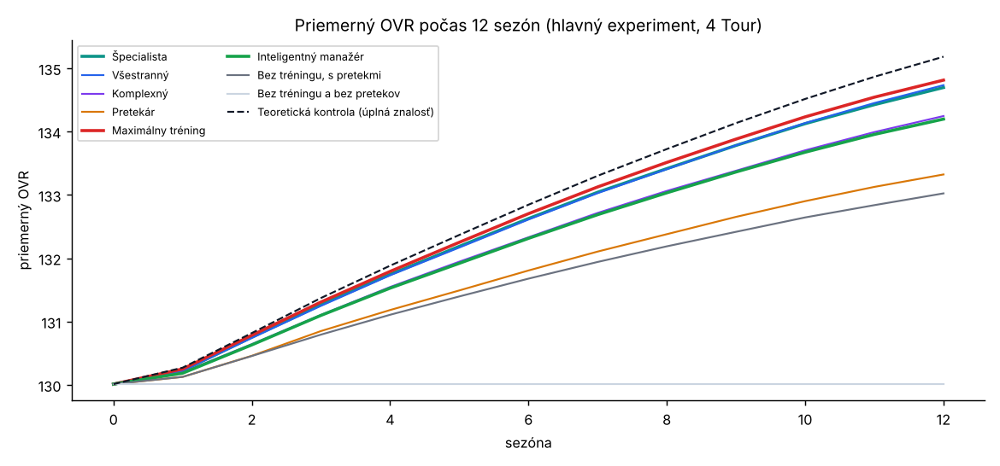
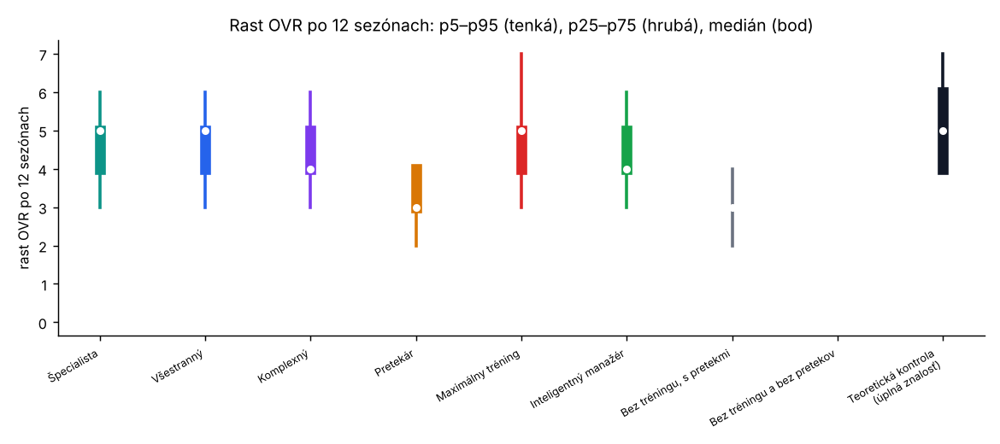
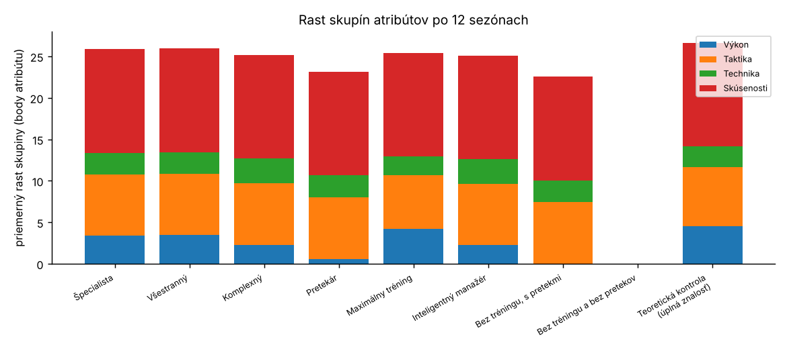
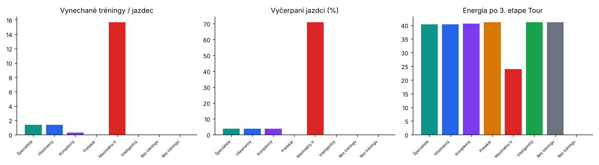
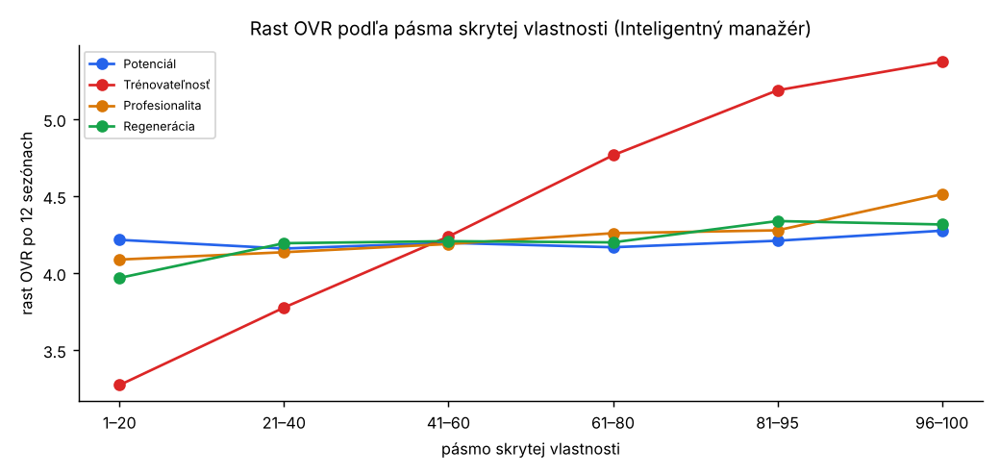
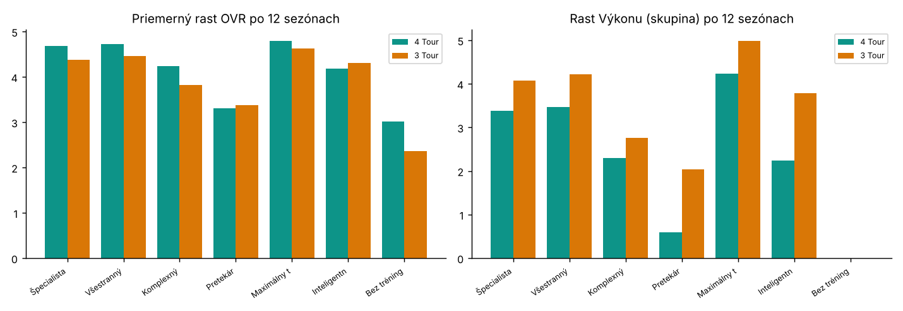
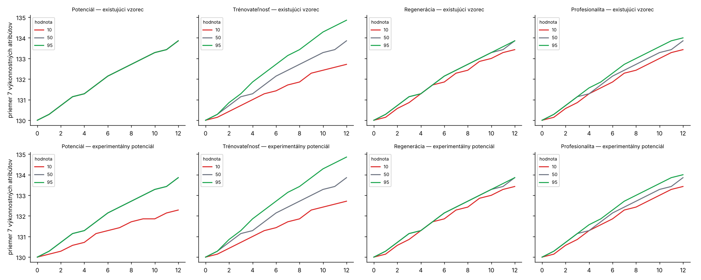
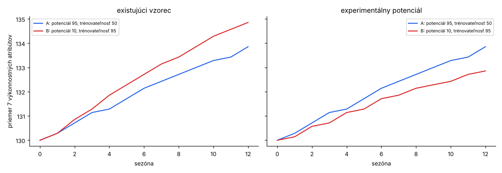
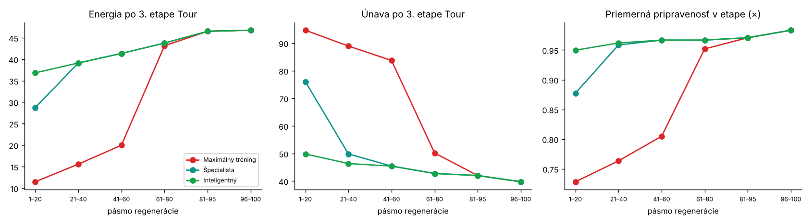
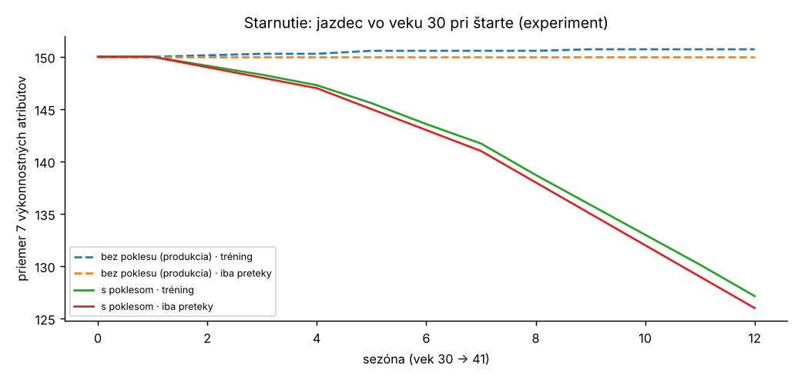

# Kariérna simulácia 10 000 jazdcov — 12 sezón (EXPERIMENT)

> **Stav:** výhradne experimentálna simulácia. Nič nie je nasadené ani schválené. Produkčná databáza, tréningové vzorce, OVR, UI ani existujúce schopnosti jazdcov sa nemenili. Všetky nové mechanizmy, vzorce a koeficienty sú označené **EXP** a budeme ich schvaľovať až po vyhodnotení. Prvá simulácia ([TRAINING_SIMULATION.md](TRAINING_SIMULATION.md)) ostáva nezmenená na porovnanie.
> Súbor generuje `docs/training-simulation/career/make_report.py` z `results.json` — každé číslo pochádza z jedného behu (seed **20261115**, **10 000** unikátnych jazdcov, 52 populačných scenárov, výpočet 443 s).

## 0. Zhrnutie

* **Rast OVR je v 12 sezónach veľmi pomalý.** Priemerný jazdec začína na OVR 130.0 a po 12 sezónach má podľa stratégie len +3.0 (iba preteky) až +4.8 (Maximálny tréning). Medián rastu je 4–5 bodov, 99. percentil 6.0–7.0, najlepší jazdec zo všetkých scenárov +9. Trénovaný výkonnostný atribút narastie za 12 sezón o ~24 bodov (priemer 7 atribútov +3.39). OVR je priemer 19 atribútov, hráč trénuje naraz jeden.
* **Tréning vs. preteky.** Samotné preteky (4 Tour) dajú +3.0 OVR (Taktika +7.4, Technika +2.6, Skúsenosti +12.5), Výkon sa pretekmi nemení. Tréning pridá ďalších 1.7 (Špecialista) až 1.8 (Maximálny tréning) bodu OVR.
* **Tvrdý tréning (−22/+16) s hranicou 30/75 vyčerpá 70.9 % jazdcov** a 31.9 % etáp odjazdia unavení (priem. účinnosť pripravenosti 0.82), no rastie len o 0.12 OVR viac než Špecialista na normálnej intenzite. **Inteligentný manažér nemá žiadneho vyčerpaného jazdca a žiadnu vynechanú jednotku**, ale rastie o 0.62 OVR menej než maximálny tréning (Výkon +2.24 vs. +4.23).
* **Regenerácia sa v Tour naozaj prejaví**, hlavne pri agresívnom plánovaní: pri maximálnom tréningu má jazdec s regeneráciou 1–20 po 3. etape energiu 11.5 a pripravenosť v etape ×0.73, jazdec 96–100 energiu 46.8 a ×0.98. Inteligentný manažér rozdiely takmer vyrovná (×0.950 vs. ×0.983).
* **Potenciál sa v dnešnom vzorci neprejaví vôbec** (rast jazdca s potenciálom 10, 50 a 95 je rovnaký: 3.9 / 3.9 / 3.9 bodov Výkonu za 12 sezón), lebo jeho účinok sa zapína až od celkového výkonu 140 a pri dnešnom tempe sa tam nikto nedostane. Jediný dôležitý skrytý atribút je trénovateľnosť (unikátne vysvetľuje 35.8 % rozptylu rastu, potenciál 0.00 %, profesionalita 0.45 %, regenerácia 0.63 %).
* **4 Tour vs. 3 Tour:** so štyrmi Tour rastie Taktika, Technika a Skúsenosti o ~28 % viac, ale Výkon o ~17 % menej (5 vs. 6 tréningových týždňov). OVR je pri štyroch Tour o 0.30 (Špecialista) až 0.66 (iba preteky) vyššie.
* **Najcitlivejší neoverený predpoklad je záťaž pretekov:** pri mierke 0,6 namiesto 1,0 klesne počet vyčerpaných pri maximálnom tréningu z 7 085 na 1 494 a energia po Tour stúpne zo 24 na 67. Engine zatiaľ neposkytuje záťaž (energia/únava) ani výsledky pre webovú hru, takže ide o hypotézu.

Odporúčania v skratke sú v §7, vrátane odpovedí na šesť otázok zo zadania.

---

## 1. Audit: čo už existuje a čo chýba

Prečítané: `lib/rider/config.ts`, `lib/rider/score.ts`, `lib/training/*`, `lib/facilities/config.ts`, `data/tours.ts`, `data/tourSchedule.ts`, `lib/leagues.ts`, `packages/race-engine/src/*`, `TRAINING_SIMULATION.md`.

### 1.1 Atribúty (19, presné kľúče v kóde)

| Skupina | Atribúty (kľúč → názov v hre) | Rozsah |
|:---|:---|:---|
| Výkon (7) | climbing Stúpanie, hills Kopce, flat Rovina, sprint Šprint, timeTrial Časovka, endurance Vytrvalosť, acceleration Akcelerácia | štart 100–160, kariérny strop **200** |
| Taktika (5) | positioning Pozícia, attackTiming Načasovanie útoku, reaction Reakcia, energyManagement Manažment energie, breakawaySkill Schopnosť úniku | 100–**160** |
| Technika (6) | descending Zjazd, bikeHandling Ovládanie bicykla, cornering Zákruty, packRiding Jazda v balíku, wetHandling Jazda v daždi, roughSurface Nerovný povrch | 100–**160** |
| Skúsenosti (1) | experience | 100–**160** |

OVR = `overallRating()` = 0,50 · priemer Výkon + 0,25 · priemer Taktika + 0,20 · priemer Technika + 0,05 · Skúsenosti (zaokrúhlené). Jeden bod atribútu preto znamená: Výkon 0,071 · Taktika 0,050 · Technika 0,033 · Skúsenosti 0,050 OVR.

### 1.2 Mechanizmy rastu

| Skupina | V produkcii | Chýba (návrh v tejto simulácii, EXP) |
|:---|:---|:---|
| Výkon | **Existuje.** Týždenný plán (1 / 2 / 3 jednotky), `BASE_TRAINING 3 × jednotky × trénovateľnosť × profesionalita × vek × zázemie × pripravenosť × developmentRoomFactor`, sekundárny atribút 35 %, akumulátor prah 12 so zvyškom. | Nič — použité bez prepisovania (importované funkcie, parita testovaná). Potenciál: experimentálne varianty (§2.4). |
| Technika | **Existuje len tréningom.** Technický plán (1 jednotka, `TECHNICAL_BASE 2.0 × trénovateľnosť × profesionalita × vek × pripravenosť`, max **+1 bod** na plán, prah 12). Preteky Techniku nemenia. | Rast z pretekov podľa charakteru etapy (§2.2). |
| Taktika | **Neexistuje** (komentár v kóde: „bude rásť cez systém situácií v pretekoch“). | Rast z pretekov, relevantnosť podľa etapy (§2.2). |
| Skúsenosti | **Neexistuje.** | +progres za každú odjazdenú etapu (§2.2). |
| Starnutie | Existuje **iba spomalenie rastu** (vekový faktor 1,30 → 0,30). **Pokles schopností neexistuje** (potvrdené v `facilities/config.ts`: „No decline system of any kind exists“). | Pokles je testovaný samostatne (§5.17), nie ako pravidlo. |
| Stav jazdca | Energia, únava (denný model z 1. simulácie je tiež iba návrh), forma 50 / kondícia 60 / morálka 70 sa nemenia. | Jednoduchý experimentálny model formy, kondície a morálky (§2.5) — nezasahuje do rastu. |

### 1.3 Race-engine

`packages/race-engine` je čisto tickový model jednej etapy (energia za km `BASE_ROAD_ENERGY_PER_KM = 0.2125`, drafting, útoky, rozpad skupín). Zistenia: **(a)** nemá integráciu do webu ani do ukladania stavu jazdca; **(b)** nepočíta únavu, formu, morálku ani pripravenosť (len energiu v etape); **(c)** terénové násobiteľe energie sú špecifikované len pre zjazd (0,35), ostatné 1,0; **(d)** `breakawaySkill` a `wetHandling` v ňom ešte neexistujú; **(e)** web nemá dáta, ktoré by umožnili etapu spoľahlivo odsimulovať (výsledky etáp, zloženie pelotónu, počasie). **Preto sú pretekové výsledky nesimulované** a použil som oddelený experimentálny model záťaže a rastu, odvodený od konštanty enginu (§2.1). Žiadne výsledky pretekov ani poradia sa nepočítajú.

### 1.4 Kalendár

`data/tourSchedule.ts`: Tour v týždňoch 2 (Highlands), 5 (Danube alebo Coastal), 7 (Northern Crown), 9 (Silver Horizon); Rookie vidí a jazdí **3 etapy** na Tour; hráč si smie vybrať max. 3 Tour za sezónu. Nová 4. Tour je **iba simulačný predpoklad**: v hlavnom experimente sa jazdia týždne 2, 5, 7 a 9 (nekoliduje s existujúcim kalendárom — týždeň 9 je v ňom už Tour). Etapy majú len typ obtiažnosti (flat/hilly/mountain) a dĺžku; časovky sú rozpoznané podľa názvu (*Koruna severu* 44 km, *Časovka Obzor* 28 km), *Kamenné cesty* sú hrubý povrch (EXP označenie).

---

## 2. Experimentálne mechanizmy (všetko EXP)

### 2.1 Pretekárska záťaž etapy
Etapy sa jazdia v **utorok, streda, štvrtok** týždňa Tour (EXP; kalendár zatiaľ nemá dátumy etáp), 3 etapy, žiadny tréning, ostatné dni plná regenerácia. Záťaž etapy z konštanty enginu: `energia = km × 0,2125 × drafting 0,80 × typ(rovina 1,0 / kopce 1,10 / hory 1,25 / časovka 1,10, bez draftingu)`, `únava = 0,75 × energia` (rovnaký pomer ako tvrdý tréning 18/24). Po etape 50 % dennej regenerácie ako pri tréningu. Päť pretekových dní z predchádzajúceho experimentu sa **nepoužíva**.

| Týždeň | Tour | Etapa | Názov | km | Typ | Hrubý povrch | Záťaž (energia / únava), mierka 1,0 | mierka 0,6 (citlivosť) |
|:---|---:|---:|---:|---:|---:|---:|---:|---:|
| 2 | highlands-tour | 1 | Úvodná | 140 | rovina |  | 24 / 18 | 14 / 11 |
| 2 | highlands-tour | 2 | Prvé kopce | 158 | kopce |  | 30 / 22 | 18 / 13 |
| 2 | highlands-tour | 3 | Kráľovská etapa | 175 | hory |  | 37 / 28 | 22 / 17 |
| 5 | danube-tour | 1 | Bratislava — Nitra | 148 | rovina |  | 25 / 19 | 15 / 11 |
| 5 | danube-tour | 2 | Vyšehrad — Ostrihom | 162 | kopce |  | 30 / 23 | 18 / 14 |
| 5 | danube-tour | 3 | Komárno — Štúrovo | 134 | rovina |  | 23 / 17 | 14 / 10 |
| 7 | northern-crown-tour | 1 | Severná brána | 168 | rovina |  | 29 / 21 | 17 / 13 |
| 7 | northern-crown-tour | 2 | Kamenné cesty | 174 | kopce | áno | 33 / 24 | 20 / 15 |
| 7 | northern-crown-tour | 3 | Koruna severu | 44 | časovka |  | 10 / 8 | 6 / 5 |
| 9 | silver-horizon-tour | 1 | Strieborné jazero | 162 | rovina |  | 28 / 21 | 17 / 12 |
| 9 | silver-horizon-tour | 2 | Horizontová vlna | 176 | kopce |  | 33 / 25 | 20 / 15 |
| 9 | silver-horizon-tour | 3 | Časovka Obzor | 28 | časovka |  | 7 / 5 | 4 / 3 |

### 2.2 Rast z pretekov (EXP)
Každá odjazdená etapa pridá surový progres do **rovnakých akumulátorov s prahom 12** ako tréning; atribúty sa neprepisujú automaticky všetky — progres dostane len schopnosť, ktorú etapa využíva (váha 0 = nič). Vzorce:

* Taktika/Technika: `progres = koeficient × váha(typ etapy) × veľkosť etapy × pripravenosť(účinnosť) × trénovateľnosť × vekový faktor × priestor`
* Skúsenosti: `progres = koeficient × veľkosť etapy × priestor` (bez skrytých vlastností a veku — skúsenosť získa každý odjazdením)
* `veľkosť etapy = km/150` v rozsahu 0,3–1,2 (časovka 0,6), `priestor = clamp((160 − hodnota)/30, 0, 1)`
* *Jazda v daždi* dostane progres iba v daždivej etape (20 % etáp, rovnaké počasie pre všetkých jazdcov, seed), *Nerovný povrch* iba v etape s hrubým povrchom.
* Výkon sa pretekmi **nemení** (výkon rastie predovšetkým tréningom).

| Variant | Taktika koef. | Technika koef. | Skúsenosti koef. | Strop za sezónu: Taktika / Technika / Skúsenosti (bodov na atribút) |
|:---|---:|---:|---:|:---|
| Konzervatívny | 1.5 | 1 | 1.5 | 2 / 3 / 2 |
| Výraznejší | 3 | 2 | 3 | 3 / 4 / 3 |

Prah akumulátora **12** (rovnaký ako tréning), tvrdé stropy: 160 pre Taktiku/Techniku/Skúsenosti, 200 pre Výkon (produkcia).

Váhy etáp (zdroj: `params.ts`, poradie atribútov Taktika: Pozícia, Načasovanie útoku, Reakcia, Manažment energie, Schopnosť úniku; Technika: Zjazd, Ovládanie bicykla, Zákruty, Jazda v balíku, [dážď], [hrubý povrch]):

```ts
export const TACT_W: Record<StageKind, number[]> = {
  flat: [1.0, 0.5, 0.8, 0.5, 0.7], hilly: [0.8, 1.0, 1.0, 0.8, 1.0], mountain: [0.5, 0.8, 0.7, 1.0, 0.4], tt: [0, 0, 0, 1.0, 0],
};

export const TECH_W: Record<StageKind, number[]> = {
  flat: [0, 0.5, 0.4, 1.0, 1, 1], hilly: [0.6, 0.7, 0.8, 0.6, 1, 1], mountain: [1.0, 0.6, 0.8, 0.3, 1, 1], tt: [0, 0.5, 0.5, 0, 1, 0],
};
```

**Zabránenie dvojitému započítaniu:** (1) tréning a preteky sa nikdy neodohrajú v tom istom týždni (Tour týždeň nemá plán); (2) každá etapa pripíše každý atribút najviac raz; (3) preteky a technický tréning zdieľajú jeden akumulátor na atribút a **spoločný sezónny strop** (Technika: konzervatívne max +3, výraznejšie +4 bodov na atribút za sezónu), technický plán má navyše produkčný strop +1 na plán; (4) rast sa nikdy nevracia do energie/únavy (test).

### 2.3 Denný tréning a regenerácia
Podľa zadania: Ľahký 1 jednotka (−12 / +8), Normálny 2 jednotky (−18 / +12 za jednotku), Tvrdý 3 jednotky v troch variantoch (−24/+18, −22/+16, −20/+15); technická jednotka = produkčných 5 / 5. Dni: Ľahký utorok, Normálny utorok+štvrtok, Tvrdý utorok+štvrtok+sobota. Regenerácia `energia 8 + round(8R/100)`, `únava 5 + round(6R/100)`, voľný deň 100 %, tréningový/pretekový deň 50 % po záťaži. Hranica: energia < 30 alebo únava > 75 pred jednotkou → vynechá sa, bez progresu a záťaže, plná regenerácia. Týždenné faktory (atribúty, vek, potenciál, trénovateľnosť, profesionalita) sa zmrazia na začiatku týždňa — rozdelenie na jednotky **nezvyšuje** rast (test z 1. simulácie platí). Hlavný scenár: hranica **zapnutá**, tvrdá jednotka **−22/+16** (stred porovnávaných variantov); ostatné varianty sú v §5.8.

### 2.4 Potenciál (EXP)
**Produkcia:** potenciál vstupuje cez `overallPotentialFactor` (váha 0 pod celkovým výkonom 140). Pri priamej škále 1–100 sa navyše hodnota v `potentialEase` orezáva na 55–95, takže všetko ≤ 55 sa správa ako 55 a ≥ 95 ako 95.
**Experimentálny model A (absolútny strop):** osobný mäkký strop celkového výkonu `C = 140 + 0.6 × potenciál` (p=1: 140.6, p=10: 146, p=50: 170, p=95: 197, p=100: 200); rast sa spomaľuje lineárne na posledných 25 bodoch pred stropom (`faktor = clamp((C − celkový výkon)/25, 0,05, 1)`). Nahrádza produkčný faktor potenciálu (nie je to ďalší násobiteľ) a nahrádza miesto `overallPotentialFactor`; lokálna obtiažnosť atribútu ostáva.
**Experimentálny model B (relatívny priestor):** `C = štartový celkový výkon jazdca + 5 + 0.45 × potenciál` — potenciál určuje, koľko môže jazdec od svojho štartu ešte vyrásť (p=10: +9.5 bodov, p=50: +27.5, p=95: +47.75).
V oboch modeloch platí: ďaleko pod stropom rastú všetci rovnako, spomalenie sa objaví až pri priblížení k osobnému stropu.

### 2.5 Forma, kondícia, morálka (EXP, nezasahujú do rastu)
`kondícia`: +0,8 za tréningovú jednotku, +1,0 za etapu, −0,15 denne (štart 60, 0–100); `forma` sa denne približuje o 25 % k `0,5 × pripravenosť + 0,5 × kondícia` (štart 50); `morálka` (štart 70): etapa s účinnosťou ≥ 0,85 +0,5, ≥ 0,70 −0,5, > 0,50 −1,0, inak −2,0, vynechaná jednotka −0,5, dokončená Tour +2, denný návrat k 70 o 3 %. Slúžia ako zobrazené výstupy; produkcia ich dnes nemení.

### 2.6 Starnutie
Produkcia: iba vekový faktor rastu. Experiment pádu (iba samostatný test, **nie** návrh pravidla): od veku 31 klesá každý výkonnostný atribút o 1 / sezónu (31–33), 2 (34–36), 3 (37+), minimum 100.

### 2.7 Hypotetický odhad pretekového výkonu
Etapový index = priemer relevantných výkonnostných atribútov etapy × účinnosť pripravenosti (tabuľka produkcie ×1,00 … ×0,50). **Nie sú to výsledky pretekov.** Sleduje sa hlavne priemerná účinnosť pripravenosti v etape a podiel etáp odjazdených pri účinnosti ≤ 0,70.

---

## 3. Populácia

10 000 unikátnych jazdcov, seed 20261115. Vek na štarte 18–22 (rovnomerne: 18: 2066, 19: 1989, 20: 2066, 21: 1911, 22: 1968), všetci oddýchnutí (energia 100, únava 0); verejné atribúty ako v 1. simulácii (základ 130 ± 12, tri silné +10, tri slabé −10, šum ±3, rozsah 100–160, priemerný štartový OVR **130.0**). Skryté vlastnosti nezávisle na priamej škále 1–100 v pásmach 10/25/40/20/4/1 %, rovnomerne v pásme. **Hlavný scenár mapovanie 1–100 → 55–95 nepoužíva** (hodnoty idú do vzorcov priamo); mapovaná variácia je len kontrola (§5.14). Rovnaká populácia vo všetkých scenároch.

| Vlastnosť | 1–20 (10 %) | 21–40 (25 %) | 41–60 (40 %) | 61–80 (20 %) | 81–95 (4 %) | 96–100 (1 %) | priemer |
|:---|---:|---:|---:|---:|---:|---:|---:|
| Potenciál | 1090 (10.9 %) | 2491 (24.9 %) | 3919 (39.2 %) | 2006 (20.1 %) | 389 (3.9 %) | 105 (1.1 %) | 47.1 |
| Trénovateľnosť | 957 (9.6 %) | 2520 (25.2 %) | 4004 (40.0 %) | 2023 (20.2 %) | 389 (3.9 %) | 107 (1.1 %) | 47.7 |
| Profesionalita | 1050 (10.5 %) | 2495 (24.9 %) | 4009 (40.1 %) | 1971 (19.7 %) | 395 (4.0 %) | 80 (0.8 %) | 47.2 |
| Regenerácia | 983 (9.8 %) | 2526 (25.3 %) | 3983 (39.8 %) | 2029 (20.3 %) | 381 (3.8 %) | 98 (1.0 %) | 47.4 |

---

## 4. Kariérne stratégie — presný algoritmus

Plán týždňa N sa vyberá na **začiatku týždňa N−1** a po výbere je nemenný (test). Týždeň 1 je bez plánu; plán na týždeň 2 sa robí v týždni 1; v Tour týždni sa neplánuje; plán na týždeň 10 sa robí v týždni 9; v týždni 10 sa neplánuje na ďalšiu sezónu. Stratégie dostávajú iba **verejný pohľad** (verejné atribúty, viditeľná energia/únava, kalendár, vek, pozorovaná rýchlosť regenerácie) — nikdy skryté vlastnosti (test: zdrojový kód plánovačov ich neobsahuje). Pozorovaný odhad regenerácie `R̂ = ((denný prírastok energie − 8)/8) × 100` z posledného voľného dňa.

| # | Stratégia | Algoritmus plánu na nasledujúci týždeň |
|:---|:---|:---|
| 1 | Špecialista | Výkonnostný plán, intenzita **normálna**, vždy ten istý atribút = najvyšší výkonnostný atribút na začiatku kariéry. |
| 2 | Všestranný | Výkonnostný plán, **normálna**, atribút = aktuálne najnižší zo 7 výkonnostných. |
| 3 | Komplexný | Cyklus 3 týždňov: 2× výkonnostný plán (najnižší výkonnostný atribút, normálna), 1× technický plán (najnižší technický atribút). Taktiku a Skúsenosti získava pretekmi. |
| 4 | Pretekár | Tour má prednosť: týždeň pred Tour **oddych (bez plánu)**, týždeň po Tour a dva týždne pred ďalšou Tour **ľahký**, inak normálny (najnižší výkonnostný atribút). |
| 5 | Maximálny tréning | Špecialista, ale **tvrdá** intenzita v každom trénovateľnom týždni. |
| 6 | Inteligentný manažér | Odhadne stav na začiatku plánovaného týždňa (zostávajúci priebeh aktuálneho týždňa s jeho potvrdeným plánom/Tour, odhad R̂, pravidlo hranice) → skóre pripravenosti ≥ 75 tvrdý, ≥ 55 normálny, ≥ 35 ľahký, inak oddych; vek ≥ 29 maximálne normálny; týždeň pred Tour maximálne ľahký; ľahký týždeň nahradí technickým plánom (len 5/5 záťaže), ak je technika slabšia než výkon; fokus = najnižší výkonnostný atribút. |
| 7 | Kontrola: bez tréningu, s pretekmi | Žiadny plán, jazdí sa všetko. |
| 8 | Kontrola: bez tréningu, bez pretekov | Žiadny plán, žiadne etapy (iba starnutie). |
| T | Teoretická kontrola (nehrateľná) | Pozná presnú regeneráciu a presný stav; z ľahkého/normálneho/tvrdého plánu vyberie najvyšší dvojtýždňový progres bez vyčerpania. Slúži iba ako strop ukazujúci, koľko stojí neznalosť skrytých vlastností. |

---

## 5. Výsledky

### 5.1 OVR po 1., 3., 6., 9. a 12. sezóne (hlavný experiment, 4 Tour)
Bunka: priemer / medián (min–max).

| Scenár | S1: priemer / medián (min–max) | S3: priemer / medián (min–max) | S6: priemer / medián (min–max) | S9: priemer / medián (min–max) | S12: priemer / medián (min–max) |
|:---|---:|---:|---:|---:|---:|
| Špecialista | 130.2 / 130.0 (117–143) | 131.3 / 131.0 (118–144) | 132.6 / 133.0 (119–145) | 133.8 / 134.0 (120–146) | 134.7 / 135.0 (121–146) |
| Všestranný | 130.2 / 130.0 (117–143) | 131.2 / 131.0 (118–144) | 132.6 / 133.0 (119–145) | 133.8 / 134.0 (120–146) | 134.7 / 135.0 (121–147) |
| Komplexný | 130.2 / 130.0 (117–143) | 131.1 / 131.0 (118–144) | 132.3 / 132.0 (119–145) | 133.4 / 133.0 (120–145) | 134.2 / 134.0 (120–146) |
| Pretekár | 130.1 / 130.0 (117–143) | 130.9 / 131.0 (117–144) | 131.8 / 132.0 (118–144) | 132.7 / 133.0 (119–145) | 133.3 / 133.0 (120–145) |
| Maximálny tréning | 130.3 / 130.0 (117–143) | 131.3 / 131.0 (118–144) | 132.7 / 133.0 (119–145) | 133.9 / 134.0 (120–146) | 134.8 / 135.0 (121–146) |
| Inteligentný manažér | 130.2 / 130.0 (117–143) | 131.1 / 131.0 (118–144) | 132.3 / 132.0 (119–145) | 133.4 / 133.0 (120–145) | 134.2 / 134.0 (120–146) |
| Bez tréningu, s pretekmi | 130.1 / 130.0 (117–143) | 130.8 / 131.0 (117–144) | 131.7 / 132.0 (118–144) | 132.4 / 133.0 (119–145) | 133.0 / 133.0 (119–145) |
| Bez tréningu a bez pretekov | 130.0 / 130.0 (117–143) | 130.0 / 130.0 (117–143) | 130.0 / 130.0 (117–143) | 130.0 / 130.0 (117–143) | 130.0 / 130.0 (117–143) |
| Teoretická kontrola (úplná znalosť) | 130.3 / 130.0 (117–143) | 131.4 / 131.0 (118–144) | 132.8 / 133.0 (119–145) | 134.1 / 134.0 (120–146) | 135.2 / 135.0 (121–147) |



**Percentily OVR po 12 sezónach (štart priemer 130.0):**

| Scenár | priemer | p5 | p25 | p50 | p75 | p90 | p95 | p99 |
|:---|---:|---:|---:|---:|---:|---:|---:|---:|
| Špecialista | 134.70 | 127.0 | 131.0 | 135.0 | 138.0 | 141.0 | 142.0 | 144.0 |
| Všestranný | 134.73 | 127.0 | 131.0 | 135.0 | 138.0 | 141.0 | 142.0 | 144.0 |
| Komplexný | 134.25 | 126.0 | 131.0 | 134.0 | 138.0 | 140.0 | 142.0 | 144.0 |
| Pretekár | 133.32 | 126.0 | 130.0 | 133.0 | 137.0 | 139.0 | 141.0 | 143.0 |
| Maximálny tréning | 134.81 | 127.0 | 132.0 | 135.0 | 138.0 | 141.0 | 142.0 | 144.0 |
| Inteligentný manažér | 134.20 | 126.0 | 131.0 | 134.0 | 138.0 | 140.0 | 142.0 | 144.0 |
| Bez tréningu, s pretekmi | 133.02 | 125.0 | 130.0 | 133.0 | 136.0 | 139.0 | 141.0 | 142.0 |
| Bez tréningu a bez pretekov | 130.01 | 122.0 | 126.0 | 130.0 | 134.0 | 137.0 | 138.0 | 140.0 |
| Teoretická kontrola (úplná znalosť) | 135.18 | 127.0 | 132.0 | 135.0 | 139.0 | 141.0 | 143.0 | 145.0 |

**Percentily rastu OVR (OVR − štartový OVR):**

Po 1. sezóne:

| Scenár | priemer | p5 | p25 | p50 | p75 | p90 | p95 | p99 | max |
|:---|---:|---:|---:|---:|---:|---:|---:|---:|---:|
| Špecialista | 0.21 | 0.0 | 0.0 | 0.0 | 0.0 | 1.0 | 1.0 | 1.0 | 1.0 |
| Všestranný | 0.21 | 0.0 | 0.0 | 0.0 | 0.0 | 1.0 | 1.0 | 1.0 | 1.0 |
| Komplexný | 0.19 | 0.0 | 0.0 | 0.0 | 0.0 | 1.0 | 1.0 | 1.0 | 1.0 |
| Pretekár | 0.11 | 0.0 | 0.0 | 0.0 | 0.0 | 1.0 | 1.0 | 1.0 | 1.0 |
| Maximálny tréning | 0.24 | 0.0 | 0.0 | 0.0 | 0.0 | 1.0 | 1.0 | 1.0 | 1.0 |
| Inteligentný manažér | 0.17 | 0.0 | 0.0 | 0.0 | 0.0 | 1.0 | 1.0 | 1.0 | 1.0 |
| Bez tréningu, s pretekmi | 0.11 | 0.0 | 0.0 | 0.0 | 0.0 | 1.0 | 1.0 | 1.0 | 1.0 |
| Bez tréningu a bez pretekov | 0.00 | 0.0 | 0.0 | 0.0 | 0.0 | 0.0 | 0.0 | 0.0 | 0.0 |
| Teoretická kontrola (úplná znalosť) | 0.26 | 0.0 | 0.0 | 0.0 | 1.0 | 1.0 | 1.0 | 1.0 | 1.0 |

Po 3. sezónach:

| Scenár | priemer | p5 | p25 | p50 | p75 | p90 | p95 | p99 | max |
|:---|---:|---:|---:|---:|---:|---:|---:|---:|---:|
| Špecialista | 1.25 | 1.0 | 1.0 | 1.0 | 2.0 | 2.0 | 2.0 | 2.0 | 2.0 |
| Všestranný | 1.24 | 1.0 | 1.0 | 1.0 | 2.0 | 2.0 | 2.0 | 2.0 | 2.0 |
| Komplexný | 1.09 | 1.0 | 1.0 | 1.0 | 1.0 | 2.0 | 2.0 | 2.0 | 2.0 |
| Pretekár | 0.84 | 0.0 | 1.0 | 1.0 | 1.0 | 1.0 | 1.0 | 2.0 | 2.0 |
| Maximálny tréning | 1.30 | 1.0 | 1.0 | 1.0 | 2.0 | 2.0 | 2.0 | 2.0 | 3.0 |
| Inteligentný manažér | 1.09 | 1.0 | 1.0 | 1.0 | 1.0 | 2.0 | 2.0 | 2.0 | 2.0 |
| Bez tréningu, s pretekmi | 0.78 | 0.0 | 1.0 | 1.0 | 1.0 | 1.0 | 1.0 | 1.0 | 2.0 |
| Bez tréningu a bez pretekov | 0.00 | 0.0 | 0.0 | 0.0 | 0.0 | 0.0 | 0.0 | 0.0 | 0.0 |
| Teoretická kontrola (úplná znalosť) | 1.36 | 1.0 | 1.0 | 1.0 | 2.0 | 2.0 | 2.0 | 2.0 | 3.0 |

Po 6. sezónach:

| Scenár | priemer | p5 | p25 | p50 | p75 | p90 | p95 | p99 | max |
|:---|---:|---:|---:|---:|---:|---:|---:|---:|---:|
| Špecialista | 2.62 | 2.0 | 2.0 | 3.0 | 3.0 | 3.0 | 4.0 | 4.0 | 4.0 |
| Všestranný | 2.60 | 2.0 | 2.0 | 3.0 | 3.0 | 3.0 | 3.0 | 4.0 | 4.0 |
| Komplexný | 2.32 | 2.0 | 2.0 | 2.0 | 3.0 | 3.0 | 3.0 | 3.0 | 4.0 |
| Pretekár | 1.79 | 1.0 | 1.0 | 2.0 | 2.0 | 2.0 | 3.0 | 3.0 | 3.0 |
| Maximálny tréning | 2.69 | 2.0 | 2.0 | 3.0 | 3.0 | 4.0 | 4.0 | 4.0 | 5.0 |
| Inteligentný manažér | 2.30 | 1.0 | 2.0 | 2.0 | 3.0 | 3.0 | 3.0 | 3.0 | 4.0 |
| Bez tréningu, s pretekmi | 1.67 | 1.0 | 1.0 | 2.0 | 2.0 | 2.0 | 2.0 | 3.0 | 3.0 |
| Bez tréningu a bez pretekov | 0.00 | 0.0 | 0.0 | 0.0 | 0.0 | 0.0 | 0.0 | 0.0 | 0.0 |
| Teoretická kontrola (úplná znalosť) | 2.83 | 2.0 | 2.0 | 3.0 | 3.0 | 4.0 | 4.0 | 4.0 | 5.0 |

Po 9. sezónach:

| Scenár | priemer | p5 | p25 | p50 | p75 | p90 | p95 | p99 | max |
|:---|---:|---:|---:|---:|---:|---:|---:|---:|---:|
| Špecialista | 3.77 | 3.0 | 3.0 | 4.0 | 4.0 | 5.0 | 5.0 | 5.0 | 6.0 |
| Všestranný | 3.77 | 3.0 | 3.0 | 4.0 | 4.0 | 5.0 | 5.0 | 5.0 | 6.0 |
| Komplexný | 3.37 | 2.0 | 3.0 | 3.0 | 4.0 | 4.0 | 4.0 | 5.0 | 6.0 |
| Pretekár | 2.64 | 2.0 | 2.0 | 3.0 | 3.0 | 3.0 | 4.0 | 4.0 | 5.0 |
| Maximálny tréning | 3.87 | 3.0 | 3.0 | 4.0 | 4.0 | 5.0 | 5.0 | 6.0 | 7.0 |
| Inteligentný manažér | 3.35 | 2.0 | 3.0 | 3.0 | 4.0 | 4.0 | 4.0 | 5.0 | 6.0 |
| Bez tréningu, s pretekmi | 2.41 | 2.0 | 2.0 | 2.0 | 3.0 | 3.0 | 3.0 | 4.0 | 4.0 |
| Bez tréningu a bez pretekov | 0.00 | 0.0 | 0.0 | 0.0 | 0.0 | 0.0 | 0.0 | 0.0 | 0.0 |
| Teoretická kontrola (úplná znalosť) | 4.12 | 3.0 | 4.0 | 4.0 | 5.0 | 5.0 | 6.0 | 6.0 | 7.0 |

Po 12. sezónach:

| Scenár | priemer | p5 | p25 | p50 | p75 | p90 | p95 | p99 | max |
|:---|---:|---:|---:|---:|---:|---:|---:|---:|---:|
| Špecialista | 4.68 | 3.0 | 4.0 | 5.0 | 5.0 | 6.0 | 6.0 | 7.0 | 8.0 |
| Všestranný | 4.72 | 3.0 | 4.0 | 5.0 | 5.0 | 6.0 | 6.0 | 7.0 | 8.0 |
| Komplexný | 4.23 | 3.0 | 4.0 | 4.0 | 5.0 | 5.0 | 6.0 | 6.0 | 7.0 |
| Pretekár | 3.31 | 2.0 | 3.0 | 3.0 | 4.0 | 4.0 | 4.0 | 5.0 | 6.0 |
| Maximálny tréning | 4.80 | 3.0 | 4.0 | 5.0 | 5.0 | 6.0 | 7.0 | 7.0 | 9.0 |
| Inteligentný manažér | 4.19 | 3.0 | 4.0 | 4.0 | 5.0 | 5.0 | 6.0 | 6.0 | 7.0 |
| Bez tréningu, s pretekmi | 3.01 | 2.0 | 3.0 | 3.0 | 3.0 | 4.0 | 4.0 | 4.0 | 5.0 |
| Bez tréningu a bez pretekov | 0.00 | 0.0 | 0.0 | 0.0 | 0.0 | 0.0 | 0.0 | 0.0 | 0.0 |
| Teoretická kontrola (úplná znalosť) | 5.17 | 4.0 | 4.0 | 5.0 | 6.0 | 7.0 | 7.0 | 8.0 | 9.0 |



### 5.2 Rast skupín atribútov
Priemerný rast skupiny v bodoch atribútu: S1 / S3 / S6 / S9 / S12.

| Scenár | Výkon: S1 / S3 / S6 / S9 / S12 | Taktika: S1 / S3 / S6 / S9 / S12 | Technika: S1 / S3 / S6 / S9 / S12 | Skúsenosti: S1 / S3 / S6 / S9 / S12 |
|:---|---:|---:|---:|---:|
| Špecialista | 0.21 / 0.95 / 1.91 / 2.74 / 3.39 | 0.27 / 1.99 / 4.16 / 5.99 / 7.38 | 0.00 / 0.54 / 1.39 / 2.05 / 2.62 | 0.89 / 3.42 / 6.77 / 9.81 / 12.49 |
| Všestranný | 0.21 / 0.92 / 1.88 / 2.74 / 3.46 | 0.27 / 1.99 / 4.16 / 5.99 / 7.38 | 0.00 / 0.54 / 1.39 / 2.05 / 2.62 | 0.89 / 3.42 / 6.77 / 9.81 / 12.49 |
| Komplexný | 0.15 / 0.58 / 1.24 / 1.82 / 2.30 | 0.27 / 2.00 / 4.18 / 6.00 / 7.40 | 0.00 / 0.65 / 1.59 / 2.36 / 3.01 | 0.89 / 3.42 / 6.77 / 9.81 / 12.49 |
| Pretekár | 0.00 / 0.12 / 0.25 / 0.46 / 0.60 | 0.28 / 2.01 / 4.19 / 6.02 / 7.42 | 0.00 / 0.54 / 1.40 / 2.06 / 2.64 | 0.89 / 3.42 / 6.77 / 9.81 / 12.49 |
| Maximálny tréning | 0.33 / 1.24 / 2.44 / 3.45 / 4.23 | 0.11 / 1.69 / 3.60 / 5.22 / 6.47 | 0.00 / 0.43 / 1.17 / 1.75 / 2.25 | 0.89 / 3.42 / 6.77 / 9.81 / 12.49 |
| Inteligentný manažér | 0.11 / 0.56 / 1.21 / 1.79 / 2.24 | 0.28 / 2.01 / 4.19 / 6.02 / 7.42 | 0.02 / 0.64 / 1.57 / 2.31 / 2.94 | 0.89 / 3.42 / 6.77 / 9.81 / 12.49 |
| Bez tréningu, s pretekmi | 0.00 / 0.00 / 0.00 / 0.00 / 0.00 | 0.28 / 2.01 / 4.19 / 6.02 / 7.42 | 0.00 / 0.54 / 1.40 / 2.06 / 2.64 | 0.89 / 3.42 / 6.77 / 9.81 / 12.49 |
| Bez tréningu a bez pretekov | 0.00 / 0.00 / 0.00 / 0.00 / 0.00 | 0.00 / 0.00 / 0.00 / 0.00 / 0.00 | 0.00 / 0.00 / 0.00 / 0.00 / 0.00 | 0.00 / 0.00 / 0.00 / 0.00 / 0.00 |
| Teoretická kontrola (úplná znalosť) | 0.33 / 1.22 / 2.45 / 3.58 / 4.51 | 0.20 / 1.90 / 4.00 / 5.77 / 7.12 | 0.00 / 0.51 / 1.33 / 1.96 / 2.51 | 0.89 / 3.42 / 6.77 / 9.81 / 12.49 |



Detailný vývoj všetkých 19 atribútov pre každý scenár je v **Prílohe A**.

### 5.3 Odohrané a vynechané tréningy, vyčerpanie

| Scenár | plánované týždne / jazdec | jednotky plánované | vykonané | vynechané | podiel vynechaných | vyčerpaní jazdci | % jazdcov | dní vyčerpania / jazdec |
|:---|---:|---:|---:|---:|---:|---:|---:|---:|
| Špecialista | 60.0 | 120.0 | 118.6 | 1.4 | 1.1 % | 392 | 3.9 % | 3.56 |
| Všestranný | 60.0 | 120.0 | 118.6 | 1.4 | 1.1 % | 392 | 3.9 % | 3.56 |
| Komplexný | 60.0 | 100.0 | 99.7 | 0.3 | 0.3 % | 392 | 3.9 % | 1.06 |
| Pretekár | 24.0 | 24.0 | 24.0 | 0.0 | 0.0 % | 0 | 0.0 % | 0.00 |
| Maximálny tréning | 60.0 | 180.0 | 164.3 | 15.7 | 8.7 % | 7 085 | 70.9 % | 51.95 |
| Inteligentný manažér | 60.0 | 92.7 | 92.7 | 0.0 | 0.0 % | 0 | 0.0 % | 0.00 |
| Bez tréningu, s pretekmi | 0.0 | 0.0 | 0.0 | 0.0 | – | 0 | 0.0 % | 0.00 |
| Bez tréningu a bez pretekov | 0.0 | 0.0 | 0.0 | 0.0 | – | 0 | 0.0 % | 0.00 |
| Teoretická kontrola (úplná znalosť) | 60.0 | 159.0 | 158.4 | 0.5 | 0.3 % | 1 494 | 14.9 % | 1.19 |

„Vyčerpaný“ = aspoň raz v dennom kroku energia ≤ 10 alebo únava ≥ 90.



### 5.4 Energia, únava a pripravenosť pred Tour a po Tour (priemer za všetkých 48 Tour)

| Scenár | energia pred Tour | únava pred Tour | energia po 3. etape | únava po 3. etape | energia na konci týždňa | únava na konci týždňa | pripravenosť na začiatku ďalšieho týždňa | priem. účinnosť pripravenosti v etape |
|:---|---:|---:|---:|---:|---:|---:|---:|---:|
| Špecialista | 99.2 | 3.6 | 40.3 | 48.8 | 75.6 | 25.3 | 75.2 | 0.956 |
| Všestranný | 99.2 | 3.6 | 40.3 | 48.8 | 75.6 | 25.3 | 75.2 | 0.956 |
| Komplexný | 99.5 | 2.0 | 40.6 | 47.3 | 75.9 | 23.7 | 76.1 | 0.960 |
| Pretekár | 100.0 | 0.0 | 41.1 | 45.3 | 76.4 | 21.7 | 77.4 | 0.964 |
| Maximálny tréning | 81.2 | 36.0 | 24.0 | 77.3 | 59.4 | 53.7 | 52.8 | 0.825 |
| Inteligentný manažér | 100.0 | 0.1 | 41.1 | 45.4 | 76.4 | 21.8 | 77.3 | 0.964 |
| Bez tréningu, s pretekmi | 100.0 | 0.0 | 41.1 | 45.3 | 76.4 | 21.7 | 77.4 | 0.964 |
| Bez tréningu a bez pretekov | – | – | – | – | – | – | – | – |
| Teoretická kontrola (úplná znalosť) | 95.0 | 18.7 | 36.0 | 64.0 | 71.4 | 40.4 | 65.5 | 0.920 |

Forma, kondícia a morálka (EXP, nezasahujú do rastu):

| Scenár | forma pri štarte Tour | kondícia pri štarte Tour | morálka pri štarte Tour | forma (koniec) | kondícia (koniec) | morálka (koniec) |
|:---|---:|---:|---:|---:|---:|---:|
| Špecialista | 91.8 | 91.6 | 74.9 | 93.8 | 99.4 | 76.3 |
| Všestranný | 91.8 | 91.6 | 74.9 | 93.8 | 99.4 | 76.3 |
| Komplexný | 92.4 | 90.6 | 75.0 | 96.4 | 99.1 | 76.4 |
| Pretekár | 87.6 | 77.0 | 75.1 | 96.4 | 97.2 | 76.6 |
| Maximálny tréning | 78.4 | 93.6 | 72.5 | 75.3 | 99.6 | 72.5 |
| Inteligentný manažér | 93.2 | 89.9 | 75.1 | 95.3 | 99.4 | 76.6 |
| Bez tréningu, s pretekmi | 82.9 | 67.6 | 75.1 | 87.4 | 78.0 | 76.6 |
| Bez tréningu a bez pretekov | 0.0 | 0.0 | 0.0 | 50.0 | 0.0 | 70.0 |
| Teoretická kontrola (úplná znalosť) | 85.4 | 93.2 | 74.7 | 82.7 | 99.7 | 75.9 |

### 5.5 Skryté vlastnosti a rozdelenie kariér

Rast OVR po 12 sezónach podľa pásma skrytej vlastnosti — **Inteligentný manažér**:


**Potenciál**

| Pásmo | jazdcov | rast OVR S12 | vynechané tréningy | vyčerpaní % | dní vyčerpania | účinnosť v etape | energia po Tour | únava po Tour |
|:---|---:|---:|---:|---:|---:|---:|---:|---:|
| 1–20 | 1 090 | 4.22 | 0.00 | 0.0 % | 0.00 | 0.964 | 41.2 | 45.3 |
| 21–40 | 2 491 | 4.16 | 0.00 | 0.0 % | 0.00 | 0.964 | 41.0 | 45.4 |
| 41–60 | 3 919 | 4.20 | 0.00 | 0.0 % | 0.00 | 0.964 | 41.1 | 45.4 |
| 61–80 | 2 006 | 4.17 | 0.00 | 0.0 % | 0.00 | 0.964 | 41.1 | 45.4 |
| 81–95 | 389 | 4.21 | 0.00 | 0.0 % | 0.00 | 0.965 | 41.1 | 45.3 |
| 96–100 | 105 | 4.28 | 0.00 | 0.0 % | 0.00 | 0.964 | 41.0 | 45.5 |

**Trénovateľnosť**

| Pásmo | jazdcov | rast OVR S12 | vynechané tréningy | vyčerpaní % | dní vyčerpania | účinnosť v etape | energia po Tour | únava po Tour |
|:---|---:|---:|---:|---:|---:|---:|---:|---:|
| 1–20 | 957 | 3.27 | 0.00 | 0.0 % | 0.00 | 0.964 | 41.1 | 45.4 |
| 21–40 | 2 520 | 3.78 | 0.00 | 0.0 % | 0.00 | 0.964 | 41.1 | 45.3 |
| 41–60 | 4 004 | 4.24 | 0.00 | 0.0 % | 0.00 | 0.964 | 41.0 | 45.4 |
| 61–80 | 2 023 | 4.77 | 0.00 | 0.0 % | 0.00 | 0.964 | 41.1 | 45.4 |
| 81–95 | 389 | 5.19 | 0.00 | 0.0 % | 0.00 | 0.964 | 41.1 | 45.3 |
| 96–100 | 107 | 5.37 | 0.00 | 0.0 % | 0.00 | 0.964 | 41.0 | 45.4 |

**Profesionalita**

| Pásmo | jazdcov | rast OVR S12 | vynechané tréningy | vyčerpaní % | dní vyčerpania | účinnosť v etape | energia po Tour | únava po Tour |
|:---|---:|---:|---:|---:|---:|---:|---:|---:|
| 1–20 | 1 050 | 4.09 | 0.00 | 0.0 % | 0.00 | 0.964 | 41.2 | 45.3 |
| 21–40 | 2 495 | 4.14 | 0.00 | 0.0 % | 0.00 | 0.964 | 41.1 | 45.4 |
| 41–60 | 4 009 | 4.19 | 0.00 | 0.0 % | 0.00 | 0.964 | 41.1 | 45.4 |
| 61–80 | 1 971 | 4.26 | 0.00 | 0.0 % | 0.00 | 0.964 | 41.1 | 45.4 |
| 81–95 | 395 | 4.28 | 0.00 | 0.0 % | 0.00 | 0.964 | 41.1 | 45.3 |
| 96–100 | 80 | 4.51 | 0.00 | 0.0 % | 0.00 | 0.965 | 41.3 | 45.0 |

**Regenerácia**

| Pásmo | jazdcov | rast OVR S12 | vynechané tréningy | vyčerpaní % | dní vyčerpania | účinnosť v etape | energia po Tour | únava po Tour |
|:---|---:|---:|---:|---:|---:|---:|---:|---:|
| 1–20 | 983 | 3.97 | 0.00 | 0.0 % | 0.00 | 0.950 | 36.8 | 49.8 |
| 21–40 | 2 526 | 4.19 | 0.00 | 0.0 % | 0.00 | 0.962 | 39.1 | 46.4 |
| 41–60 | 3 983 | 4.21 | 0.00 | 0.0 % | 0.00 | 0.967 | 41.3 | 45.4 |
| 61–80 | 2 029 | 4.20 | 0.00 | 0.0 % | 0.00 | 0.967 | 43.8 | 42.8 |
| 81–95 | 381 | 4.34 | 0.00 | 0.0 % | 0.00 | 0.971 | 46.5 | 42.0 |
| 96–100 | 98 | 4.32 | 0.00 | 0.0 % | 0.00 | 0.983 | 46.8 | 39.8 |



Rovnako pre **Maximálny tréning** (kde sa regenerácia prejaví):

**Regenerácia**

| Pásmo | jazdcov | rast OVR S12 | vynechané tréningy | vyčerpaní % | dní vyčerpania | účinnosť v etape | energia po Tour | únava po Tour |
|:---|---:|---:|---:|---:|---:|---:|---:|---:|
| 1–20 | 983 | 3.89 | 56.67 | 100.0 % | 125.85 | 0.728 | 11.5 | 94.7 |
| 21–40 | 2 526 | 4.29 | 37.43 | 100.0 % | 74.11 | 0.763 | 15.6 | 88.9 |
| 41–60 | 3 983 | 4.90 | 1.60 | 89.8 % | 52.37 | 0.805 | 20.0 | 83.7 |
| 61–80 | 2 029 | 5.50 | 0.00 | 0.0 % | 0.00 | 0.952 | 43.1 | 50.2 |
| 81–95 | 381 | 5.54 | 0.00 | 0.0 % | 0.00 | 0.971 | 46.5 | 42.0 |
| 96–100 | 98 | 5.51 | 0.00 | 0.0 % | 0.00 | 0.983 | 46.8 | 39.8 |

**Špecialista (normálny tréning):**

**Regenerácia**

| Pásmo | jazdcov | rast OVR S12 | vynechané tréningy | vyčerpaní % | dní vyčerpania | účinnosť v etape | energia po Tour | únava po Tour |
|:---|---:|---:|---:|---:|---:|---:|---:|---:|
| 1–20 | 983 | 4.21 | 13.96 | 39.9 % | 36.20 | 0.877 | 28.7 | 76.0 |
| 21–40 | 2 526 | 4.73 | 0.00 | 0.0 % | 0.00 | 0.959 | 39.1 | 49.8 |
| 41–60 | 3 983 | 4.73 | 0.00 | 0.0 % | 0.00 | 0.967 | 41.3 | 45.4 |
| 61–80 | 2 029 | 4.75 | 0.00 | 0.0 % | 0.00 | 0.967 | 43.8 | 42.8 |
| 81–95 | 381 | 4.73 | 0.00 | 0.0 % | 0.00 | 0.971 | 46.5 | 42.0 |
| 96–100 | 98 | 4.68 | 0.00 | 0.0 % | 0.00 | 0.983 | 46.8 | 39.8 |

Rozklad rozptylu výsledkov na štyri skryté vlastnosti (lineárna regresia, „unikátny podiel“ = pokles R² po vyradení vlastnosti):

| Scenár | výsledok | R² (4 vlastnosti) | unikátny podiel: potenciál | trénovateľnosť | profesionalita | regenerácia |
|:---|---:|---:|---:|---:|---:|---:|
| Inteligentný | rast OVR S12 | 36.88 % | 0.00 % | 35.81 % | 0.45 % | 0.63 % |
| Inteligentný | vynechané tréningy | 0.00 % | 0.00 % | 0.00 % | 0.00 % | 0.00 % |
| Inteligentný | dni vyčerpania | 0.00 % | 0.00 % | 0.00 % | 0.00 % | 0.00 % |
| Inteligentný | účinnosť v etape | 59.52 % | 0.01 % | 0.00 % | 0.00 % | 59.49 % |
| Špecialista | rast OVR S12 | 40.58 % | 0.00 % | 38.51 % | 0.60 % | 1.52 % |
| Špecialista | vynechané tréningy | 17.39 % | 0.00 % | 0.01 % | 0.02 % | 17.36 % |
| Špecialista | dni vyčerpania | 17.40 % | 0.00 % | 0.01 % | 0.02 % | 17.37 % |
| Špecialista | účinnosť v etape | 41.59 % | 0.01 % | 0.01 % | 0.02 % | 41.57 % |
| Maximálny | rast OVR S12 | 55.89 % | 0.00 % | 28.94 % | 0.90 % | 26.51 % |
| Maximálny | vynechané tréningy | 71.16 % | 0.00 % | 0.00 % | 0.00 % | 71.14 % |
| Maximálny | dni vyčerpania | 84.30 % | 0.00 % | 0.00 % | 0.00 % | 84.29 % |
| Maximálny | účinnosť v etape | 77.83 % | 0.00 % | 0.00 % | 0.00 % | 77.82 % |

**Zistenie:** rast OVR určuje takmer výlučne trénovateľnosť (r²≈37 %, z toho 36 % jej unikátny podiel). Potenciál, profesionalita aj regenerácia vysvetľujú pri rovnakom plánovaní 1.1 % spolu. Regenerácia je rozhodujúca pri **záťaži** (účinnosť v etape: unikátne 78 % pri maximálnom tréningu, 1 % rastu pri Inteligentnom) a pri výskyte vyčerpania.

### 5.6 Vplyv veku
Rast OVR podľa veku na štarte (Inteligentný manažér) a podľa veku v sezóne:


| Vek na štarte | jazdcov | rast OVR S12 |
|:---|---:|---:|
| 18 | 2 066 | 4.51 |
| 19 | 1 989 | 4.34 |
| 20 | 2 066 | 4.23 |
| 21 | 1 911 | 3.98 |
| 22 | 1 968 | 3.83 |

| Vek v sezóne | jazdec-sezón | rast OVR / sezóna | rast Výkonu / sezóna |
|:---|---:|---:|---:|
| 18 | 2 066 | 0.20 | 0.12 |
| 19 | 4 055 | 0.33 | 0.18 |
| 20 | 6 121 | 0.37 | 0.18 |
| 21 | 8 032 | 0.37 | 0.20 |
| 22 | 10 000 | 0.40 | 0.20 |
| 23 | 10 000 | 0.41 | 0.21 |
| 24 | 10 000 | 0.41 | 0.22 |
| 25 | 10 000 | 0.40 | 0.22 |
| 26 | 10 000 | 0.36 | 0.20 |
| 27 | 10 000 | 0.36 | 0.20 |
| 28 | 10 000 | 0.36 | 0.20 |
| 29 | 10 000 | 0.28 | 0.14 |
| 30 | 7 934 | 0.28 | 0.15 |
| 31 | 5 945 | 0.27 | 0.15 |
| 32 | 3 879 | 0.21 | 0.10 |
| 33 | 1 968 | 0.20 | 0.10 |

Vekový faktor produkcie (1,30 pre ≤ 19, 1,20 pre 20–22, 1,10 pre 23–25, 1,00 pre 26–28, 0,80 pre 29–31, 0,55 pre 32–34) sa prejaví: rast Výkonu za sezónu klesá od 0.12 (vek 18) na 0.10 (vek 33). Keďže jazdci štartujú 18–22 a simulácia končí vo veku 29–33, jazdec neprejde do veku, v ktorom by starnutie bolo kritické; pokles schopností v populácii (§5.17) preto zasiahne len posledné 1–3 sezóny.

### 5.7 Tri vs. štyri Tour za sezónu

| Scenár | rast OVR (priemer) | medián | Výkon | Taktika | Technika | Skúsenosti | jednotky / jazdec | vynechané | vyčerpaní | účinnosť v etape | energia po Tour |
|:---|---:|---:|---:|---:|---:|---:|---:|---:|---:|---:|---:|
| Špecialista — 4 Tour | 4.68 | 5.00 | 3.39 | 7.38 | 2.62 | 12.49 | 118.6 | 1.4 | 392 | 0.956 | 40.3 |
| Komplexný — 4 Tour | 4.23 | 4.00 | 2.30 | 7.40 | 3.01 | 12.49 | 99.7 | 0.3 | 392 | 0.960 | 40.6 |
| Inteligentný manažér — 4 Tour | 4.19 | 4.00 | 2.24 | 7.42 | 2.94 | 12.49 | 92.7 | 0.0 | 0 | 0.964 | 41.1 |
| Maximálny tréning — 4 Tour | 4.80 | 5.00 | 4.23 | 6.47 | 2.25 | 12.49 | 164.3 | 15.7 | 7 085 | 0.825 | 24.0 |
| Bez tréningu, s pretekmi — 4 Tour | 3.01 | 3.00 | 0.00 | 7.42 | 2.64 | 12.49 | 0.0 | 0.0 | 0 | 0.964 | 41.1 |
| Špecialista — 3 Tour | 4.38 | 4.00 | 4.07 | 5.75 | 1.99 | 10.19 | 143.5 | 0.5 | 392 | 0.963 | 37.2 |
| Komplexný — 3 Tour | 3.82 | 4.00 | 2.75 | 5.77 | 2.45 | 10.19 | 120.0 | 0.0 | 0 | 0.967 | 37.6 |
| Inteligentný manažér — 3 Tour | 4.31 | 4.00 | 3.78 | 5.78 | 2.28 | 10.19 | 142.6 | 0.0 | 0 | 0.969 | 38.0 |
| Maximálny tréning — 3 Tour | 4.62 | 5.00 | 4.99 | 5.09 | 1.71 | 10.19 | 197.1 | 18.9 | 7 085 | 0.844 | 23.1 |
| Bez tréningu, s pretekmi — 3 Tour | 2.36 | 2.00 | 0.00 | 5.78 | 2.00 | 10.19 | 0.0 | 0.0 | 0 | 0.969 | 38.0 |



Štyri Tour = 48 Tour a 144 etáp za 12 sezón, päť tréningových týždňov za sezónu (60 za kariéru); tri Tour = 36 Tour, 108 etáp, šesť tréningových týždňov (72). Rozdiel v počte vykonaných jednotiek: Špecialista 144 vs. 119.

### 5.8 Tri varianty tvrdej tréningovej záťaže (Maximálny tréning a Inteligentný manažér)

| Stratégia | Tvrdá jednotka (energia / únava) | hranica 30/75 | rast OVR | rast Výkonu | vykonané | vynechané | vyčerpaní | % | dní vyčerpania | účinnosť v etape | energia po Tour |
|:---|---:|---:|---:|---:|---:|---:|---:|---:|---:|---:|---:|
| Maximálny tréning | −24 / +18 | hranica | 4.62 | 3.94 | 154.7 | 25.3 | 7 085 | 70.9 % | 58.24 | 0.808 | 23.4 |
| Maximálny tréning | −24 / +18 | bez hranice | 4.58 | 4.23 | 180.0 | 0.0 | 7 085 | 70.9 % | 145.17 | 0.744 | 19.0 |
| Maximálny tréning | −22 / +16 | hranica | 4.80 | 4.23 | 164.3 | 15.7 | 7 085 | 70.9 % | 51.95 | 0.825 | 24.0 |
| Maximálny tréning | −22 / +16 | bez hranice | 4.78 | 4.41 | 180.0 | 0.0 | 7 085 | 70.9 % | 107.69 | 0.788 | 22.0 |
| Maximálny tréning | −20 / +15 | hranica | 4.95 | 4.38 | 167.5 | 12.5 | 7 085 | 70.9 % | 45.54 | 0.853 | 29.7 |
| Maximálny tréning | −20 / +15 | bez hranice | 4.93 | 4.51 | 180.0 | 0.0 | 7 085 | 70.9 % | 89.70 | 0.823 | 26.3 |
| Inteligentný manažér | −24 / +18 | hranica | 4.18 | 2.23 | 92.7 | 0.0 | 0 | 0.0 % | 0.00 | 0.964 | 41.1 |
| Inteligentný manažér | −24 / +18 | bez hranice | 4.18 | 2.23 | 92.7 | 0.0 | 0 | 0.0 % | 0.00 | 0.964 | 41.1 |
| Inteligentný manažér | −22 / +16 | hranica | 4.19 | 2.24 | 92.7 | 0.0 | 0 | 0.0 % | 0.00 | 0.964 | 41.1 |
| Inteligentný manažér | −22 / +16 | bez hranice | 4.19 | 2.24 | 92.7 | 0.0 | 0 | 0.0 % | 0.00 | 0.964 | 41.1 |
| Inteligentný manažér | −20 / +15 | hranica | 4.19 | 2.24 | 92.7 | 0.0 | 0 | 0.0 % | 0.00 | 0.964 | 41.1 |
| Inteligentný manažér | −20 / +15 | bez hranice | 4.19 | 2.24 | 92.7 | 0.0 | 0 | 0.0 % | 0.00 | 0.964 | 41.1 |

### 5.9 Existujúci vs. experimentálny potenciál (populácia)

| Scenár | rast OVR (priemer) | medián | Výkon | Taktika | Technika | Skúsenosti | jednotky / jazdec | vynechané | vyčerpaní | účinnosť v etape | energia po Tour |
|:---|---:|---:|---:|---:|---:|---:|---:|---:|---:|---:|---:|
| Špecialista — existujúci | 4.68 | 5.00 | 3.39 | 7.38 | 2.62 | 12.49 | 118.6 | 1.4 | 392 | 0.956 | 40.3 |
| Špecialista — model A (absolútny strop) | 4.59 | 5.00 | 3.19 | 7.38 | 2.62 | 12.49 | 118.6 | 1.4 | 392 | 0.956 | 40.3 |
| Špecialista — model B (relatívny priestor) | 4.43 | 4.00 | 2.87 | 7.38 | 2.62 | 12.49 | 118.6 | 1.4 | 392 | 0.956 | 40.3 |
| Komplexný — existujúci | 4.23 | 4.00 | 2.30 | 7.40 | 3.01 | 12.49 | 99.7 | 0.3 | 392 | 0.960 | 40.6 |
| Komplexný — model A | 4.16 | 4.00 | 2.17 | 7.40 | 3.01 | 12.49 | 99.7 | 0.3 | 392 | 0.960 | 40.6 |
| Komplexný — model B | 4.06 | 4.00 | 1.95 | 7.40 | 3.01 | 12.49 | 99.7 | 0.3 | 392 | 0.960 | 40.6 |
| Inteligentný — existujúci | 4.19 | 4.00 | 2.24 | 7.42 | 2.94 | 12.49 | 92.7 | 0.0 | 0 | 0.964 | 41.1 |
| Inteligentný — model A | 4.12 | 4.00 | 2.11 | 7.42 | 2.93 | 12.49 | 92.7 | 0.0 | 0 | 0.964 | 41.1 |
| Inteligentný — model B | 4.02 | 4.00 | 1.90 | 7.42 | 2.93 | 12.49 | 92.7 | 0.0 | 0 | 0.964 | 41.1 |
| Maximálny — existujúci | 4.80 | 5.00 | 4.23 | 6.47 | 2.25 | 12.49 | 164.3 | 15.7 | 7 085 | 0.825 | 24.0 |
| Maximálny — model A | 4.68 | 5.00 | 3.98 | 6.47 | 2.25 | 12.49 | 164.3 | 15.7 | 7 085 | 0.825 | 24.0 |
| Maximálny — model B | 4.47 | 4.00 | 3.56 | 6.47 | 2.25 | 12.49 | 164.3 | 15.7 | 7 085 | 0.825 | 24.0 |

### 5.10 Kontrolované porovnania identických jazdcov
Verejné atribúty všetky 130, vek 20, ostatné tri skryté vlastnosti 50, hlavný experiment (4 Tour, hranica, −22/+16), Špecialista (normálny tréning), priama škála 1–100.

**Existujúci vzorec:**

| Jazdec (ostatné skryté = 50) | rast Výkonu S12 | rast OVR S12 | Výkon S3 | Výkon S6 | jednotky | vynechané | dni vyčerpania | účinnosť v etape | energia po Tour | únava po Tour |
|:---|---:|---:|---:|---:|---:|---:|---:|---:|---:|---:|
| základ 50/50/50/50 | 3.9 | 5 | 1.1 | 2.1 | 120 | 0 | 0 | 0.967 | 40.8 | 45.8 |
| potential 10 | 3.9 | 5 | 1.1 | 2.1 | 120 | 0 | 0 | 0.967 | 40.8 | 45.8 |
| potential 50 | 3.9 | 5 | 1.1 | 2.1 | 120 | 0 | 0 | 0.967 | 40.8 | 45.8 |
| potential 95 | 3.9 | 5 | 1.1 | 2.1 | 120 | 0 | 0 | 0.967 | 40.8 | 45.8 |
| trainability 10 | 2.7 | 4 | 0.7 | 1.4 | 120 | 0 | 0 | 0.967 | 40.8 | 45.8 |
| trainability 50 | 3.9 | 5 | 1.1 | 2.1 | 120 | 0 | 0 | 0.967 | 40.8 | 45.8 |
| trainability 95 | 4.9 | 6 | 1.3 | 2.7 | 120 | 0 | 0 | 0.967 | 40.8 | 45.8 |
| recovery 10 | 3.4 | 5 | 0.9 | 1.9 | 120 | 0 | 0 | 0.908 | 31.8 | 66.0 |
| recovery 50 | 3.9 | 5 | 1.1 | 2.1 | 120 | 0 | 0 | 0.967 | 40.8 | 45.8 |
| recovery 95 | 3.9 | 5 | 1.1 | 2.1 | 120 | 0 | 0 | 0.983 | 46.8 | 39.8 |
| professionalism 10 | 3.4 | 5 | 0.9 | 1.9 | 120 | 0 | 0 | 0.967 | 40.8 | 45.8 |
| professionalism 50 | 3.9 | 5 | 1.1 | 2.1 | 120 | 0 | 0 | 0.967 | 40.8 | 45.8 |
| professionalism 95 | 4.0 | 5 | 1.1 | 2.3 | 120 | 0 | 0 | 0.967 | 40.8 | 45.8 |
| A: potenciál 95, trénovateľnosť 50 | 3.9 | 5 | 1.1 | 2.1 | 120 | 0 | 0 | 0.967 | 40.8 | 45.8 |
| B: potenciál 10, trénovateľnosť 95 | 4.9 | 6 | 1.3 | 2.7 | 120 | 0 | 0 | 0.967 | 40.8 | 45.8 |

**Experimentálny potenciál A:**

| Jazdec (ostatné skryté = 50) | rast Výkonu S12 | rast OVR S12 | Výkon S3 | Výkon S6 | jednotky | vynechané | dni vyčerpania | účinnosť v etape | energia po Tour | únava po Tour |
|:---|---:|---:|---:|---:|---:|---:|---:|---:|---:|---:|
| základ 50/50/50/50 | 3.9 | 5 | 1.1 | 2.1 | 120 | 0 | 0 | 0.967 | 40.8 | 45.8 |
| potential 10 | 2.3 | 4 | 0.6 | 1.3 | 120 | 0 | 0 | 0.967 | 40.8 | 45.8 |
| potential 50 | 3.9 | 5 | 1.1 | 2.1 | 120 | 0 | 0 | 0.967 | 40.8 | 45.8 |
| potential 95 | 3.9 | 5 | 1.1 | 2.1 | 120 | 0 | 0 | 0.967 | 40.8 | 45.8 |
| trainability 10 | 2.7 | 4 | 0.7 | 1.4 | 120 | 0 | 0 | 0.967 | 40.8 | 45.8 |
| trainability 50 | 3.9 | 5 | 1.1 | 2.1 | 120 | 0 | 0 | 0.967 | 40.8 | 45.8 |
| trainability 95 | 4.9 | 6 | 1.3 | 2.7 | 120 | 0 | 0 | 0.967 | 40.8 | 45.8 |
| recovery 10 | 3.4 | 5 | 0.9 | 1.9 | 120 | 0 | 0 | 0.908 | 31.8 | 66.0 |
| recovery 50 | 3.9 | 5 | 1.1 | 2.1 | 120 | 0 | 0 | 0.967 | 40.8 | 45.8 |
| recovery 95 | 3.9 | 5 | 1.1 | 2.1 | 120 | 0 | 0 | 0.983 | 46.8 | 39.8 |
| professionalism 10 | 3.4 | 5 | 0.9 | 1.9 | 120 | 0 | 0 | 0.967 | 40.8 | 45.8 |
| professionalism 50 | 3.9 | 5 | 1.1 | 2.1 | 120 | 0 | 0 | 0.967 | 40.8 | 45.8 |
| professionalism 95 | 4.0 | 5 | 1.1 | 2.3 | 120 | 0 | 0 | 0.967 | 40.8 | 45.8 |
| A: potenciál 95, trénovateľnosť 50 | 3.9 | 5 | 1.1 | 2.1 | 120 | 0 | 0 | 0.967 | 40.8 | 45.8 |
| B: potenciál 10, trénovateľnosť 95 | 2.9 | 5 | 0.7 | 1.7 | 120 | 0 | 0 | 0.967 | 40.8 | 45.8 |

**Experimentálny potenciál B:**

| Jazdec (ostatné skryté = 50) | rast Výkonu S12 | rast OVR S12 | Výkon S3 | Výkon S6 | jednotky | vynechané | dni vyčerpania | účinnosť v etape | energia po Tour | únava po Tour |
|:---|---:|---:|---:|---:|---:|---:|---:|---:|---:|---:|
| základ 50/50/50/50 | 3.7 | 5 | 1.1 | 2.1 | 120 | 0 | 0 | 0.967 | 40.8 | 45.8 |
| potential 10 | 1.3 | 4 | 0.3 | 0.7 | 120 | 0 | 0 | 0.967 | 40.8 | 45.8 |
| potential 50 | 3.7 | 5 | 1.1 | 2.1 | 120 | 0 | 0 | 0.967 | 40.8 | 45.8 |
| potential 95 | 3.9 | 5 | 1.1 | 2.1 | 120 | 0 | 0 | 0.967 | 40.8 | 45.8 |
| trainability 10 | 2.7 | 4 | 0.7 | 1.4 | 120 | 0 | 0 | 0.967 | 40.8 | 45.8 |
| trainability 50 | 3.7 | 5 | 1.1 | 2.1 | 120 | 0 | 0 | 0.967 | 40.8 | 45.8 |
| trainability 95 | 4.7 | 6 | 1.3 | 2.7 | 120 | 0 | 0 | 0.967 | 40.8 | 45.8 |
| recovery 10 | 3.4 | 5 | 0.9 | 1.9 | 120 | 0 | 0 | 0.908 | 31.8 | 66.0 |
| recovery 50 | 3.7 | 5 | 1.1 | 2.1 | 120 | 0 | 0 | 0.967 | 40.8 | 45.8 |
| recovery 95 | 3.9 | 5 | 1.1 | 2.1 | 120 | 0 | 0 | 0.983 | 46.8 | 39.8 |
| professionalism 10 | 3.4 | 5 | 0.9 | 1.9 | 120 | 0 | 0 | 0.967 | 40.8 | 45.8 |
| professionalism 50 | 3.7 | 5 | 1.1 | 2.1 | 120 | 0 | 0 | 0.967 | 40.8 | 45.8 |
| professionalism 95 | 4.0 | 5 | 1.1 | 2.3 | 120 | 0 | 0 | 0.967 | 40.8 | 45.8 |
| A: potenciál 95, trénovateľnosť 50 | 3.9 | 5 | 1.1 | 2.1 | 120 | 0 | 0 | 0.967 | 40.8 | 45.8 |
| B: potenciál 10, trénovateľnosť 95 | 1.7 | 5 | 0.4 | 0.9 | 120 | 0 | 0 | 0.967 | 40.8 | 45.8 |

**Maximálny tréning (tvrdý), existujúci vzorec — tu sa prejaví regenerácia:**

| Jazdec (ostatné skryté = 50) | rast Výkonu S12 | rast OVR S12 | Výkon S3 | Výkon S6 | jednotky | vynechané | dni vyčerpania | účinnosť v etape | energia po Tour | únava po Tour |
|:---|---:|---:|---:|---:|---:|---:|---:|---:|---:|---:|
| základ 50/50/50/50 | 4.9 | 5 | 1.3 | 2.9 | 180 | 0 | 58 | 0.784 | 14.5 | 87.2 |
| potential 10 | 4.9 | 5 | 1.3 | 2.9 | 180 | 0 | 58 | 0.784 | 14.5 | 87.2 |
| potential 50 | 4.9 | 5 | 1.3 | 2.9 | 180 | 0 | 58 | 0.784 | 14.5 | 87.2 |
| potential 95 | 4.9 | 5 | 1.3 | 2.9 | 180 | 0 | 58 | 0.784 | 14.5 | 87.2 |
| trainability 10 | 3.6 | 4 | 1.0 | 2.0 | 180 | 0 | 58 | 0.784 | 14.5 | 87.2 |
| trainability 50 | 4.9 | 5 | 1.3 | 2.9 | 180 | 0 | 58 | 0.784 | 14.5 | 87.2 |
| trainability 95 | 6.3 | 7 | 1.9 | 3.6 | 180 | 0 | 58 | 0.784 | 14.5 | 87.2 |
| recovery 10 | 3.4 | 4 | 0.9 | 1.9 | 132 | 48 | 107 | 0.747 | 9.8 | 93.7 |
| recovery 50 | 4.9 | 5 | 1.3 | 2.9 | 180 | 0 | 58 | 0.784 | 14.5 | 87.2 |
| recovery 95 | 5.6 | 6 | 1.7 | 3.3 | 180 | 0 | 0 | 0.983 | 46.8 | 39.8 |
| professionalism 10 | 4.4 | 5 | 1.3 | 2.4 | 180 | 0 | 58 | 0.784 | 14.5 | 87.2 |
| professionalism 50 | 4.9 | 5 | 1.3 | 2.9 | 180 | 0 | 58 | 0.784 | 14.5 | 87.2 |
| professionalism 95 | 5.3 | 5 | 1.6 | 3.0 | 180 | 0 | 58 | 0.784 | 14.5 | 87.2 |
| A: potenciál 95, trénovateľnosť 50 | 4.9 | 5 | 1.3 | 2.9 | 180 | 0 | 58 | 0.784 | 14.5 | 87.2 |
| B: potenciál 10, trénovateľnosť 95 | 6.3 | 7 | 1.9 | 3.6 | 180 | 0 | 58 | 0.784 | 14.5 | 87.2 |



**Môže jazdec s vysokým potenciálom a priemernou trénovateľnosťou (A) predbehnúť rýchlo sa učiaceho jazdca s nízkym potenciálom (B)?** Priemer 7 výkonnostných atribútov (A / B):

| Model | A / B po S1 | S3 | S6 | S9 | S12 | A predbehne B |
|:---|---:|---:|---:|---:|---:|---:|
| existujúci vzorec | 130.3 / 130.3 | 131.1 / 131.3 | 132.1 / 132.7 | 133.0 / 133.9 | 133.9 / 134.9 | nepredbehne za 12 sezón |
| experimentálny potenciál | 130.3 / 130.1 | 131.1 / 130.7 | 132.1 / 131.7 | 133.0 / 132.3 | 133.9 / 132.9 | sezóna 1 |

Model B (relatívny priestor): A predbehne B sezóna 1 (A: +3.9, B: +1.7 za 12 sezón).



### 5.11 Regenerácia a viacdňové Tour
Rozdelenie podľa pásma regenerácie pri **Maximálnom tréningu**, **Špecialistovi** a **Inteligentnom manažérovi** je v tabuľkách §5.5. Kontrolný jazdec s hranicou **vypnutou** (maximálny tréning, ostatné vlastnosti 50):

| Regenerácia | OVR po 12 sezónach (štart 130) | dní vyčerpania | energia po 3. etape | únava po 3. etape | účinnosť v etape | etáp odjazdených unavený |
|:---|---:|---:|---:|---:|---:|---:|
| 10 | 134 | 373 | 7.2 | 96.2 | 0.62 | 82.6 % |
| 50 | 135 | 58 | 14.5 | 87.2 | 0.78 | 41.7 % |
| 95 | 136 | 0 | 46.8 | 39.8 | 0.98 | 0.0 % |



### 5.12 Konzervatívny vs. výraznejší rast Taktiky, Techniky a Skúsenosti

| Scenár | rast OVR (priemer) | medián | Výkon | Taktika | Technika | Skúsenosti | jednotky / jazdec | vynechané | vyčerpaní | účinnosť v etape | energia po Tour |
|:---|---:|---:|---:|---:|---:|---:|---:|---:|---:|---:|---:|
| Iba preteky — konzervatívny | 3.01 | 3.00 | 0.00 | 7.42 | 2.64 | 12.49 | 0.0 | 0.0 | 0 | 0.964 | 41.1 |
| Iba preteky — výraznejší | 5.50 | 5.00 | 0.00 | 13.51 | 5.53 | 20.29 | 0.0 | 0.0 | 0 | 0.964 | 41.1 |
| Všestranný — konzervatívny | 4.72 | 5.00 | 3.46 | 7.38 | 2.62 | 12.49 | 118.6 | 1.4 | 392 | 0.956 | 40.3 |
| Všestranný — výraznejší | 7.20 | 7.00 | 3.46 | 13.44 | 5.50 | 20.29 | 118.6 | 1.4 | 392 | 0.956 | 40.3 |
| Komplexný — konzervatívny | 4.23 | 4.00 | 2.30 | 7.40 | 3.01 | 12.49 | 99.7 | 0.3 | 392 | 0.960 | 40.6 |
| Komplexný — výraznejší | 6.71 | 7.00 | 2.30 | 13.47 | 5.87 | 20.29 | 99.7 | 0.3 | 392 | 0.960 | 40.6 |
| Inteligentný — konzervatívny | 4.19 | 4.00 | 2.24 | 7.42 | 2.94 | 12.49 | 92.7 | 0.0 | 0 | 0.964 | 41.1 |
| Inteligentný — výraznejší | 6.74 | 7.00 | 2.41 | 13.51 | 5.71 | 20.29 | 92.7 | 0.0 | 0 | 0.964 | 41.1 |

Priemerný rast za sezónu pri iba pretekoch: Taktika 0.62 / 1.13 (konzerv. / výraz.), Technika 0.22 / 0.46, Skúsenosti 1.04 / 1.69 bodu na atribút.

### 5.13 Zázemie (Tréningové a Regeneračné centrum, úroveň 5) — citlivostná analýza
Rookie liga má strop zázemia úroveň 1, takže ide o investíciu vyšších líg. Vplyv: Tréningové centrum ×1,03–1,15 podľa veku (iba Výkon), Regeneračné centrum ×1,20 na dennú regeneráciu.

| Scenár | rast OVR (priemer) | medián | Výkon | Taktika | Technika | Skúsenosti | jednotky / jazdec | vynechané | vyčerpaní | účinnosť v etape | energia po Tour |
|:---|---:|---:|---:|---:|---:|---:|---:|---:|---:|---:|---:|
| Špecialista — bez zázemia | 4.68 | 5.00 | 3.39 | 7.38 | 2.62 | 12.49 | 118.6 | 1.4 | 392 | 0.956 | 40.3 |
| Špecialista — zázemie L5 | 4.93 | 5.00 | 3.82 | 7.44 | 2.65 | 12.49 | 120.0 | 0.0 | 0 | 0.970 | 44.5 |
| Komplexný — bez zázemia | 4.23 | 4.00 | 2.30 | 7.40 | 3.01 | 12.49 | 99.7 | 0.3 | 392 | 0.960 | 40.6 |
| Komplexný — zázemie L5 | 4.39 | 4.00 | 2.60 | 7.44 | 3.04 | 12.49 | 100.0 | 0.0 | 0 | 0.971 | 44.5 |
| Inteligentný — bez zázemia | 4.19 | 4.00 | 2.24 | 7.42 | 2.94 | 12.49 | 92.7 | 0.0 | 0 | 0.964 | 41.1 |
| Inteligentný — zázemie L5 | 4.38 | 4.00 | 2.59 | 7.44 | 2.97 | 12.49 | 95.7 | 0.0 | 0 | 0.971 | 44.5 |

Zázemie pridá 0.24 (Špecialista), 0.16 (Komplexný) a 0.19 (Inteligentný) OVR a zníži počet vyčerpaných jazdcov Špecialistu z 392 na 0 — zázemie hlavne kompenzuje nízku vrodenú regeneráciu, rast zvyšuje menej.

### 5.14 Citlivosť: mapovanie skrytých hodnôt (kontrola oproti dnešnému systému)
Hlavný scenár používa priamu škálu 1–100. Mapovaný variant (1→55, 100→95) zodpovedá dnešnej kalibrácii vzorcov:

| Scenár | rast OVR (priemer) | medián | Výkon | Taktika | Technika | Skúsenosti | jednotky / jazdec | vynechané | vyčerpaní | účinnosť v etape | energia po Tour |
|:---|---:|---:|---:|---:|---:|---:|---:|---:|---:|---:|---:|
| Špecialista — priama škála 1–100 | 4.68 | 5.00 | 3.39 | 7.38 | 2.62 | 12.49 | 118.6 | 1.4 | 392 | 0.956 | 40.3 |
| Špecialista — mapované 55–95 | 5.52 | 6.00 | 4.20 | 8.61 | 3.20 | 12.49 | 118.6 | 1.4 | 392 | 0.956 | 40.3 |
| Komplexný — priama | 4.23 | 4.00 | 2.30 | 7.40 | 3.01 | 12.49 | 99.7 | 0.3 | 392 | 0.960 | 40.6 |
| Komplexný — mapované | 4.96 | 5.00 | 2.90 | 8.64 | 3.65 | 12.49 | 99.7 | 0.3 | 392 | 0.960 | 40.6 |
| Inteligentný — priama | 4.19 | 4.00 | 2.24 | 7.42 | 2.94 | 12.49 | 92.7 | 0.0 | 0 | 0.964 | 41.1 |
| Inteligentný — mapované | 4.92 | 5.00 | 2.83 | 8.66 | 3.57 | 12.49 | 92.7 | 0.0 | 0 | 0.964 | 41.1 |
| Maximálny — priama | 4.80 | 5.00 | 4.23 | 6.47 | 2.25 | 12.49 | 164.3 | 15.7 | 7 085 | 0.825 | 24.0 |
| Maximálny — mapované | 5.66 | 6.00 | 5.19 | 7.59 | 2.70 | 12.49 | 164.3 | 15.7 | 7 085 | 0.825 | 24.0 |

Priama škála spomalí priemerný rast OVR o 0.83–0.86 bodu (Špecialista … Maximálny) a rast Výkonu Špecialistu o 19 %. Dôvod: priemerná trénovateľnosť na škále 1–100 je 48 (faktor učenia `0,5 + t/200` = 0.74), po mapovaní na 55–95 je 74 (faktor 0.87). Zároveň sú rozdiely medzi jazdcami pri priamej škále väčšie (trénovateľnosť 1 dáva faktor 0,505, 100 dáva 1,0; pri mapovaní 0,78–0,97).

### 5.15 Citlivosť: záťaž etapy (mierka 0,6 namiesto 1,0)

| Scenár | rast OVR (priemer) | medián | Výkon | Taktika | Technika | Skúsenosti | jednotky / jazdec | vynechané | vyčerpaní | účinnosť v etape | energia po Tour |
|:---|---:|---:|---:|---:|---:|---:|---:|---:|---:|---:|---:|
| Komplexný — mierka 1,0 | 4.23 | 4.00 | 2.30 | 7.40 | 3.01 | 12.49 | 99.7 | 0.3 | 392 | 0.960 | 40.6 |
| Komplexný — mierka 0,6 | 4.30 | 4.00 | 2.34 | 7.52 | 3.08 | 12.49 | 100.0 | 0.0 | 0 | 0.992 | 72.1 |
| Inteligentný — mierka 1,0 | 4.19 | 4.00 | 2.24 | 7.42 | 2.94 | 12.49 | 92.7 | 0.0 | 0 | 0.964 | 41.1 |
| Inteligentný — mierka 0,6 | 4.39 | 4.00 | 2.55 | 7.52 | 3.01 | 12.49 | 102.1 | 0.0 | 0 | 0.992 | 72.1 |
| Maximálny — mierka 1,0 | 4.80 | 5.00 | 4.23 | 6.47 | 2.25 | 12.49 | 164.3 | 15.7 | 7 085 | 0.825 | 24.0 |
| Maximálny — mierka 0,6 | 5.44 | 5.00 | 4.91 | 7.32 | 2.61 | 12.49 | 175.6 | 4.4 | 1 494 | 0.962 | 67.1 |

### 5.16 Rozdiel medzi tvrdým tréningom a plánovaním (zhrnutie)
Maximálny tréning vykoná 164 jednotiek (+ 15.7 vynechaných), Špecialista 119, Inteligentný 93. Rozdiel rastu Výkonu: Maximálny +4.23, Špecialista +3.39, Inteligentný +2.24, Teoretická kontrola +4.51 (pri 1 494 vyčerpaných jazdcoch).

### 5.17 Starnutie — samostatný test poklesu
Jazdec starý 30 rokov, všetky atribúty 150, ostatné skryté 50, 12 sezón (vek 30 → 41):

| Scenár | priemer výkonu po 12 sezónach | OVR po 12 sezónach |
|:---|---:|---:|
| bez poklesu (produkcia) · špecialista | 150.7 | 151 |
| bez poklesu (produkcia) · iba preteky | 150.0 | 150 |
| s poklesom (EXP) · špecialista | 127.1 | 139 |
| s poklesom (EXP) · iba preteky | 126.0 | 138 |



V populácii (štart 18–22, koniec 29–33) test poklesu: Inteligentný 3.60 vs. 4.19 OVR bez poklesu (rozdiel -0.59).

### 5.18 Dvadsať konkrétnych kariér
Výber podľa pevných pravidiel v `career.cli.ts` (každé pravidlo je v názve), z populácie pri seede 20261115. „Štart → po 12 sezónach“ sú verejné atribúty pri stratégii *Inteligentný manažér*; OVR podľa stratégie sú pre toho istého jazdca.

#### 1. Najlepší jazdec (najvyšší OVR po 12 sezónach)

Jazdec č. 6682 · vek na štarte 19 · skryté vlastnosti: potenciál **16**, trénovateľnosť **92**, profesionalita **13**, regenerácia **51** · stratégia „Inteligentný manažér“ (vykonané / vynechané jednotky: 94 / 0).

OVR: štart **142** → S1 142 → S3 143 → S6 144 → S9 145 → **S12 146** (rast +4).

| Skupina | štart → po 12 sezónach |
|:---|:---|
| Výkon | Stúpanie 142→142, Kopce 141→142, Rovina 134→142, Šprint 142→142, Časovka 151→154, Vytrvalosť 138→142, Akcelerácia 139→142 |
| Taktika | Pozícia 144→150, Načasovanie útoku 142→148, Reakcia 141→148, Manažment energie 144→149, Schopnosť úniku 143→149 |
| Technika | Zjazd 140→142, Ovládanie bicykla 132→137, Zatáčky 154→155, Jazda v balíku 132→138, Jazda v daždi 154→154, Nerovný povrch 144→144 |
| Skúsenosti | Skúsenosti 142→150 |

Výsledný OVR po 12 sezónach podľa stratégie (rovnaký jazdec): Špecialista 146, Všestranný 146, Komplexný 146, Pretekár 145, Maximálny 146, Inteligentný 146, Bez tréningu+preteky 144, Bez všetkého 142, Teoretická kontrola 146. Maximálny tréning: 58 dní vyčerpania.

#### 2. Priemerný jazdec (OVR najbližšie k mediánu)

Jazdec č. 5 · vek na štarte 20 · skryté vlastnosti: potenciál **35**, trénovateľnosť **47**, profesionalita **25**, regenerácia **34** · stratégia „Inteligentný manažér“ (vykonané / vynechané jednotky: 93 / 0).

OVR: štart **130** → S1 130 → S3 131 → S6 132 → S9 133 → **S12 134** (rast +4).

| Skupina | štart → po 12 sezónach |
|:---|:---|
| Výkon | Stúpanie 129→129, Kopce 132→132, Rovina 139→139, Šprint 129→130, Časovka 134→136, Vytrvalosť 118→125, Akcelerácia 121→125 |
| Taktika | Pozícia 130→138, Načasovanie útoku 138→143, Reakcia 133→141, Manažment energie 132→139, Schopnosť úniku 139→144 |
| Technika | Zjazd 133→135, Ovládanie bicykla 120→127, Zatáčky 128→133, Jazda v balíku 129→134, Jazda v daždi 128→129, Nerovný povrch 129→129 |
| Skúsenosti | Skúsenosti 131→144 |

Výsledný OVR po 12 sezónach podľa stratégie (rovnaký jazdec): Špecialista 135, Všestranný 135, Komplexný 134, Pretekár 133, Maximálny 134, Inteligentný 134, Bez tréningu+preteky 133, Bez všetkého 130, Teoretická kontrola 135. Maximálny tréning: 60 dní vyčerpania.

#### 3. Najslabší jazdec (najnižší OVR po 12 sezónach)

Jazdec č. 5444 · vek na štarte 20 · skryté vlastnosti: potenciál **45**, trénovateľnosť **7**, profesionalita **9**, regenerácia **58** · stratégia „Inteligentný manažér“ (vykonané / vynechané jednotky: 93 / 0).

OVR: štart **117** → S1 117 → S3 118 → S6 119 → S9 120 → **S12 120** (rast +3).

| Skupina | štart → po 12 sezónach |
|:---|:---|
| Výkon | Stúpanie 118→118, Kopce 115→116, Rovina 115→116, Šprint 109→116, Časovka 115→116, Vytrvalosť 118→118, Akcelerácia 115→118 |
| Taktika | Pozícia 108→115, Načasovanie útoku 118→124, Reakcia 118→125, Manažment energie 120→126, Schopnosť úniku 115→121 |
| Technika | Zjazd 119→121, Ovládanie bicykla 131→134, Zatáčky 116→119, Jazda v balíku 128→132, Jazda v daždi 121→122, Nerovný povrch 105→105 |
| Skúsenosti | Skúsenosti 125→140 |

Výsledný OVR po 12 sezónach podľa stratégie (rovnaký jazdec): Špecialista 121, Všestranný 121, Komplexný 120, Pretekár 120, Maximálny 121, Inteligentný 120, Bez tréningu+preteky 119, Bez všetkého 117, Teoretická kontrola 121. Maximálny tréning: 58 dní vyčerpania.

#### 4. Najväčší rast OVR

Jazdec č. 4 · vek na štarte 18 · skryté vlastnosti: potenciál **22**, trénovateľnosť **96**, profesionalita **32**, regenerácia **59** · stratégia „Inteligentný manažér“ (vykonané / vynechané jednotky: 95 / 0).

OVR: štart **123** → S1 124 → S3 125 → S6 127 → S9 128 → **S12 130** (rast +7).

| Skupina | štart → po 12 sezónach |
|:---|:---|
| Výkon | Stúpanie 133→133, Kopce 121→126, Rovina 124→126, Šprint 127→130, Časovka 122→126, Vytrvalosť 122→126, Akcelerácia 115→125 |
| Taktika | Pozícia 133→143, Načasovanie útoku 112→124, Reakcia 122→136, Manažment energie 111→124, Schopnosť úniku 122→135 |
| Technika | Zjazd 126→130, Ovládanie bicykla 127→134, Zatáčky 131→137, Jazda v balíku 124→132, Jazda v daždi 126→128, Nerovný povrch 122→123 |
| Skúsenosti | Skúsenosti 124→139 |

Výsledný OVR po 12 sezónach podľa stratégie (rovnaký jazdec): Špecialista 130, Všestranný 130, Komplexný 130, Pretekár 128, Maximálny 131, Inteligentný 130, Bez tréningu+preteky 128, Bez všetkého 123, Teoretická kontrola 132. Maximálny tréning: 0 dní vyčerpania.

#### 5. Vysoký potenciál (≥81), nízka trénovateľnosť (≤20) — najlepší rast

Jazdec č. 127 · vek na štarte 18 · skryté vlastnosti: potenciál **96**, trénovateľnosť **16**, profesionalita **28**, regenerácia **51** · stratégia „Inteligentný manažér“ (vykonané / vynechané jednotky: 95 / 0).

OVR: štart **136** → S1 137 → S3 137 → S6 138 → S9 139 → **S12 140** (rast +4).

| Skupina | štart → po 12 sezónach |
|:---|:---|
| Výkon | Stúpanie 139→139, Kopce 135→136, Rovina 136→136, Šprint 134→136, Časovka 126→135, Vytrvalosť 137→140, Akcelerácia 137→138 |
| Taktika | Pozícia 129→136, Načasovanie útoku 137→142, Reakcia 140→145, Manažment energie 149→151, Schopnosť úniku 135→141 |
| Technika | Zjazd 139→140, Ovládanie bicykla 137→140, Zatáčky 136→139, Jazda v balíku 125→130, Jazda v daždi 144→144, Nerovný povrch 140→140 |
| Skúsenosti | Skúsenosti 144→151 |

Výsledný OVR po 12 sezónach podľa stratégie (rovnaký jazdec): Špecialista 140, Všestranný 140, Komplexný 139, Pretekár 139, Maximálny 140, Inteligentný 140, Bez tréningu+preteky 138, Bez všetkého 136, Teoretická kontrola 140. Maximálny tréning: 58 dní vyčerpania.

#### 6. Nízky potenciál (≤20), vysoká trénovateľnosť (≥81) — najlepší rast

Jazdec č. 2611 · vek na štarte 19 · skryté vlastnosti: potenciál **5**, trénovateľnosť **95**, profesionalita **49**, regenerácia **45** · stratégia „Inteligentný manažér“ (vykonané / vynechané jednotky: 94 / 0).

OVR: štart **124** → S1 125 → S3 126 → S6 128 → S9 130 → **S12 131** (rast +7).

| Skupina | štart → po 12 sezónach |
|:---|:---|
| Výkon | Stúpanie 126→126, Kopce 116→126, Rovina 125→125, Šprint 114→125, Časovka 126→126, Vytrvalosť 126→126, Akcelerácia 135→142 |
| Taktika | Pozícia 125→138, Načasovanie útoku 122→134, Reakcia 123→136, Manažment energie 112→124, Schopnosť úniku 126→137 |
| Technika | Zjazd 134→137, Ovládanie bicykla 126→132, Zatáčky 122→129, Jazda v balíku 127→134, Jazda v daždi 137→138, Nerovný povrch 126→127 |
| Skúsenosti | Skúsenosti 125→140 |

Výsledný OVR po 12 sezónach podľa stratégie (rovnaký jazdec): Špecialista 131, Všestranný 132, Komplexný 131, Pretekár 129, Maximálny 131, Inteligentný 131, Bez tréningu+preteky 129, Bez všetkého 124, Teoretická kontrola 132. Maximálny tréning: 58 dní vyčerpania.

#### 7. Vysoký potenciál, priemerná trénovateľnosť (41–60) — najlepší rast

Jazdec č. 549 · vek na štarte 18 · skryté vlastnosti: potenciál **91**, trénovateľnosť **47**, profesionalita **41**, regenerácia **30** · stratégia „Inteligentný manažér“ (vykonané / vynechané jednotky: 95 / 0).

OVR: štart **121** → S1 121 → S3 122 → S6 124 → S9 125 → **S12 127** (rast +6).

| Skupina | štart → po 12 sezónach |
|:---|:---|
| Výkon | Stúpanie 120→120, Kopce 120→120, Rovina 122→122, Šprint 121→123, Časovka 130→133, Vytrvalosť 110→118, Akcelerácia 110→118 |
| Taktika | Pozícia 122→132, Načasovanie útoku 125→134, Reakcia 125→135, Manažment energie 122→131, Schopnosť úniku 122→132 |
| Technika | Zjazd 124→127, Ovládanie bicykla 122→127, Zatáčky 132→136, Jazda v balíku 130→135, Jazda v daždi 124→126, Nerovný povrch 112→112 |
| Skúsenosti | Skúsenosti 123→138 |

Výsledný OVR po 12 sezónach podľa stratégie (rovnaký jazdec): Špecialista 127, Všestranný 127, Komplexný 126, Pretekár 125, Maximálny 126, Inteligentný 127, Bez tréningu+preteky 125, Bez všetkého 121, Teoretická kontrola 127. Maximálny tréning: 73 dní vyčerpania.

#### 8. Nízky potenciál, vysoká trénovateľnosť — medián rastu

Jazdec č. 873 · vek na štarte 22 · skryté vlastnosti: potenciál **17**, trénovateľnosť **85**, profesionalita **51**, regenerácia **58** · stratégia „Inteligentný manažér“ (vykonané / vynechané jednotky: 91 / 0).

OVR: štart **132** → S1 132 → S3 133 → S6 135 → S9 136 → **S12 136** (rast +4).

| Skupina | štart → po 12 sezónach |
|:---|:---|
| Výkon | Stúpanie 129→131, Kopce 143→143, Rovina 121→130, Šprint 129→130, Časovka 141→144, Vytrvalosť 135→135, Akcelerácia 135→135 |
| Taktika | Pozícia 130→139, Načasovanie útoku 130→138, Reakcia 129→139, Manažment energie 121→131, Schopnosť úniku 135→142 |
| Technika | Zjazd 133→135, Ovládanie bicykla 135→139, Zatáčky 131→136, Jazda v balíku 141→144, Jazda v daždi 125→130, Nerovný povrch 129→129 |
| Skúsenosti | Skúsenosti 131→144 |

Výsledný OVR po 12 sezónach podľa stratégie (rovnaký jazdec): Špecialista 137, Všestranný 137, Komplexný 137, Pretekár 136, Maximálny 138, Inteligentný 136, Bez tréningu+preteky 135, Bez všetkého 132, Teoretická kontrola 138. Maximálny tréning: 58 dní vyčerpania.

#### 9. Výnimočná regenerácia (≥96) — najlepší rast

Jazdec č. 206 · vek na štarte 18 · skryté vlastnosti: potenciál **56**, trénovateľnosť **47**, profesionalita **97**, regenerácia **96** · stratégia „Inteligentný manažér“ (vykonané / vynechané jednotky: 105 / 0).

OVR: štart **120** → S1 120 → S3 122 → S6 123 → S9 124 → **S12 126** (rast +6).

| Skupina | štart → po 12 sezónach |
|:---|:---|
| Výkon | Stúpanie 119→123, Kopce 122→123, Rovina 124→124, Šprint 110→122, Časovka 118→122, Vytrvalosť 121→123, Akcelerácia 118→122 |
| Taktika | Pozícia 120→131, Načasovanie útoku 112→121, Reakcia 129→138, Manažment energie 109→119, Schopnosť úniku 120→130 |
| Technika | Zjazd 120→123, Ovládanie bicykla 124→129, Zatáčky 119→124, Jazda v balíku 130→135, Jazda v daždi 119→121, Nerovný povrch 123→123 |
| Skúsenosti | Skúsenosti 133→145 |

Výsledný OVR po 12 sezónach podľa stratégie (rovnaký jazdec): Špecialista 126, Všestranný 126, Komplexný 125, Pretekár 124, Maximálny 127, Inteligentný 126, Bez tréningu+preteky 124, Bez všetkého 120, Teoretická kontrola 127. Maximálny tréning: 0 dní vyčerpania.

#### 10. Veľmi nízka regenerácia (≤10) — najviac vyčerpaných dní pri maximálnom tréningu

Jazdec č. 12 · vek na štarte 20 · skryté vlastnosti: potenciál **41**, trénovateľnosť **51**, profesionalita **23**, regenerácia **2** · stratégia „Inteligentný manažér“ (vykonané / vynechané jednotky: 73 / 0).

OVR: štart **131** → S1 131 → S3 132 → S6 133 → S9 134 → **S12 135** (rast +4).

| Skupina | štart → po 12 sezónach |
|:---|:---|
| Výkon | Stúpanie 121→128, Kopce 131→131, Rovina 140→140, Šprint 133→133, Časovka 133→133, Vytrvalosť 131→133, Akcelerácia 131→131 |
| Taktika | Pozícia 132→140, Načasovanie útoku 139→144, Reakcia 123→133, Manažment energie 133→140, Schopnosť úniku 131→139 |
| Technika | Zjazd 130→132, Ovládanie bicykla 139→142, Zatáčky 130→134, Jazda v balíku 120→128, Jazda v daždi 132→133, Nerovný povrch 128→128 |
| Skúsenosti | Skúsenosti 129→142 |

Výsledný OVR po 12 sezónach podľa stratégie (rovnaký jazdec): Špecialista 135, Všestranný 135, Komplexný 135, Pretekár 134, Maximálny 135, Inteligentný 135, Bez tréningu+preteky 134, Bez všetkého 131, Teoretická kontrola 135. Maximálny tréning: 154 dní vyčerpania.

#### 11. Výnimočná kombinácia — najvyšší súčet skrytých vlastností

Jazdec č. 8324 · vek na štarte 20 · skryté vlastnosti: potenciál **96**, trénovateľnosť **95**, profesionalita **88**, regenerácia **56** · stratégia „Inteligentný manažér“ (vykonané / vynechané jednotky: 93 / 0).

OVR: štart **139** → S1 139 → S3 140 → S6 141 → S9 143 → **S12 144** (rast +5).

| Skupina | štart → po 12 sezónach |
|:---|:---|
| Výkon | Stúpanie 130→139, Kopce 148→148, Rovina 127→139, Šprint 139→139, Časovka 137→141, Vytrvalosť 138→141, Akcelerácia 138→139 |
| Taktika | Pozícia 139→146, Načasovanie útoku 142→148, Reakcia 130→141, Manažment energie 142→148, Schopnosť úniku 143→149 |
| Technika | Zjazd 139→141, Ovládanie bicykla 153→154, Zatáčky 153→154, Jazda v balíku 137→142, Jazda v daždi 140→141, Nerovný povrch 139→139 |
| Skúsenosti | Skúsenosti 140→149 |

Výsledný OVR po 12 sezónach podľa stratégie (rovnaký jazdec): Špecialista 144, Všestranný 144, Komplexný 143, Pretekár 142, Maximálny 144, Inteligentný 144, Bez tréningu+preteky 141, Bez všetkého 139, Teoretická kontrola 145. Maximálny tréning: 58 dní vyčerpania.

#### 12. Vyvážený talent — najvyššie minimum zo skrytých vlastností

Jazdec č. 9955 · vek na štarte 18 · skryté vlastnosti: potenciál **74**, trénovateľnosť **93**, profesionalita **80**, regenerácia **78** · stratégia „Inteligentný manažér“ (vykonané / vynechané jednotky: 95 / 0).

OVR: štart **127** → S1 127 → S3 128 → S6 130 → S9 132 → **S12 133** (rast +6).

| Skupina | štart → po 12 sezónach |
|:---|:---|
| Výkon | Stúpanie 128→130, Kopce 117→130, Rovina 125→129, Šprint 130→130, Časovka 124→129, Vytrvalosť 127→129, Akcelerácia 126→130 |
| Taktika | Pozícia 135→144, Načasovanie útoku 128→139, Reakcia 120→134, Manažment energie 125→137, Schopnosť úniku 127→138 |
| Technika | Zjazd 140→142, Ovládanie bicykla 114→121, Zatáčky 134→139, Jazda v balíku 130→137, Jazda v daždi 129→131, Nerovný povrch 130→131 |
| Skúsenosti | Skúsenosti 125→140 |

Výsledný OVR po 12 sezónach podľa stratégie (rovnaký jazdec): Špecialista 134, Všestranný 134, Komplexný 133, Pretekár 132, Maximálny 135, Inteligentný 133, Bez tréningu+preteky 131, Bez všetkého 127, Teoretická kontrola 135. Maximálny tréning: 0 dní vyčerpania.

#### 13. Najväčší vplyv stratégie manažéra (rozdiel najlepšej a najhoršej stratégie)

Jazdec č. 2755 · vek na štarte 18 · skryté vlastnosti: potenciál **47**, trénovateľnosť **99**, profesionalita **49**, regenerácia **76** · stratégia „Inteligentný manažér“ (vykonané / vynechané jednotky: 95 / 0).

OVR: štart **127** → S1 128 → S3 129 → S6 131 → S9 132 → **S12 134** (rast +7).

| Skupina | štart → po 12 sezónach |
|:---|:---|
| Výkon | Stúpanie 131→131, Kopce 128→131, Rovina 128→131, Šprint 118→130, Časovka 135→137, Vytrvalosť 125→130, Akcelerácia 126→131 |
| Taktika | Pozícia 128→140, Načasovanie útoku 127→138, Reakcia 127→140, Manažment energie 116→129, Schopnosť úniku 129→140 |
| Technika | Zjazd 129→133, Ovládanie bicykla 141→145, Zatáčky 139→143, Jazda v balíku 129→136, Jazda v daždi 131→133, Nerovný povrch 128→129 |
| Skúsenosti | Skúsenosti 115→131 |

Výsledný OVR po 12 sezónach podľa stratégie (rovnaký jazdec): Špecialista 134, Všestranný 134, Komplexný 134, Pretekár 132, Maximálny 136, Inteligentný 134, Bez tréningu+preteky 132, Bez všetkého 127, Teoretická kontrola 136. Maximálny tréning: 0 dní vyčerpania.

#### 14. Stratégia s rozumným plánovaním ďaleko predbehla maximálny tréning

Jazdec č. 15 · vek na štarte 18 · skryté vlastnosti: potenciál **53**, trénovateľnosť **93**, profesionalita **3**, regenerácia **23** · stratégia „Inteligentný manažér“ (vykonané / vynechané jednotky: 95 / 0).

OVR: štart **126** → S1 126 → S3 127 → S6 129 → S9 130 → **S12 132** (rast +6).

| Skupina | štart → po 12 sezónach |
|:---|:---|
| Výkon | Stúpanie 119→124, Kopce 115→123, Rovina 125→125, Šprint 128→128, Časovka 135→137, Vytrvalosť 115→123, Akcelerácia 124→126 |
| Taktika | Pozícia 127→139, Načasovanie útoku 123→134, Reakcia 128→140, Manažment energie 128→139, Schopnosť úniku 138→146 |
| Technika | Zjazd 129→132, Ovládanie bicykla 139→143, Zatáčky 127→134, Jazda v balíku 124→132, Jazda v daždi 127→129, Nerovný povrch 126→127 |
| Skúsenosti | Skúsenosti 124→139 |

Výsledný OVR po 12 sezónach podľa stratégie (rovnaký jazdec): Špecialista 132, Všestranný 132, Komplexný 131, Pretekár 130, Maximálny 131, Inteligentný 132, Bez tréningu+preteky 130, Bez všetkého 126, Teoretická kontrola 132. Maximálny tréning: 108 dní vyčerpania.

#### 15. Maximálny tréning ďaleko predbehol rozumné plánovanie

Jazdec č. 5679 · vek na štarte 18 · skryté vlastnosti: potenciál **48**, trénovateľnosť **70**, profesionalita **74**, regenerácia **65** · stratégia „Inteligentný manažér“ (vykonané / vynechané jednotky: 95 / 0).

OVR: štart **128** → S1 129 → S3 130 → S6 131 → S9 132 → **S12 133** (rast +5).

| Skupina | štart → po 12 sezónach |
|:---|:---|
| Výkon | Stúpanie 125→131, Kopce 136→136, Rovina 135→135, Šprint 128→131, Časovka 131→131, Vytrvalosť 131→133, Akcelerácia 125→130 |
| Taktika | Pozícia 120→132, Načasovanie útoku 130→139, Reakcia 136→144, Manažment energie 127→137, Schopnosť úniku 117→128 |
| Technika | Zjazd 117→125, Ovládanie bicykla 127→133, Zatáčky 128→134, Jazda v balíku 130→136, Jazda v daždi 127→129, Nerovný povrch 129→130 |
| Skúsenosti | Skúsenosti 127→141 |

Výsledný OVR po 12 sezónach podľa stratégie (rovnaký jazdec): Špecialista 135, Všestranný 135, Komplexný 134, Pretekár 133, Maximálny 136, Inteligentný 133, Bez tréningu+preteky 132, Bez všetkého 128, Teoretická kontrola 136. Maximálny tréning: 0 dní vyčerpania.

#### 16. Komplexný jazdec získal najviac oproti špecialistovi

Jazdec č. 1108 · vek na štarte 19 · skryté vlastnosti: potenciál **26**, trénovateľnosť **48**, profesionalita **22**, regenerácia **5** · stratégia „Inteligentný manažér“ (vykonané / vynechané jednotky: 73 / 0).

OVR: štart **135** → S1 135 → S3 136 → S6 137 → S9 138 → **S12 138** (rast +3).

| Skupina | štart → po 12 sezónach |
|:---|:---|
| Výkon | Stúpanie 141→141, Kopce 145→145, Rovina 132→132, Šprint 134→134, Časovka 124→128, Vytrvalosť 134→135, Akcelerácia 146→146 |
| Taktika | Pozícia 133→141, Načasovanie útoku 134→140, Reakcia 135→142, Manažment energie 136→142, Schopnosť úniku 136→142 |
| Technika | Zjazd 136→138, Ovládanie bicykla 121→131, Zatáčky 136→140, Jazda v balíku 137→141, Jazda v daždi 133→134, Nerovný povrch 136→136 |
| Skúsenosti | Skúsenosti 123→138 |

Výsledný OVR po 12 sezónach podľa stratégie (rovnaký jazdec): Špecialista 138, Všestranný 139, Komplexný 139, Pretekár 138, Maximálny 138, Inteligentný 138, Bez tréningu+preteky 138, Bez všetkého 135, Teoretická kontrola 139. Maximálny tréning: 154 dní vyčerpania.

#### 17. Najstarší štart (22) — najlepší rast

Jazdec č. 767 · vek na štarte 22 · skryté vlastnosti: potenciál **22**, trénovateľnosť **95**, profesionalita **78**, regenerácia **54** · stratégia „Inteligentný manažér“ (vykonané / vynechané jednotky: 91 / 0).

OVR: štart **127** → S1 128 → S3 129 → S6 130 → S9 132 → **S12 133** (rast +6).

| Skupina | štart → po 12 sezónach |
|:---|:---|
| Výkon | Stúpanie 128→130, Kopce 130→130, Rovina 127→129, Šprint 125→129, Časovka 125→129, Vytrvalosť 118→129, Akcelerácia 129→130 |
| Taktika | Pozícia 135→143, Načasovanie útoku 121→131, Reakcia 117→129, Manažment energie 129→138, Schopnosť úniku 137→144 |
| Technika | Zjazd 131→134, Ovládanie bicykla 131→136, Zatáčky 127→133, Jazda v balíku 140→144, Jazda v daždi 126→128, Nerovný povrch 125→126 |
| Skúsenosti | Skúsenosti 125→140 |

Výsledný OVR po 12 sezónach podľa stratégie (rovnaký jazdec): Špecialista 133, Všestranný 133, Komplexný 133, Pretekár 131, Maximálny 133, Inteligentný 133, Bez tréningu+preteky 131, Bez všetkého 127, Teoretická kontrola 134. Maximálny tréning: 58 dní vyčerpania.

#### 18. Najmladší štart (18) — najlepší rast

Jazdec č. 339 · vek na štarte 18 · skryté vlastnosti: potenciál **80**, trénovateľnosť **76**, profesionalita **35**, regenerácia **73** · stratégia „Inteligentný manažér“ (vykonané / vynechané jednotky: 95 / 0).

OVR: štart **123** → S1 124 → S3 125 → S6 127 → S9 128 → **S12 130** (rast +7).

| Skupina | štart → po 12 sezónach |
|:---|:---|
| Výkon | Stúpanie 126→126, Kopce 111→126, Rovina 126→126, Šprint 121→125, Časovka 124→125, Vytrvalosť 125→125, Akcelerácia 126→132 |
| Taktika | Pozícia 124→136, Načasovanie útoku 121→132, Reakcia 116→129, Manažment energie 136→144, Schopnosť úniku 123→134 |
| Technika | Zjazd 126→129, Ovládanie bicykla 133→138, Zatáčky 126→132, Jazda v balíku 120→127, Jazda v daždi 136→137, Nerovný povrch 111→112 |
| Skúsenosti | Skúsenosti 120→135 |

Výsledný OVR po 12 sezónach podľa stratégie (rovnaký jazdec): Špecialista 130, Všestranný 130, Komplexný 129, Pretekár 128, Maximálny 131, Inteligentný 130, Bez tréningu+preteky 128, Bez všetkého 123, Teoretická kontrola 131. Maximálny tréning: 0 dní vyčerpania.

#### 19. Silné skryté vlastnosti, ale podpriemerný rast

Jazdec č. 4303 · vek na štarte 22 · skryté vlastnosti: potenciál **87**, trénovateľnosť **65**, profesionalita **93**, regenerácia **68** · stratégia „Inteligentný manažér“ (vykonané / vynechané jednotky: 91 / 0).

OVR: štart **137** → S1 137 → S3 138 → S6 139 → S9 140 → **S12 140** (rast +3).

| Skupina | štart → po 12 sezónach |
|:---|:---|
| Výkon | Stúpanie 137→139, Kopce 138→138, Rovina 149→149, Šprint 137→138, Časovka 133→138, Vytrvalosť 135→138, Akcelerácia 149→149 |
| Taktika | Pozícia 133→141, Načasovanie útoku 125→133, Reakcia 124→134, Manažment energie 135→141, Schopnosť úniku 125→134 |
| Technika | Zjazd 136→138, Ovládanie bicykla 139→142, Zatáčky 139→142, Jazda v balíku 148→150, Jazda v daždi 135→137, Nerovný povrch 133→137 |
| Skúsenosti | Skúsenosti 138→148 |

Výsledný OVR po 12 sezónach podľa stratégie (rovnaký jazdec): Špecialista 141, Všestranný 141, Komplexný 141, Pretekár 140, Maximálny 142, Inteligentný 140, Bez tréningu+preteky 139, Bez všetkého 137, Teoretická kontrola 142. Maximálny tréning: 0 dní vyčerpania.

#### 20. Slabé skryté vlastnosti, ale nadpriemerný rast

Jazdec č. 5550 · vek na štarte 18 · skryté vlastnosti: potenciál **22**, trénovateľnosť **22**, profesionalita **22**, regenerácia **10** · stratégia „Inteligentný manažér“ (vykonané / vynechané jednotky: 95 / 0).

OVR: štart **121** → S1 121 → S3 122 → S6 123 → S9 125 → **S12 126** (rast +5).

| Skupina | štart → po 12 sezónach |
|:---|:---|
| Výkon | Stúpanie 114→118, Kopce 124→124, Rovina 130→130, Šprint 110→118, Časovka 120→120, Vytrvalosť 118→119, Akcelerácia 131→133 |
| Taktika | Pozícia 109→118, Načasovanie útoku 121→128, Reakcia 121→130, Manažment energie 123→131, Schopnosť úniku 123→131 |
| Technika | Zjazd 122→124, Ovládanie bicykla 119→123, Zatáčky 124→128, Jazda v balíku 129→134, Jazda v daždi 123→124, Nerovný povrch 123→123 |
| Skúsenosti | Skúsenosti 123→138 |

Výsledný OVR po 12 sezónach podľa stratégie (rovnaký jazdec): Špecialista 126, Všestranný 126, Komplexný 125, Pretekár 125, Maximálny 125, Inteligentný 126, Bez tréningu+preteky 125, Bez všetkého 121, Teoretická kontrola 126. Maximálny tréning: 107 dní vyčerpania.


---

## 6. Technické kontroly

`npx tsx --tsconfig tsconfig.json src/lib/training/sim/career/career.test.ts` — **131 kontrol**, všetky prechádzajú. Overujú: reprodukovateľnosť (rovnaký seed → bitovo rovnaké kariéry); hranice atribútov (Výkon 100–200, ostatné ≤ 160, celé čísla); neklesajúce atribúty bez experimentu poklesu; zákaz tréningu v Tour týždni; nemennosť plánov (vykonaný plán = plán rozhodnutý o týždeň skôr); týždeň 1 bez plánu a žiadny plán na ďalšiu sezónu; počet trénovateľných týždňov (5 / 6) vrátane týždňa 10; 48 Tour a 144 etáp; starnutie (vek +1 za sezónu, pokles presne od 31. roku); nemennosť vrodených skrytých vlastností (zmrazený vstup, kontrolný súčet); sezónne stropy rastu z pretekov a technického tréningu; rast nevracia nič do energie/únavy; žiadne neplatné hodnoty pre 10 000 jazdcov × 12 sezón; parita s produkčným `calculatePerformanceRawGrowth()` a `overallRating()`; konštanta enginu zrkadlená z balíka; hranica 30/75; plánovače nepoužívajú skryté vlastnosti (statická kontrola kódu); potenciál modely A/B (monotónnosť, žiadny plošný násobiteľ).

---

## 7. Odporúčania


Všetko nižšie je **odporúčanie na rozhodnutie**, nič nebolo zmenené. Čísla sú z tejto simulácie, preto platia pri predpokladoch z §2 (hlavne záťaž etapy a koeficienty rastu z pretekov sú EXP).

### 7.1 Aký rast jazdca je primeraný?
* **Dnešné tempo je pre 12 sezón príliš pomalé na to, aby hráč videl OVR rásť.** Medián +4 až +5 OVR (130 → 134–135) znamená zmenu celočíselného OVR približne raz za 3 sezóny. Rast jednotlivých atribútov je viditeľnejší (trénovaný výkonnostný atribút ≈ +24, Skúsenosti +12.5, Taktika +7.4 na atribút), no OVR ho zrieďuje: tréning zasahuje 1 z 19 atribútov a jeden bod atribútu je 0,03–0,07 OVR.
* **Navrhovaný cieľ na rozhodnutie:** medián ≈ +7 až +10 OVR po 12 sezónach, 95. percentil ≈ +12 až +15, najlepší jazdec ≈ +20. K tomu by viedlo: výraznejší rast z pretekov (Inteligentný manažér: +6.7 namiesto +4.2), silnejší technický tréning (viď 7.2) a/alebo rýchlejší rast Výkonu. Zvýšenie `BASE_TRAINING` je lineárne (analýza, nie simulácia v tomto behu); to je zmena schváleného vzorca, preto ju neodporúčam bez samostatného rozhodnutia.
* **Rozdiely medzi stratégiami sú malé** (OVR +4.2 … +4.8), kým Výkon sa líši výrazne (+2.2 … +4.2, teoretický strop +4.5). Rozhodnutia hráča sa dnes prejavia najmä v Taktike/Technike/Skúsenostiach a v kondícii, menej v OVR.

### 7.2 Ktoré koeficienty ponechať alebo upraviť
| Oblasť | Odporúčanie | Dôvod z výsledkov |
|:---|:---|:---|
| Vzorec rastu Výkonu, `BASE_TRAINING 3`, prah 12, počty jednotiek, tabuľka pripravenosti, vekové faktory | **Ponechať** | Správajú sa konzistentne; parita testovaná; denné rozdelenie týždňa rast nezvyšuje. |
| Denná regenerácia `8 + round(8R/100)`, `5 + round(6R/100)`, 100 % / 50 % | **Ponechať** | Normálny a ľahký tréning sú udržateľné pre všetkých; regenerácia vytvára reálne rozdiely v Tour. |
| Hranica 30/75 | **Ponechať ako ochranu** | Pri −22/+16 zníži dni vyčerpania z 108 na 52 na jazdca bez straty rastu (OVR 4.78 → 4.80). |
| Záťaž tvrdej jednotky | **−20 / +15** | Najvyšší rast spomedzi variantov (4.95 OVR), najmenej dní vyčerpania a vynechaných jednotiek. **Pozor:** pri plnej záťaži etapy sú vyčerpaní 70.9 % jazdcov pri akejkoľvek z troch hodnôt; to nerieši tréningová záťaž, ale kombinácia s Tour (viď záťaž etapy). |
| Záťaž etapy | **Nezaviesť, kým engine nemá reálne hodnoty** | Pri mierke 0,6 je vyčerpaných 14.9 % namiesto 70.9 %. Je to najcitlivejšia neoverená vstupná hodnota. |
| Rast Taktiky/Techniky/Skúsenosti z pretekov | **Výraznejší variant** (alebo medzi) s ročnými stropmi 3 / 4 / 3 | Konzervatívny variant dá Taktike len ~0,6 bodu za sezónu; výraznejší ~1,1. Stropy bránia, aby 4 Tour „roztiahli“ rast. Skúsenosti rastú takmer deterministicky (+12.5 / +20.3 za 12 sezón). |
| `TECHNICAL_BASE 2.0` a +1/plán | **Na prehodnotenie** | Technický plán dnes dá počas 12 sezón len ~+0.4 bodu priemeru Techniky navyše oproti iba pretekom (Komplexný vs. iba preteky) — je prakticky bezvýznamný. |
| Mapovanie skrytých hodnôt | **Rozhodnúť:** priama 1–100 spomalí priemerný rast o 0.83–0.86 OVR oproti dnešnej kalibrácii | Pri priamej škále sa musia upraviť konštanty (alebo ostať mapovanie). |
| Pokles schopností (starnutie) | **Zatiaľ nezavádzať** | Pri štarte 18–22 a 12 sezónach sa k veku 31+ dostane len koniec populácie (-0.59 OVR). Potrebuje samostatný návrh (dlhšia kariéra). |

### 7.3 Sú štyri Tour vhodnejšie ako tri?
* **Pre rast OVR je rozdiel malý a závisí od stratégie:** štyri Tour dajú OVR +0.30 (Špecialista), +0.41 (Komplexný), +0.18 (Maximálny), +0.66 (iba preteky), ale -0.12 (Inteligentný). Taktika/Technika/Skúsenosti rastú o ~28 % viac.
* **Pre Výkon horšie:** −1 tréningový týždeň za sezónu (5 vs. 6) = Výkon −17 % pri Špecialistovi a −41 % pri Inteligentnom manažérovi.
* **Pre kondíciu horšie:** viac Tour → viac dní únavy a menej priestoru na tvrdý tréning (Maximálny tréning odjazdí 31.9 % etáp unavený pri 4 Tour vs. 28.3 % pri 3).
* **Odporúčanie:** ponechať **3 Tour**, kým nepoznáme reálnu záťaž etáp — štyri Tour nepridajú k OVR dosť na to, aby vyvážili stratu Výkonu a kondície. Štyri Tour majú zmysel iba ak sa dizajnovo chce, aby pretekanie (nie tréning) tvorilo väčšinu rastu Taktiky a Skúsenosti. Štvrtá Tour by tiež vyžadovala rozhodnutie o kalendári (v existujúcom sú týždne 2, 5, 7 a 9 už obsadené piatimi Tour).

### 7.4 Ako nastaviť potenciál, aby mal význam počas celej kariéry
* Dnešný vzorec: potenciál **nemá žiadny účinok** (rast pri potenciáli 10 / 50 / 95 = 3.9 / 3.9 / 3.9).
* **Model A (absolútny strop)** a **model B (relatívny priestor)** zavedú potenciál len ako **spomalenie blízko osobného stropu**: jazdec s potenciálom 10 vyrastie o 2.3 (A) / 1.3 (B) bodov Výkonu oproti 3.9 pri potenciáli 50; potenciál 95 = 3.9 (nad strop sa nezrýchľuje). Jazdec s vysokým potenciálom a priemernou trénovateľnosťou predbehne rýchlo sa učiaceho jazdca s nízkym potenciálom už v sezóna 1 (A) / sezóna 1 (B), pri existujúcom vzorci nikdy.
* **Obmedzenie:** pri dnešnom tempe rastu (+3.4 bodu Výkonu za 12 sezón) sa k osobnému stropu priblíži len jazdec s nízkym potenciálom; jazdci so stredným a vysokým potenciálom sú nerozlíšiteľní. Potenciál bude mať „význam počas celej kariéry“ len ak (a) rastie tempo rastu, alebo (b) sa strop posunie bližšie k štartovnej úrovni (model B s vyšším základom), alebo (c) kariéra trvá dlhšie než 12 sezón.
* **Odporúčanie:** prijať **model B (relatívny priestor)** ako východisko, lebo dáva potenciálu intuitívny význam („koľko môže jazdec ešte vyrásť od štartu“) a nie je to plošný násobiteľ; konkrétne konštanty (základ 5, sklon 0.45, rozpätie 25) ladiť až spolu s rozhodnutím o tempe rastu.

### 7.5 Vytvárajú štyri skryté vlastnosti dostatočne rozdielnych jazdcov?
| Vlastnosť | Verdikt | Dôkaz |
|:---|:---|:---|
| Trénovateľnosť | **Áno — dominuje** | Rast OVR 3.27 (pásmo 1–20) vs. 5.37 (96–100); unikátne 35.8 % rozptylu. |
| Regenerácia | **Áno, ale iba pri záťaži** | V Tour pri maximálnom tréningu účinnosť ×0.73 vs. ×0.98; pri Inteligentnom plánovaní rozdiely takmer miznú. Na rast OVR vplýva 0.6 %. Rozdiel v dňoch vyčerpania je dramatický (126 vs. 0 dní). |
| Profesionalita | **Slabo** | Rast OVR 4.09 → 4.51 (rozsah ~+10 %), lebo faktor je len 0,8–1,0. |
| Potenciál | **Nie** (dnes) | Žiadny účinok pod výkonom 140; v experimentálnych modeloch len spomalenie nízkeho potenciálu. |

Odporúčanie: trénovateľnosť a regenerácia stačia na rozlíšenie jazdcov; profesionalite treba dať väčší alebo iný účinok (napr. širší rozsah faktora, alebo vplyv na stabilitu pripravenosti), potenciál potrebuje rozhodnutie z 7.4.

### 7.6 Mechaniky, ktoré ešte potrebujú rozhodnutie
1. **Záťaž etapy** (energia/únava) a **dni etáp** — engine ju zatiaľ neposkytuje; rozhodnúť, či sa použije odvodenie z konštanty enginu (návrh v §2.1) alebo iný model.
2. **Výsledky pretekov a väzba na stav jazdca** — bez nich nie je možné stanoviť skutočnú cenu únavy; v tejto simulácii len znižuje účinnosť rastu z pretekov.
3. **Rast Taktiky, Techniky a Skúsenosti** — konzervatívny vs. výraznejší variant, stropy, váhy etáp, zdieľaný akumulátor (§2.2).
4. **Technický tréning** — sila (`TECHNICAL_BASE`) a cap +1/plán.
5. **Potenciál** — model B, konštanty a tempo rastu (7.4).
6. **Mapovanie skrytých hodnôt** — priama škála 1–100 vs. dnešná 55–95 a nutná rekalibrácia.
7. **Tvrdá jednotka** (−20/+15 odporúčané), **hranica 30/75** (odporúčané ponechať) a **počet Tour** (3 vs. 4).
8. **Pokles schopností v staršom veku** — dnes neexistuje, nie je súčasťou pravidiel; ak sa zavedie, treba ho zladiť s dĺžkou kariéry (12 sezón je málo na jeho prejav) a s retention bonusom Tréningového centra L5.
9. **Forma, kondícia, morálka** — produkcia ich nemení; model v §2.5 je len ilustračný.
10. **Rookie OVR limity**, typy jazdcov, skryté talenty, prestupy, kontrakty a postup medzi ligami — podľa zadania neimplementované ani nesimulované.


---

## 8. Reprodukcia a obmedzenia

```
cd apps/web
npx --no-install tsx --tsconfig tsconfig.json src/lib/training/sim/career/career.cli.ts 20261115 10000
npx --no-install tsx --tsconfig tsconfig.json src/lib/training/sim/career/career.test.ts
cd ../.. && python3 docs/training-simulation/career/make_report.py
```

Obmedzenia: žiadne výsledky pretekov (engine nie je integrovaný); záťaž etapy, forma/kondícia/morálka a všetky koeficienty rastu z pretekov sú EXP; zameranie tréningu určuje stratégia (reálny hráč môže meniť); chýba zranenie, cena zázemia, kontrakty, prestupy, ligy; Rookie OVR limity nie sú implementované (pozri 1. simuláciu — nepasujú na stupnicu `overallRating()`); všetci jazdci jazdia všetky etapy všetkých Tour; hráči-ľudia sa nesimulujú ako náhodní — stratégie sú deterministické; kalendár dní etáp (Ut–Št) je predpoklad.

---

## Príloha A — vývoj všetkých 19 atribútov (priemerný prírastok oproti štartu, body)


### Špecialista

| Atribút | štart | +S1 | +S3 | +S6 | +S9 | +S12 | priemer S12 |
|:---|---:|---:|---:|---:|---:|---:|---:|
| Stúpanie | 130.0 | 0.24 | 0.83 | 1.63 | 2.32 | 2.85 | 132.8 |
| Kopce | 130.0 | 0.23 | 0.81 | 1.59 | 2.25 | 2.76 | 132.8 |
| Rovina | 130.0 | 0.21 | 0.73 | 1.43 | 2.03 | 2.50 | 132.5 |
| Šprint | 130.0 | 0.21 | 0.93 | 1.87 | 2.68 | 3.30 | 133.3 |
| Časovka | 130.1 | 0.21 | 1.13 | 2.31 | 3.33 | 4.13 | 134.2 |
| Vytrvalosť | 130.0 | 0.18 | 1.11 | 2.28 | 3.30 | 4.10 | 134.1 |
| Akcelerácia | 130.0 | 0.18 | 1.10 | 2.27 | 3.28 | 4.08 | 134.0 |
| Pozícia | 130.1 | 0.39 | 2.15 | 4.45 | 6.37 | 7.83 | 137.9 |
| Načasovanie útoku | 130.0 | 0.12 | 1.79 | 3.80 | 5.49 | 6.79 | 136.8 |
| Reakcia | 130.0 | 0.41 | 2.19 | 4.51 | 6.46 | 7.92 | 137.9 |
| Manažment energie | 130.0 | 0.18 | 1.89 | 3.97 | 5.73 | 7.08 | 137.1 |
| Schopnosť úniku | 130.0 | 0.23 | 1.94 | 4.09 | 5.88 | 7.26 | 137.2 |
| Zjazd | 130.0 | 0.00 | 0.05 | 0.93 | 1.53 | 2.01 | 132.0 |
| Ovládanie bicykla | 130.1 | 0.00 | 0.87 | 2.02 | 3.06 | 3.87 | 134.0 |
| Zatáčky | 130.1 | 0.00 | 0.89 | 2.09 | 3.15 | 3.98 | 134.1 |
| Jazda v balíku | 130.0 | 0.00 | 1.04 | 2.47 | 3.68 | 4.63 | 134.6 |
| Jazda v daždi | 130.0 | 0.00 | 0.38 | 0.81 | 0.88 | 1.17 | 131.1 |
| Nerovný povrch | 130.0 | 0.00 | 0.00 | 0.00 | 0.00 | 0.09 | 130.1 |
| Skúsenosti | 130.0 | 0.89 | 3.42 | 6.77 | 9.81 | 12.49 | 142.5 |


### Všestranný

| Atribút | štart | +S1 | +S3 | +S6 | +S9 | +S12 | priemer S12 |
|:---|---:|---:|---:|---:|---:|---:|---:|
| Stúpanie | 130.0 | 0.23 | 0.83 | 1.71 | 2.56 | 3.29 | 133.2 |
| Kopce | 130.0 | 0.21 | 0.79 | 1.63 | 2.45 | 3.15 | 133.2 |
| Rovina | 130.0 | 0.22 | 0.77 | 1.58 | 2.36 | 3.04 | 133.0 |
| Šprint | 130.0 | 0.20 | 0.89 | 1.81 | 2.61 | 3.27 | 133.3 |
| Časovka | 130.1 | 0.20 | 1.04 | 2.11 | 3.04 | 3.78 | 133.8 |
| Vytrvalosť | 130.0 | 0.19 | 1.03 | 2.11 | 3.05 | 3.79 | 133.8 |
| Akcelerácia | 130.0 | 0.19 | 1.07 | 2.18 | 3.14 | 3.92 | 133.9 |
| Pozícia | 130.1 | 0.39 | 2.15 | 4.45 | 6.37 | 7.83 | 137.9 |
| Načasovanie útoku | 130.0 | 0.12 | 1.79 | 3.80 | 5.49 | 6.79 | 136.8 |
| Reakcia | 130.0 | 0.41 | 2.19 | 4.51 | 6.46 | 7.92 | 137.9 |
| Manažment energie | 130.0 | 0.18 | 1.89 | 3.97 | 5.73 | 7.08 | 137.1 |
| Schopnosť úniku | 130.0 | 0.23 | 1.94 | 4.09 | 5.88 | 7.26 | 137.2 |
| Zjazd | 130.0 | 0.00 | 0.05 | 0.93 | 1.53 | 2.01 | 132.0 |
| Ovládanie bicykla | 130.1 | 0.00 | 0.87 | 2.02 | 3.06 | 3.87 | 134.0 |
| Zatáčky | 130.1 | 0.00 | 0.89 | 2.09 | 3.15 | 3.98 | 134.1 |
| Jazda v balíku | 130.0 | 0.00 | 1.04 | 2.47 | 3.68 | 4.63 | 134.6 |
| Jazda v daždi | 130.0 | 0.00 | 0.38 | 0.81 | 0.88 | 1.17 | 131.1 |
| Nerovný povrch | 130.0 | 0.00 | 0.00 | 0.00 | 0.00 | 0.09 | 130.1 |
| Skúsenosti | 130.0 | 0.89 | 3.42 | 6.77 | 9.81 | 12.49 | 142.5 |


### Komplexný

| Atribút | štart | +S1 | +S3 | +S6 | +S9 | +S12 | priemer S12 |
|:---|---:|---:|---:|---:|---:|---:|---:|
| Stúpanie | 130.0 | 0.17 | 0.53 | 1.11 | 1.66 | 2.13 | 132.1 |
| Kopce | 130.0 | 0.16 | 0.50 | 1.06 | 1.58 | 2.03 | 132.1 |
| Rovina | 130.0 | 0.16 | 0.50 | 1.03 | 1.53 | 1.96 | 131.9 |
| Šprint | 130.0 | 0.15 | 0.57 | 1.20 | 1.76 | 2.20 | 132.2 |
| Časovka | 130.1 | 0.14 | 0.66 | 1.41 | 2.05 | 2.57 | 132.6 |
| Vytrvalosť | 130.0 | 0.13 | 0.65 | 1.40 | 2.05 | 2.57 | 132.6 |
| Akcelerácia | 130.0 | 0.14 | 0.67 | 1.45 | 2.11 | 2.65 | 132.6 |
| Pozícia | 130.1 | 0.39 | 2.16 | 4.46 | 6.39 | 7.85 | 137.9 |
| Načasovanie útoku | 130.0 | 0.13 | 1.79 | 3.81 | 5.51 | 6.81 | 136.8 |
| Reakcia | 130.0 | 0.42 | 2.20 | 4.53 | 6.48 | 7.94 | 137.9 |
| Manažment energie | 130.0 | 0.19 | 1.90 | 3.99 | 5.76 | 7.11 | 137.1 |
| Schopnosť úniku | 130.0 | 0.23 | 1.95 | 4.10 | 5.90 | 7.28 | 137.3 |
| Zjazd | 130.0 | 0.00 | 0.25 | 1.19 | 1.88 | 2.43 | 132.4 |
| Ovládanie bicykla | 130.1 | 0.00 | 0.98 | 2.22 | 3.33 | 4.17 | 134.3 |
| Zatáčky | 130.1 | 0.00 | 1.00 | 2.27 | 3.39 | 4.27 | 134.4 |
| Jazda v balíku | 130.0 | 0.00 | 1.15 | 2.63 | 3.89 | 4.88 | 134.9 |
| Jazda v daždi | 130.0 | 0.00 | 0.49 | 1.00 | 1.21 | 1.62 | 131.6 |
| Nerovný povrch | 130.0 | 0.00 | 0.03 | 0.23 | 0.45 | 0.68 | 130.7 |
| Skúsenosti | 130.0 | 0.89 | 3.42 | 6.77 | 9.81 | 12.49 | 142.5 |


### Pretekár

| Atribút | štart | +S1 | +S3 | +S6 | +S9 | +S12 | priemer S12 |
|:---|---:|---:|---:|---:|---:|---:|---:|
| Stúpanie | 130.0 | 0.00 | 0.13 | 0.28 | 0.43 | 0.55 | 130.5 |
| Kopce | 130.0 | 0.00 | 0.12 | 0.26 | 0.40 | 0.52 | 130.6 |
| Rovina | 130.0 | 0.00 | 0.12 | 0.26 | 0.40 | 0.52 | 130.5 |
| Šprint | 130.0 | 0.00 | 0.11 | 0.26 | 0.45 | 0.59 | 130.6 |
| Časovka | 130.1 | 0.00 | 0.11 | 0.25 | 0.51 | 0.68 | 130.7 |
| Vytrvalosť | 130.0 | 0.00 | 0.10 | 0.23 | 0.50 | 0.67 | 130.7 |
| Akcelerácia | 130.0 | 0.00 | 0.10 | 0.24 | 0.52 | 0.68 | 130.6 |
| Pozícia | 130.1 | 0.40 | 2.17 | 4.48 | 6.40 | 7.87 | 137.9 |
| Načasovanie útoku | 130.0 | 0.13 | 1.80 | 3.82 | 5.52 | 6.83 | 136.9 |
| Reakcia | 130.0 | 0.42 | 2.21 | 4.54 | 6.50 | 7.97 | 138.0 |
| Manažment energie | 130.0 | 0.20 | 1.90 | 4.00 | 5.78 | 7.13 | 137.2 |
| Schopnosť úniku | 130.0 | 0.24 | 1.95 | 4.11 | 5.91 | 7.30 | 137.3 |
| Zjazd | 130.0 | 0.00 | 0.05 | 0.93 | 1.54 | 2.02 | 132.0 |
| Ovládanie bicykla | 130.1 | 0.00 | 0.88 | 2.04 | 3.09 | 3.90 | 134.0 |
| Zatáčky | 130.1 | 0.00 | 0.89 | 2.10 | 3.17 | 4.01 | 134.1 |
| Jazda v balíku | 130.0 | 0.00 | 1.04 | 2.48 | 3.70 | 4.65 | 134.6 |
| Jazda v daždi | 130.0 | 0.00 | 0.39 | 0.81 | 0.88 | 1.17 | 131.1 |
| Nerovný povrch | 130.0 | 0.00 | 0.00 | 0.00 | 0.00 | 0.10 | 130.1 |
| Skúsenosti | 130.0 | 0.89 | 3.42 | 6.77 | 9.81 | 12.49 | 142.5 |


### Maximálny tréning

| Atribút | štart | +S1 | +S3 | +S6 | +S9 | +S12 | priemer S12 |
|:---|---:|---:|---:|---:|---:|---:|---:|
| Stúpanie | 130.0 | 0.33 | 1.08 | 2.07 | 2.90 | 3.52 | 133.5 |
| Kopce | 130.0 | 0.32 | 1.05 | 2.01 | 2.81 | 3.42 | 133.5 |
| Rovina | 130.0 | 0.29 | 0.94 | 1.81 | 2.53 | 3.08 | 133.0 |
| Šprint | 130.0 | 0.33 | 1.21 | 2.38 | 3.36 | 4.12 | 134.1 |
| Časovka | 130.1 | 0.37 | 1.48 | 2.95 | 4.21 | 5.18 | 135.2 |
| Vytrvalosť | 130.0 | 0.35 | 1.46 | 2.92 | 4.18 | 5.16 | 135.2 |
| Akcelerácia | 130.0 | 0.35 | 1.45 | 2.91 | 4.15 | 5.12 | 135.1 |
| Pozícia | 130.1 | 0.17 | 1.84 | 3.89 | 5.61 | 6.94 | 137.0 |
| Načasovanie útoku | 130.0 | 0.04 | 1.51 | 3.27 | 4.79 | 5.95 | 136.0 |
| Reakcia | 130.0 | 0.19 | 1.86 | 3.92 | 5.66 | 6.99 | 137.0 |
| Manažment energie | 130.0 | 0.06 | 1.57 | 3.38 | 4.93 | 6.13 | 136.2 |
| Schopnosť úniku | 130.0 | 0.08 | 1.65 | 3.52 | 5.13 | 6.36 | 136.3 |
| Zjazd | 130.0 | 0.00 | 0.01 | 0.81 | 1.26 | 1.69 | 131.7 |
| Ovládanie bicykla | 130.1 | 0.00 | 0.72 | 1.70 | 2.61 | 3.32 | 133.4 |
| Zatáčky | 130.1 | 0.00 | 0.75 | 1.76 | 2.67 | 3.40 | 133.5 |
| Jazda v balíku | 130.0 | 0.00 | 0.91 | 2.12 | 3.21 | 4.05 | 134.0 |
| Jazda v daždi | 130.0 | 0.00 | 0.17 | 0.63 | 0.73 | 0.98 | 131.0 |
| Nerovný povrch | 130.0 | 0.00 | 0.00 | 0.00 | 0.00 | 0.02 | 130.0 |
| Skúsenosti | 130.0 | 0.89 | 3.42 | 6.77 | 9.81 | 12.49 | 142.5 |


### Inteligentný manažér

| Atribút | štart | +S1 | +S3 | +S6 | +S9 | +S12 | priemer S12 |
|:---|---:|---:|---:|---:|---:|---:|---:|
| Stúpanie | 130.0 | 0.13 | 0.51 | 1.08 | 1.62 | 2.06 | 132.0 |
| Kopce | 130.0 | 0.12 | 0.49 | 1.04 | 1.55 | 1.97 | 132.0 |
| Rovina | 130.0 | 0.12 | 0.49 | 1.01 | 1.50 | 1.90 | 131.9 |
| Šprint | 130.0 | 0.11 | 0.55 | 1.18 | 1.73 | 2.14 | 132.2 |
| Časovka | 130.1 | 0.11 | 0.63 | 1.38 | 2.01 | 2.50 | 132.6 |
| Vytrvalosť | 130.0 | 0.10 | 0.61 | 1.36 | 2.01 | 2.49 | 132.5 |
| Akcelerácia | 130.0 | 0.10 | 0.63 | 1.41 | 2.08 | 2.58 | 132.5 |
| Pozícia | 130.1 | 0.40 | 2.17 | 4.47 | 6.40 | 7.87 | 137.9 |
| Načasovanie útoku | 130.0 | 0.13 | 1.80 | 3.82 | 5.52 | 6.83 | 136.9 |
| Reakcia | 130.0 | 0.42 | 2.21 | 4.54 | 6.50 | 7.96 | 138.0 |
| Manažment energie | 130.0 | 0.20 | 1.90 | 4.00 | 5.78 | 7.13 | 137.2 |
| Schopnosť úniku | 130.0 | 0.24 | 1.95 | 4.11 | 5.91 | 7.30 | 137.3 |
| Zjazd | 130.0 | 0.00 | 0.20 | 1.14 | 1.82 | 2.36 | 132.4 |
| Ovládanie bicykla | 130.1 | 0.02 | 0.97 | 2.21 | 3.31 | 4.15 | 134.2 |
| Zatáčky | 130.1 | 0.03 | 0.99 | 2.27 | 3.38 | 4.24 | 134.4 |
| Jazda v balíku | 130.0 | 0.04 | 1.13 | 2.62 | 3.88 | 4.85 | 134.8 |
| Jazda v daždi | 130.0 | 0.00 | 0.49 | 0.99 | 1.15 | 1.52 | 131.5 |
| Nerovný povrch | 130.0 | 0.00 | 0.08 | 0.20 | 0.33 | 0.51 | 130.5 |
| Skúsenosti | 130.0 | 0.89 | 3.42 | 6.77 | 9.81 | 12.49 | 142.5 |


### Bez tréningu, s pretekmi

| Atribút | štart | +S1 | +S3 | +S6 | +S9 | +S12 | priemer S12 |
|:---|---:|---:|---:|---:|---:|---:|---:|
| Stúpanie | 130.0 | 0.00 | 0.00 | 0.00 | 0.00 | 0.00 | 130.0 |
| Kopce | 130.0 | 0.00 | 0.00 | 0.00 | 0.00 | 0.00 | 130.0 |
| Rovina | 130.0 | 0.00 | 0.00 | 0.00 | 0.00 | 0.00 | 130.0 |
| Šprint | 130.0 | 0.00 | 0.00 | 0.00 | 0.00 | 0.00 | 130.0 |
| Časovka | 130.1 | 0.00 | 0.00 | 0.00 | 0.00 | 0.00 | 130.1 |
| Vytrvalosť | 130.0 | 0.00 | 0.00 | 0.00 | 0.00 | 0.00 | 130.0 |
| Akcelerácia | 130.0 | 0.00 | 0.00 | 0.00 | 0.00 | 0.00 | 130.0 |
| Pozícia | 130.1 | 0.40 | 2.17 | 4.48 | 6.40 | 7.87 | 137.9 |
| Načasovanie útoku | 130.0 | 0.13 | 1.80 | 3.82 | 5.52 | 6.83 | 136.9 |
| Reakcia | 130.0 | 0.42 | 2.21 | 4.54 | 6.50 | 7.97 | 138.0 |
| Manažment energie | 130.0 | 0.20 | 1.90 | 4.00 | 5.78 | 7.13 | 137.2 |
| Schopnosť úniku | 130.0 | 0.24 | 1.95 | 4.11 | 5.91 | 7.30 | 137.3 |
| Zjazd | 130.0 | 0.00 | 0.05 | 0.93 | 1.54 | 2.02 | 132.0 |
| Ovládanie bicykla | 130.1 | 0.00 | 0.88 | 2.04 | 3.09 | 3.90 | 134.0 |
| Zatáčky | 130.1 | 0.00 | 0.89 | 2.10 | 3.17 | 4.01 | 134.1 |
| Jazda v balíku | 130.0 | 0.00 | 1.04 | 2.48 | 3.70 | 4.65 | 134.6 |
| Jazda v daždi | 130.0 | 0.00 | 0.39 | 0.81 | 0.88 | 1.17 | 131.1 |
| Nerovný povrch | 130.0 | 0.00 | 0.00 | 0.00 | 0.00 | 0.10 | 130.1 |
| Skúsenosti | 130.0 | 0.89 | 3.42 | 6.77 | 9.81 | 12.49 | 142.5 |


### Bez tréningu a bez pretekov

| Atribút | štart | +S1 | +S3 | +S6 | +S9 | +S12 | priemer S12 |
|:---|---:|---:|---:|---:|---:|---:|---:|
| Stúpanie | 130.0 | 0.00 | 0.00 | 0.00 | 0.00 | 0.00 | 130.0 |
| Kopce | 130.0 | 0.00 | 0.00 | 0.00 | 0.00 | 0.00 | 130.0 |
| Rovina | 130.0 | 0.00 | 0.00 | 0.00 | 0.00 | 0.00 | 130.0 |
| Šprint | 130.0 | 0.00 | 0.00 | 0.00 | 0.00 | 0.00 | 130.0 |
| Časovka | 130.1 | 0.00 | 0.00 | 0.00 | 0.00 | 0.00 | 130.1 |
| Vytrvalosť | 130.0 | 0.00 | 0.00 | 0.00 | 0.00 | 0.00 | 130.0 |
| Akcelerácia | 130.0 | 0.00 | 0.00 | 0.00 | 0.00 | 0.00 | 130.0 |
| Pozícia | 130.1 | 0.00 | 0.00 | 0.00 | 0.00 | 0.00 | 130.1 |
| Načasovanie útoku | 130.0 | 0.00 | 0.00 | 0.00 | 0.00 | 0.00 | 130.0 |
| Reakcia | 130.0 | 0.00 | 0.00 | 0.00 | 0.00 | 0.00 | 130.0 |
| Manažment energie | 130.0 | 0.00 | 0.00 | 0.00 | 0.00 | 0.00 | 130.0 |
| Schopnosť úniku | 130.0 | 0.00 | 0.00 | 0.00 | 0.00 | 0.00 | 130.0 |
| Zjazd | 130.0 | 0.00 | 0.00 | 0.00 | 0.00 | 0.00 | 130.0 |
| Ovládanie bicykla | 130.1 | 0.00 | 0.00 | 0.00 | 0.00 | 0.00 | 130.1 |
| Zatáčky | 130.1 | 0.00 | 0.00 | 0.00 | 0.00 | 0.00 | 130.1 |
| Jazda v balíku | 130.0 | 0.00 | 0.00 | 0.00 | 0.00 | 0.00 | 130.0 |
| Jazda v daždi | 130.0 | 0.00 | 0.00 | 0.00 | 0.00 | 0.00 | 130.0 |
| Nerovný povrch | 130.0 | 0.00 | 0.00 | 0.00 | 0.00 | 0.00 | 130.0 |
| Skúsenosti | 130.0 | 0.00 | 0.00 | 0.00 | 0.00 | 0.00 | 130.0 |
