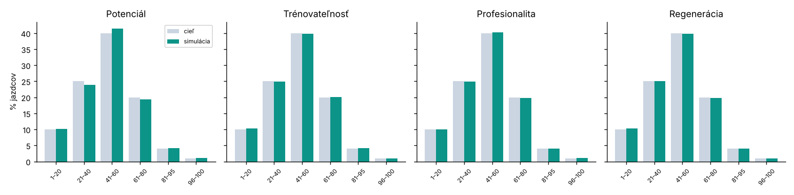
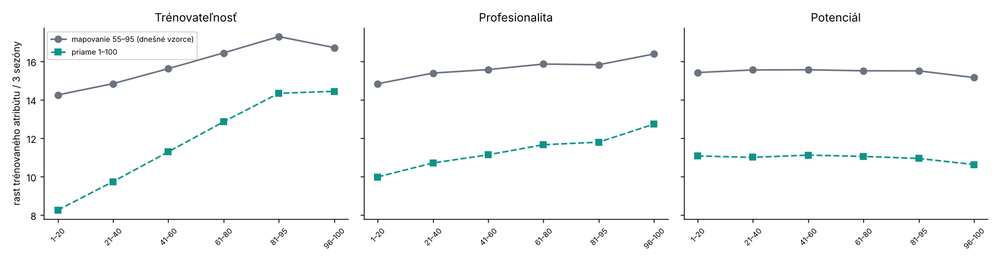
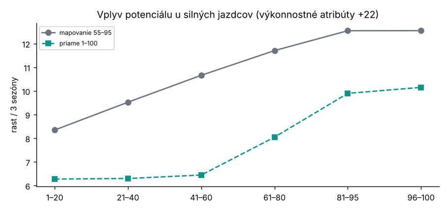
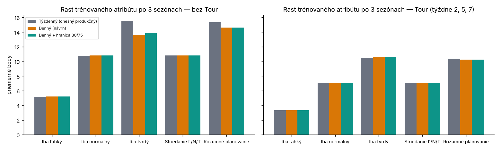
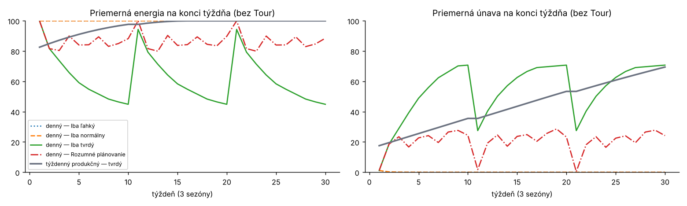
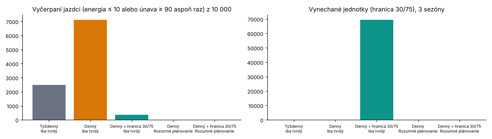
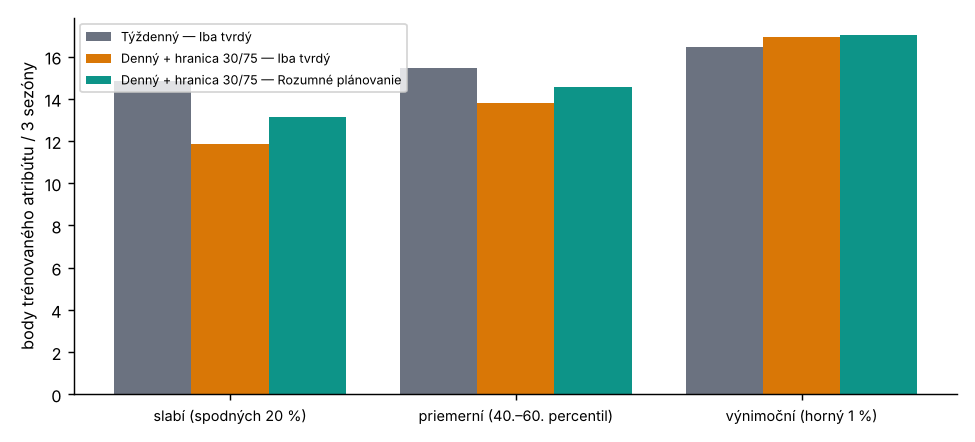

# Simulácia denného tréningu, regenerácie a skrytých vlastností

> **Stav:** iba návrh a simulácia. Nič z toho nie je nasadené ani schválené. Produkčná databáza, schopnosti jazdcov, OVR, tréningové plány ani UI sa nemenili. Všetky koeficienty v časti „Návrh“ sú **experimentálne**; schvaľovať ich budeme až po vyhodnotení.
> Tento súbor sa generuje skriptom `docs/training-simulation/make_report.py` z `results.json` — všetky čísla pochádzajú z jedného behu simulácie.

**Beh:** seed **20261115**, **10 000** unikátnych jazdcov, 3 sezóny po 10 týždňov, 44 scenárov (+ citlivostné behy), výpočet 15 s. Ten istý seed dá bit-po-bite ten istý výsledok (overené testom).

## 0. Zhrnutie

1. **Populácia sedí na zadané rozdelenie** (tabuľky v §2). Potenciál 96–100 má **106** jazdcov, z toho s trénovateľnosťou > 80 len **3**. Kombináciu „všetky štyri vlastnosti ≥ 81“ nemá **nikto** (0 z 10 000; teoreticky 0.06). „Výnimočný“ jazdec v zmysle všetkých štyroch ≥ 61 je 38 jazdcov.
2. **Dnešné vzorce rešpektujú význam vlastností len čiastočne.** Trénovateľnosť a profesionalita fungujú (ako násobiteľ rýchlosti). **Potenciál nemá v prvých 3 sezónach prakticky žiadny efekt** (+0.6 % medzi najslabším a výborným pásmom) — vzorec ho zapína až od celkového výkonu ≥ 140. U jazdcov, ktorí už sú silní, sa potenciál prejaví (+50 % pri mapovaní 55–95, +58 % pri priamej stupnici 1–100). Regenerácia sa dnes vo vzorci vôbec nepoužíva.
3. **Navrhnutá záťaž tvrdej jednotky (−24 / +18) je pre väčšinu jazdcov neudržateľná.** Pri samých tvrdých týždňoch je po 3 sezónach vyčerpaných **7 118 z 10 000** jazdcov (všetci s regeneráciou ≤ 60), priemerná energia na konci tréningového týždňa 58 a únava 58. Ľahký a normálny tréning sú plne udržateľné (energia ~100, únava ~0). Dnešný týždenný model je naopak veľmi benevolentný: tvrdý týždeň stojí iba 15/18 a energia ostáva 97.
4. **Hranica „energia < 30 alebo únava > 75“** zníži vyčerpaných jazdcov z 7 118 na **362**, no vynechá 8.6 % všetkých tvrdých jednotiek a rast trénovaného atribútu mierne **zvýši** (13.60 → 13.85), lebo sa nevykonávajú neúčinné jednotky pri pripravenosti ×0,50–0,70.
5. **Rozumné plánovanie intenzity** (podľa pripravenosti na začiatku týždňa) dáva v dennom modeli vyšší rast než samé tvrdé týždne (14.61 vs. 13.60 bez hranice a 13.85 s hranicou) **bez jediného vynechaného tréningu a bez jediného vyčerpaného jazdca**.
6. **OVR rastie pomaly:** keďže hráč trénuje jeden atribút, medián rastu OVR po 3 sezónach je 1.0 bodu (priemer 1.39). Trénovaný atribút rastie o ~15 bodov. Pozri §5.1 a §8.
7. **Rookie limity OVR 75 / 95 nie sú na stupnici schváleného `overallRating()`** (štartovací jazdec má 130.03), preto sa pri ňom nedajú použiť. Pozri §5.9.

**Odporúčanie v skratke (podrobne §8):** ponechať vzorec rastu, prah 12, počty jednotiek, tabuľku pripravenosti a vzorce dennej regenerácie; **znížiť záťaž tvrdej jednotky** (napr. −20 / +15 alebo −22 / +16 — nulové vyčerpanie pri zachovaní tvrdosti); **zaviesť hranicu** ako ochranný mechanizmus (nie ako trest); rozhodnúť o stupnici skrytých vlastností (mapovanie 55–95 vs. priama 1–100); a **definovať Rookie limity na stupnici `overallRating()`**.

---

## 1. Audit existujúceho systému

Prečítané: `CLAUDE.md`, `GAME_DESIGN.md`, `DECISIONS.md`, `TRAINING_AUDIT.md`, `lib/training/*`, `lib/rider/score.ts`, `lib/facilities/config.ts`, SQL migrácie 20261115_01–03 (autoritatívne spracovanie v `apply_training_plan_internal`). Značky: **[IMPL]** reálne v kóde/SQL.

| Téma | Zistenie |
|---|---|
| Skryté vlastnosti — rozsah a generovanie | Štartovací jazdec: potenciál, trénovateľnosť, profesionalita, regenerácia **55–95** (celé čísla; SQL ich pri vytvorení overuje na 55–95). Verejné atribúty: základ 130 ± 5, tvar ±10, šum ±3 (112–148), vek 18–22. **[IMPL]** |
| Presný vzorec (Performance) | `BASE_TRAINING 3 × počet_jednotiek (1/2/3) × (0,5 + trénovateľnosť/200) × (0,8 + profesionalita/500) × vekový_faktor × násobok_tréningového_centra × pripravenosť × developmentRoomFactor`. Sekundárny atribút 35 % primárneho (pevná mapa). **[IMPL]** |
| Vekový faktor | ≤ 19: 1,30 · 20–22: 1,20 · 23–25: 1,10 · 26–28: 1,00 · 29–31: 0,80 · 32–34: 0,55 · 35+: 0,30 **[IMPL]** |
| Úloha skrytých vlastností | **Trénovateľnosť** = násobiteľ rýchlosti učenia (0,5–1,0 pri škále 0–100). **Profesionalita** = násobiteľ efektivity tréningu (0,8–1,0). **Potenciál** vstupuje iba cez `developmentRoomFactor = max(0,05, lokálny_faktor(hodnota) × faktor_potenciálu(celkový_výkon, potenciál))`; faktor potenciálu má **váhu 0 pod celkovým výkonom 140** a rastie k 1 pri 200. **Regenerácia sa vo vzorci nepoužíva** (iba sa zobrazuje v Rozvoji). Duplicitný násobiteľ som nenašiel: každá vlastnosť vstupuje práve raz. **[IMPL]** |
| Strop | Výkonnostné atribúty 200, ostatné 160. Pri 200 je rast 0. |
| Hranica 12 a progres | Surový rast sa sčíta do akumulátora pre každý atribút zvlášť (`rider_training_progress`); celé body = `floor((súčet + 1e-9) / 12)`, zvyšok sa prenáša medzi týždňami. Technical plán: max +1 bod / plán (v simulácii sa nepoužíva). **[IMPL]** |
| Energia, únava, forma, kondícia | Štart 100 / 0 / forma 50 / kondícia 60 / morálka 70. Tréning mení iba energiu a únavu: týždenná cena (ľahký 5/5, normálny 10/10, tvrdý 15/18) **raz za týždeň**, potom pasívna regenerácia na voľných dňoch (6/5/4 dní × 5 energie × 4 únavy × násobok Regeneračného centra). Zaokrúhli sa a ohraničí 0–100. Forma, kondícia, morálka sa nemenia. **[IMPL]** |
| Pripravenosť | `(energia + 100 − únava) / 2` zo stavu **pred** týždňom → účinnosť 1,00 / 0,95 / 0,85 / 0,70 / 0,50 pre ≥ 80 / ≥ 60 / ≥ 40 / ≥ 20 / menej. **[IMPL]** |
| Regenerácia bez plánu | **Neexistuje** — v týždni bez plánu sa stav nemení (potvrdené simuláciou, §6). |
| Zázemie | Tréningové centrum: násobok 1,15 / 1,10 / 1,05 / 1,03 podľa vekového pásma (odomyká sa úrovňami 2–5), len Performance. Regeneračné centrum: ×1,00–1,20 na pasívnu regeneráciu. Čísla sú `[PLACEHOLDER]`. **V simulácii sú obe vypnuté (×1,00)**, aby bol vidieť čistý vplyv jazdca. |
| Rozpis dní | UI aj návrh: ľahká = utorok, normálna = utorok + štvrtok, tvrdá = utorok + štvrtok + sobota (Po = 0 … Ne = 6). Zhoda s `TrainingConfigForm` je kontrolovaná testom. |

Dnešný produkčný model je v simulácii zahrnutý ako **„Týždenný (dnešný produkčný)“** — počíta sa **tými istými funkciami** (`calculatePerformanceRawGrowth`, `accumulateProgress`, `weeklyConditionDelta`, `applyConditionDelta`, `readinessEffectiveness`), nie ich kópiou, takže sa od hry nemôže rozísť.

---

## 2. Experimentálny model skrytých vlastností

Stupnica 1–100, štyri vlastnosti **nezávisle**, v pásme rovnomerne, seed 20261115:

| Pásmo | 1–20 | 21–40 | 41–60 | 61–80 | 81–95 | 96–100 |
|---|---:|---:|---:|---:|---:|---:|
| Podiel | 10 % | 25 % | 40 % | 20 % | 4 % | 1 % |

### 2.1 Reálne rozdelenie vo vygenerovanej populácii (10 000 jazdcov)

| Vlastnosť | 1–20 (10 %) | 21–40 (25 %) | 41–60 (40 %) | 61–80 (20 %) | 81–95 (4 %) | 96–100 (1 %) | priemer | medián | min–max |
|:---|---:|---:|---:|---:|---:|---:|---:|---:|---:|
| Potenciál | 1 012 (10.12 %) | 2 393 (23.93 %) | 4 136 (41.36 %) | 1 937 (19.37 %) | 416 (4.16 %) | 106 (1.06 %) | 47.6 | 48 | 1–100 |
| Trénovateľnosť | 1 024 (10.24 %) | 2 485 (24.85 %) | 3 983 (39.83 %) | 2 006 (20.06 %) | 412 (4.12 %) | 90 (0.90 %) | 47.5 | 48 | 1–100 |
| Profesionalita | 1 001 (10.01 %) | 2 489 (24.89 %) | 4 025 (40.25 %) | 1 983 (19.83 %) | 399 (3.99 %) | 103 (1.03 %) | 47.4 | 48 | 1–100 |
| Regenerácia | 1 029 (10.29 %) | 2 509 (25.09 %) | 3 979 (39.79 %) | 1 985 (19.85 %) | 402 (4.02 %) | 96 (0.96 %) | 47.3 | 48 | 1–100 |



Nezávislosť (Pearsonovo r medzi vlastnosťami, očakávané ≈ 0):

| Dvojica | Pearsonovo r |
|:---|---:|
| potential ↔ trainability | +0.0014 |
| potential ↔ professionalism | +0.0077 |
| potential ↔ recovery | -0.0031 |
| trainability ↔ professionalism | -0.0101 |
| trainability ↔ recovery | -0.0051 |
| professionalism ↔ recovery | -0.0002 |

### 2.2 Zaujímavé kombinácie

| Kombinácia | Počet jazdcov | Očakávaný počet (teória) |
|:---|---:|---:|
| Potenciál 96–100 | 106 | 100.00 |
| Potenciál 96–100 a trénovateľnosť > 80 | 3 | 5.00 |
| Potenciál ≥ 81 a trénovateľnosť ≥ 81 | 21 | 25.00 |
| Všetky štyri ≥ 61 | 38 | 39.06 |
| Aspoň tri zo štyroch ≥ 81 | 7 | 4.81 |
| Všetky štyri ≥ 81 (výnimočná kombinácia) | 0 | 0.06 |
| Všetky štyri ≥ 96 | 0 | 0.00 |
| Všetky štyri ≤ 20 (najslabšia kombinácia) | 3 | 1.00 |

Kombinácia „všetky štyri ≥ 81“ má pravdepodobnosť 0,05⁴ = 0,0006 % — v 10 000 jazdcoch ju teda **nemožno očakávať**. Ak má hra takých jazdcov mať, treba ich generovať cielene (alebo zvoliť slabšiu definíciu „výnimočnosti“, napr. aspoň tri vlastnosti ≥ 81: 7 jazdcov).

### 2.3 Mapovanie na dnešnú stupnicu

Produkčné vzorce boli ladené na 55–95. Pre simuláciu sú pripravené dve mapovania (databáza sa nemení):

* **`rescaled` (hlavné):** lineárne 1 → 55, 100 → 95 (`55 + (v − 1) × 40 / 99`) pre trénovateľnosť, profesionalitu a potenciál. Vzorce ostávajú **nezmenené** a zachovajú dnešnú rýchlosť rastu.
* **`direct` (citlivostná analýza):** surové hodnoty 1–100 do nezmenených vzorcov. Rozdiely medzi jazdcami sú väčšie (trénovateľnosť 1 dáva faktor 0,505, nie 0,775) a priemerný jazdec rastie pomalšie.

Regenerácia sa **nemapuje** — nový denný vzorec je definovaný priamo na 1–100.

### 2.4 Rešpektuje existujúci vzorec význam vlastností?

Rast trénovaného atribútu po 3 sezónach (tvrdý týždenný tréning, dnešný vzorec, mapovanie 55–95), podľa pásma vlastnosti:

**Trénovateľnosť** (+21.3 % medzi pásmom 1–20 a 81–95):

| Pásmo | Jazdcov | Rast trénovaného atribútu S3 | Rast OVR S3 |
|:---|---:|---:|---:|
| 1–20 | 1 024 | 14.3 | 1.35 |
| 21–40 | 2 485 | 14.8 | 1.41 |
| 41–60 | 3 983 | 15.6 | 1.49 |
| 61–80 | 2 006 | 16.4 | 1.57 |
| 81–95 | 412 | 17.3 | 1.65 |
| 96–100 | 90 | 16.7 | 1.58 |

**Profesionalita** (+6.7 %):

| Pásmo | Jazdcov | Rast trénovaného atribútu S3 | Rast OVR S3 |
|:---|---:|---:|---:|
| 1–20 | 1 001 | 14.8 | 1.44 |
| 21–40 | 2 489 | 15.4 | 1.46 |
| 41–60 | 4 025 | 15.6 | 1.48 |
| 61–80 | 1 983 | 15.9 | 1.52 |
| 81–95 | 399 | 15.8 | 1.56 |
| 96–100 | 103 | 16.4 | 1.58 |

**Potenciál** (+0.6 %):

| Pásmo | Jazdcov | Rast trénovaného atribútu S3 | Rast OVR S3 |
|:---|---:|---:|---:|
| 1–20 | 1 012 | 15.4 | 1.47 |
| 21–40 | 2 393 | 15.6 | 1.48 |
| 41–60 | 4 136 | 15.6 | 1.48 |
| 61–80 | 1 937 | 15.5 | 1.48 |
| 81–95 | 416 | 15.5 | 1.50 |
| 96–100 | 106 | 15.2 | 1.42 |

**Regenerácia** (dnes bez vplyvu, +1.0 %):

| Pásmo | Jazdcov | Rast trénovaného atribútu S3 | Rast OVR S3 |
|:---|---:|---:|---:|
| 1–20 | 1 029 | 15.6 | 1.50 |
| 21–40 | 2 509 | 15.6 | 1.49 |
| 41–60 | 3 979 | 15.5 | 1.48 |
| 61–80 | 1 985 | 15.4 | 1.46 |
| 81–95 | 402 | 15.8 | 1.50 |
| 96–100 | 96 | 15.4 | 1.42 |

Pri priamej stupnici 1–100 (denný tvrdý s hranicou):

| Pásmo | Jazdcov | Rast trénovaného atribútu S3 | Rast OVR S3 |
|:---|---:|---:|---:|
| 1–20 | 1 024 | 8.3 | 0.77 |
| 21–40 | 2 485 | 9.7 | 0.92 |
| 41–60 | 3 983 | 11.3 | 1.08 |
| 61–80 | 2 006 | 12.9 | 1.23 |
| 81–95 | 412 | 14.3 | 1.36 |
| 96–100 | 90 | 14.4 | 1.34 |

| Pásmo | Jazdcov | Rast trénovaného atribútu S3 | Rast OVR S3 |
|:---|---:|---:|---:|
| 1–20 | 1 001 | 10.0 | 0.96 |
| 21–40 | 2 489 | 10.7 | 1.01 |
| 41–60 | 4 025 | 11.1 | 1.05 |
| 61–80 | 1 983 | 11.7 | 1.11 |
| 81–95 | 399 | 11.8 | 1.15 |
| 96–100 | 103 | 12.7 | 1.26 |

| Pásmo | Jazdcov | Rast trénovaného atribútu S3 | Rast OVR S3 |
|:---|---:|---:|---:|
| 1–20 | 1 012 | 11.1 | 1.06 |
| 21–40 | 2 393 | 11.0 | 1.05 |
| 41–60 | 4 136 | 11.1 | 1.05 |
| 61–80 | 1 937 | 11.1 | 1.05 |
| 81–95 | 416 | 10.9 | 1.04 |
| 96–100 | 106 | 10.6 | 0.98 |



**Zistenia:**

* **Trénovateľnosť** určuje rýchlosť učenia — správne. **Profesionalita** pôsobí ako jemnejší násobiteľ efektivity — správne, no na rozsahu 55–95 len ~+6.7 %.
* **Potenciál nerozhoduje o rozvoji v prvých sezónach.** Vzorec ho zapína až od celkového výkonu ≥ 140; štartovací jazdci majú ~130 a po 3 sezónach tréningu jedného atribútu zostávajú pod 140. Potenciál „určuje dlhodobý rozvoj“ až po prekročení tejto hranice. Test s tými istými jazdcami, ktorým som výkonnostné atribúty zdvihol o 22:

| Potenciál | Jazdcov | Rast atribútu S3 — mapovanie 55–95 | priame 1–100 |
|:---|---:|---:|---:|
| 1–20 | 1 012 | 8.3 | 6.3 |
| 21–40 | 2 393 | 9.5 | 6.3 |
| 41–60 | 4 136 | 10.7 | 6.4 |
| 61–80 | 1 937 | 11.7 | 8.0 |
| 81–95 | 416 | 12.5 | 9.9 |
| 96–100 | 106 | 12.5 | 10.2 |



* Rozdiely medzi mapovaniami sú dôležité pre dizajn: pri `rescaled` je jazdec s vysokou trénovateľnosťou rýchlejší len o ~+21.3 % než jazdec s nízkou, pri `direct` sa rozdiel medzi slabým a výborným jazdcom výrazne zväčší (tabuľky vyššie). **Toto je herné rozhodnutie** — odporúčam ho prijať vedome.
* **Duplicitné násobitele sa nenašli.** Nič som nepridával ani nemenil.

Vplyv veku (dnešný vekový faktor, 3 sezóny):

| Scenár | Vek na začiatku | Jazdcov | Rast atribútu S3 | Rast OVR S3 |
|:---|---:|---:|---:|---:|
| Týždenný tvrdý | 18–22 | 5 517 | 18.0 | 1.72 |
| Týždenný tvrdý | 23–27 | 2 497 | 15.5 | 1.47 |
| Týždenný tvrdý | 28–32 | 1 268 | 10.7 | 1.03 |
| Týždenný tvrdý | 33–39 | 718 | 5.2 | 0.50 |
| Denný+hr. rozumný | 18–22 | 5 517 | 17.0 | 1.62 |
| Denný+hr. rozumný | 23–27 | 2 497 | 14.5 | 1.37 |
| Denný+hr. rozumný | 28–32 | 1 268 | 10.0 | 0.96 |
| Denný+hr. rozumný | 33–39 | 718 | 4.9 | 0.46 |

---

## 3. Experimentálny denný tréning (návrh)

### 3.1 Pravidlá (zachované)
Plánuje sa nasledujúci týždeň · potvrdený plán je konečný · týždeň 1 prípravný · v týždni 10 sa už neplánuje na ďalšiu sezónu (tréning týždňa 10 sa plánuje v týždni 9 a prebehne) · v Tour týždni sa netrénuje · bez plánu žiadny progres · regenerácia prebieha aj bez plánu.

### 3.2 Jednotky a záťaž
| Intenzita | Dni | Záťaž jednej jednotky |
|---|---|---|
| Ľahká | utorok | energia −12, únava +8 |
| Normálna | utorok, štvrtok | energia −18, únava +12 |
| Tvrdá | utorok, štvrtok, sobota | energia −24, únava +18 |

### 3.3 Denná regenerácia pri vrodenej hodnote R (1–100)
`obnova energie = 8 + round(8·R/100)`, `odbúranie únavy = 5 + round(6·R/100)`. Voľný deň 100 %, tréningový deň 50 % **po** tréningu (zaokrúhlené polovicou dennej hodnoty, half-up). Hodnoty sa po každom kroku ohraničujú na 0–100.

| R | Voľný deň: +energia | −únava | Tréningový deň: +energia | −únava | Týždeň TVRDÝ: Δ energia | Δ únava | Týždeň NORMÁLNY: Δ energia | Δ únava |
|:---|---:|---:|---:|---:|---:|---:|---:|---:|
| 1 | 8 | 5 | 4 | 3 | -28 | +25 | +12 | -7 |
| 10 | 9 | 6 | 5 | 3 | -21 | +21 | +19 | -12 |
| 25 | 10 | 7 | 5 | 4 | -17 | +14 | +24 | -19 |
| 50 | 12 | 8 | 6 | 4 | -6 | +10 | +36 | -24 |
| 75 | 14 | 10 | 7 | 5 | +5 | -1 | +48 | -36 |
| 90 | 15 | 10 | 8 | 5 | +12 | -1 | +55 | -36 |
| 100 | 16 | 11 | 8 | 6 | +16 | -8 | +60 | -43 |

Z tabuľky je vidno základný fakt: **normálny týždeň je pre každého jazdca energeticky kladný, tvrdý týždeň je záporný pre R ≲ 60** (týždenný súčet = 4 voľné dni + 3 tréningové dni − 3 × 24).

### 3.4 Rozdelenie týždenného progresu na jednotky
Faktory týždňa (atribúty, vek, potenciál, trénovateľnosť, profesionalita, `developmentRoomFactor`) sa **zmrazia na začiatku týždňa**; týždenný surový progres sa vydelí počtom jednotiek; každá jednotka ho vynásobí **vlastnou pripravenosťou** (stav tesne pred ňou) a pripíše do rovnakých akumulátorov s prahom 12. Zvyškový progres sa prenáša medzi jednotkami aj týždňami. **Dôkaz, že rozdelenie samo rast nezvyšuje:** keď sa pripravenosť neutralizuje (×1,00), denný model dáva pre každého z 10 000 jazdcov rovnaký výsledok ako týždenný (test v §6). Jediný rozdiel medzi modelmi je teda realistická pripravenosť pri každej jednotke.

### 3.5 Experimentálna hranica
Pred jednotkou: energia < 30 **alebo** únava > 75 → jednotka sa neuskutoční, jazdec nezíska progres, nezaplatí záťaž a regeneruje 100 %. Porovnanie „s hranicou“ a „bez hranice“ je v §5.7.

---

## 4. Návrh simulácie

* **Kód:** `apps/web/src/lib/training/sim/` (`rng.ts`, `population.ts`, `model.ts`, `stats.ts`, `run.cli.ts`, `sim.test.ts`). Žiadny prístup k databáze. Spustenie: `npx tsx src/lib/training/sim/run.cli.ts [seed] [n]`, potom `python3 docs/training-simulation/make_report.py`.
* **Populácia (predpoklady):** vek 18–22 (55 %), 23–27 (25 %), 28–32 (13 %), 33–36 (7 %); verejné atribúty: úroveň 130 ± 12 (trojuholníkové), 3 silné (+10) a 3 slabé (−10) atribúty, šum ±3, rozsah 100–160; štartovacia kondícia: polovica oddýchnutá (100/0), polovica náhodná (energia 30–100, únava 0–70); **zameranie tréningu** je náhodné z 7 výkonnostných atribútov a pre jazdca rovnaké vo všetkých scenároch. Štartovací OVR (`overallRating`): priemer 130.03.
* **Scenáre:** bez tréningu · iba ľahký · iba normálny · iba tvrdý · striedanie Ľ→N→T · **rozumné plánovanie** (pripravenosť ≥ 75 → tvrdý, ≥ 55 → normálny, ≥ 35 → ľahký, inak týždeň odpočinku; rozhoduje stav na začiatku týždňa, predpoklad: manažér pozná dobrú projekciu) — každý v troch modeloch (týždenný produkčný, denný, denný s hranicou) a v dvoch kalendároch.
* **Kalendár:** 3 sezóny × 10 týždňov; v každej sezóne týždeň 1 bez tréningu, týždeň 10 sa trénuje; vek +1 pri začiatku sezóny. **Tour:** tri Tour za sezónu podľa Rookie pravidiel v týždňoch 2, 5 a 7 (podľa `data/tourSchedule.ts`; týždne 5 sú jedna spoločná voľba), v nich sa netrénuje a jazdec regeneruje voľne.
* **Oddelený experiment s hypotetickou záťažou pretekov („Tour + záťaž“):** reálne pretekárske výpočty energie a únavy ešte nie sú integrované. Ako **hypotézu** sa v Tour týždni používa 5 pretekových dní (Ut–So), každý −15 energie, +10 únavy, regenerácia po preteku 50 %. **Nie sú to skutočné výsledky pretekov**; slúži iba na odhad, ako by ťažký Tour zaťažil tréningový režim.
* **Zázemie a personál:** vypnuté (×1,00, žiadny tréner ani fyzioterapeut).
* **OVR:** schválený `overallRating()` (váhy 50/25/20/5). Aby bolo vidieť aj priamy efekt, uvádzam vždy aj rast **trénovaného atribútu**.
* **Obmedzenia:** jeden fixný fokus na jazdca (reálny hráč môže meniť); Technical plány, skúsenosti, rast Taktiky, zranenia a preteky nie sú v modeli; AI jazdci netrénujú; rast OVR je celé číslo po zaokrúhlení, preto sú mediány často 0 alebo 1.

---

## 5. Výsledky

### 5.1 Rast OVR po 1 a 3 sezónach (S1 / S3), bez Tour

OVR = `overallRating()` (štart priemer 130.03). Rast v bodoch OVR; percentily sú z 10 000 jazdcov.

| Model | Scenár | S1 priemer | S1 medián | S3 priemer | S3 medián | S3 p5 | S3 p25 | S3 p75 | S3 p95 | S3 p99 | S3 max |
|:---|---:|---:|---:|---:|---:|---:|---:|---:|---:|---:|---:|
| Týždenný (dnešný produkčný) | Bez tréningu | 0.00 | 0.0 | 0.00 | 0.0 | 0.0 | 0.0 | 0.0 | 0.0 | 0.0 | 0.0 |
| Týždenný (dnešný produkčný) | Iba ľahký | 0.12 | 0.0 | 0.47 | 0.0 | 0.0 | 0.0 | 1.0 | 1.0 | 1.0 | 1.0 |
| Týždenný (dnešný produkčný) | Iba normálny | 0.31 | 0.0 | 1.02 | 1.0 | 0.0 | 1.0 | 1.0 | 2.0 | 2.0 | 2.0 |
| Týždenný (dnešný produkčný) | Iba tvrdý | 0.48 | 0.0 | 1.48 | 2.0 | 1.0 | 1.0 | 2.0 | 2.0 | 2.0 | 3.0 |
| Týždenný (dnešný produkčný) | Striedanie Ľ/N/T | 0.31 | 0.0 | 1.02 | 1.0 | 0.0 | 1.0 | 1.0 | 2.0 | 2.0 | 2.0 |
| Týždenný (dnešný produkčný) | Rozumné plánovanie | 0.47 | 0.0 | 1.46 | 2.0 | 0.0 | 1.0 | 2.0 | 2.0 | 2.0 | 3.0 |
| Denný (návrh) | Bez tréningu | 0.00 | 0.0 | 0.00 | 0.0 | 0.0 | 0.0 | 0.0 | 0.0 | 0.0 | 0.0 |
| Denný (návrh) | Iba ľahký | 0.12 | 0.0 | 0.48 | 0.0 | 0.0 | 0.0 | 1.0 | 1.0 | 1.0 | 1.0 |
| Denný (návrh) | Iba normálny | 0.31 | 0.0 | 1.02 | 1.0 | 0.0 | 1.0 | 1.0 | 2.0 | 2.0 | 2.0 |
| Denný (návrh) | Iba tvrdý | 0.41 | 0.0 | 1.29 | 1.0 | 0.0 | 1.0 | 2.0 | 2.0 | 2.0 | 3.0 |
| Denný (návrh) | Striedanie Ľ/N/T | 0.31 | 0.0 | 1.02 | 1.0 | 0.0 | 1.0 | 1.0 | 2.0 | 2.0 | 2.0 |
| Denný (návrh) | Rozumné plánovanie | 0.44 | 0.0 | 1.39 | 1.0 | 0.0 | 1.0 | 2.0 | 2.0 | 2.0 | 3.0 |
| Denný + hranica 30/75 | Bez tréningu | 0.00 | 0.0 | 0.00 | 0.0 | 0.0 | 0.0 | 0.0 | 0.0 | 0.0 | 0.0 |
| Denný + hranica 30/75 | Iba ľahký | 0.12 | 0.0 | 0.48 | 0.0 | 0.0 | 0.0 | 1.0 | 1.0 | 1.0 | 1.0 |
| Denný + hranica 30/75 | Iba normálny | 0.31 | 0.0 | 1.02 | 1.0 | 0.0 | 1.0 | 1.0 | 2.0 | 2.0 | 2.0 |
| Denný + hranica 30/75 | Iba tvrdý | 0.42 | 0.0 | 1.32 | 1.0 | 0.0 | 1.0 | 2.0 | 2.0 | 2.0 | 3.0 |
| Denný + hranica 30/75 | Striedanie Ľ/N/T | 0.31 | 0.0 | 1.02 | 1.0 | 0.0 | 1.0 | 1.0 | 2.0 | 2.0 | 2.0 |
| Denný + hranica 30/75 | Rozumné plánovanie | 0.44 | 0.0 | 1.39 | 1.0 | 0.0 | 1.0 | 2.0 | 2.0 | 2.0 | 3.0 |

### 5.2 Rast OVR, s Tour (týždne 2, 5, 7 bez tréningu)

| Model | Scenár | S1 priemer | S1 medián | S3 priemer | S3 medián | S3 p5 | S3 p25 | S3 p75 | S3 p95 | S3 p99 | S3 max |
|:---|---:|---:|---:|---:|---:|---:|---:|---:|---:|---:|---:|
| Týždenný (dnešný produkčný) | Bez tréningu | 0.00 | 0.0 | 0.00 | 0.0 | 0.0 | 0.0 | 0.0 | 0.0 | 0.0 | 0.0 |
| Týždenný (dnešný produkčný) | Iba ľahký | 0.06 | 0.0 | 0.30 | 0.0 | 0.0 | 0.0 | 1.0 | 1.0 | 1.0 | 1.0 |
| Týždenný (dnešný produkčný) | Iba normálny | 0.18 | 0.0 | 0.65 | 1.0 | 0.0 | 0.0 | 1.0 | 1.0 | 1.0 | 1.0 |
| Týždenný (dnešný produkčný) | Iba tvrdý | 0.30 | 0.0 | 0.99 | 1.0 | 0.0 | 1.0 | 1.0 | 2.0 | 2.0 | 2.0 |
| Týždenný (dnešný produkčný) | Striedanie Ľ/N/T | 0.18 | 0.0 | 0.66 | 1.0 | 0.0 | 0.0 | 1.0 | 1.0 | 1.0 | 1.0 |
| Týždenný (dnešný produkčný) | Rozumné plánovanie | 0.30 | 0.0 | 0.98 | 1.0 | 0.0 | 1.0 | 1.0 | 2.0 | 2.0 | 2.0 |
| Denný (návrh) | Bez tréningu | 0.00 | 0.0 | 0.00 | 0.0 | 0.0 | 0.0 | 0.0 | 0.0 | 0.0 | 0.0 |
| Denný (návrh) | Iba ľahký | 0.06 | 0.0 | 0.30 | 0.0 | 0.0 | 0.0 | 1.0 | 1.0 | 1.0 | 1.0 |
| Denný (návrh) | Iba normálny | 0.19 | 0.0 | 0.66 | 1.0 | 0.0 | 0.0 | 1.0 | 1.0 | 1.0 | 1.0 |
| Denný (návrh) | Iba tvrdý | 0.31 | 0.0 | 1.01 | 1.0 | 0.0 | 1.0 | 1.0 | 2.0 | 2.0 | 2.0 |
| Denný (návrh) | Striedanie Ľ/N/T | 0.19 | 0.0 | 0.66 | 1.0 | 0.0 | 0.0 | 1.0 | 1.0 | 1.0 | 1.0 |
| Denný (návrh) | Rozumné plánovanie | 0.30 | 0.0 | 0.97 | 1.0 | 0.0 | 1.0 | 1.0 | 2.0 | 2.0 | 2.0 |
| Denný + hranica 30/75 | Bez tréningu | 0.00 | 0.0 | 0.00 | 0.0 | 0.0 | 0.0 | 0.0 | 0.0 | 0.0 | 0.0 |
| Denný + hranica 30/75 | Iba ľahký | 0.06 | 0.0 | 0.30 | 0.0 | 0.0 | 0.0 | 1.0 | 1.0 | 1.0 | 1.0 |
| Denný + hranica 30/75 | Iba normálny | 0.19 | 0.0 | 0.66 | 1.0 | 0.0 | 0.0 | 1.0 | 1.0 | 1.0 | 1.0 |
| Denný + hranica 30/75 | Iba tvrdý | 0.31 | 0.0 | 1.01 | 1.0 | 0.0 | 1.0 | 1.0 | 2.0 | 2.0 | 2.0 |
| Denný + hranica 30/75 | Striedanie Ľ/N/T | 0.19 | 0.0 | 0.66 | 1.0 | 0.0 | 0.0 | 1.0 | 1.0 | 1.0 | 1.0 |
| Denný + hranica 30/75 | Rozumné plánovanie | 0.30 | 0.0 | 0.97 | 1.0 | 0.0 | 1.0 | 1.0 | 2.0 | 2.0 | 2.0 |

### 5.3 Rast trénovaného atribútu (priemer, body)

**Bez Tour:**

| Scenár | Týž. S1 | Týž. S3 | Denný S1 | Denný S3 | Denný+hr. S1 | Denný+hr. S3 | Plánovaných týždňov / 3 sezóny |
|:---|---:|---:|---:|---:|---:|---:|---:|
| Iba ľahký | 1.6 | 5.2 | 1.6 | 5.2 | 1.6 | 5.2 | 27.0 |
| Iba normálny | 3.4 | 10.8 | 3.5 | 10.8 | 3.5 | 10.8 | 27.0 |
| Iba tvrdý | 5.3 | 15.5 | 4.6 | 13.6 | 4.6 | 13.8 | 27.0 |
| Striedanie Ľ/N/T | 3.5 | 10.8 | 3.5 | 10.8 | 3.5 | 10.8 | 27.0 |
| Rozumné plánovanie | 5.2 | 15.4 | 4.9 | 14.6 | 4.9 | 14.6 | 26.8 |

**S Tour:**

| Scenár | Týž. S1 | Týž. S3 | Denný S1 | Denný S3 | Denný+hr. S1 | Denný+hr. S3 | Plánovaných týždňov / 3 sezóny |
|:---|---:|---:|---:|---:|---:|---:|---:|
| Iba ľahký | 0.9 | 3.3 | 0.9 | 3.3 | 0.9 | 3.3 | 18.0 |
| Iba normálny | 2.1 | 7.1 | 2.1 | 7.1 | 2.1 | 7.1 | 18.0 |
| Iba tvrdý | 3.3 | 10.5 | 3.4 | 10.7 | 3.4 | 10.7 | 18.0 |
| Striedanie Ľ/N/T | 2.1 | 7.1 | 2.1 | 7.1 | 2.1 | 7.1 | 18.0 |
| Rozumné plánovanie | 3.2 | 10.4 | 3.3 | 10.2 | 3.3 | 10.2 | 17.9 |



### 5.4 Rast jednotlivých verejných atribútov (priemer na jazdca, všetci jazdci)

Trénovaný je vždy jeden výkonnostný atribút (náhodný) a jeho sekundárny partner; Taktika, Technika a Skúsenosti sa tréningom nemenia.

| Atribút | Týž. tvrdý S1 | S3 | Denný+hr. tvrdý S1 | S3 | Denný+hr. rozumný + Tour S1 | S3 |
|:---|---:|---:|---:|---:|---:|---:|
| Stúpanie | 0.75 | 2.21 | 0.66 | 1.97 | 0.46 | 1.46 |
| Kopce | 0.76 | 2.25 | 0.67 | 2.00 | 0.47 | 1.49 |
| Rovina | 0.75 | 2.23 | 0.67 | 1.99 | 0.47 | 1.47 |
| Šprint | 0.97 | 2.94 | 0.84 | 2.62 | 0.58 | 1.92 |
| Časovka | 1.23 | 3.77 | 1.06 | 3.35 | 0.72 | 2.44 |
| Vytrvalosť | 1.18 | 3.65 | 1.02 | 3.24 | 0.70 | 2.37 |
| Zjazd | 0.00 | 0.00 | 0.00 | 0.00 | 0.00 | 0.00 |
| Akcelerácia | 1.20 | 3.70 | 1.03 | 3.29 | 0.71 | 2.40 |
| Manažment energie | 0.00 | 0.00 | 0.00 | 0.00 | 0.00 | 0.00 |
| Pozícia | 0.00 | 0.00 | 0.00 | 0.00 | 0.00 | 0.00 |
| Reakcia | 0.00 | 0.00 | 0.00 | 0.00 | 0.00 | 0.00 |
| Schopnosť úniku | 0.00 | 0.00 | 0.00 | 0.00 | 0.00 | 0.00 |
| Jazda v balíku | 0.00 | 0.00 | 0.00 | 0.00 | 0.00 | 0.00 |
| Skúsenosti | 0.00 | 0.00 | 0.00 | 0.00 | 0.00 | 0.00 |
| Ovládanie bicykla | 0.00 | 0.00 | 0.00 | 0.00 | 0.00 | 0.00 |
| Zatáčky | 0.00 | 0.00 | 0.00 | 0.00 | 0.00 | 0.00 |
| Načasovanie útoku | 0.00 | 0.00 | 0.00 | 0.00 | 0.00 | 0.00 |
| Nerovný povrch | 0.00 | 0.00 | 0.00 | 0.00 | 0.00 | 0.00 |
| Jazda v daždi | 0.00 | 0.00 | 0.00 | 0.00 | 0.00 | 0.00 |

### 5.5 Energia a únava

Priemer na konci **tréningových** týždňov, bez Tour:

| Scenár (bez Tour) | Týž. energia | Týž. únava | Denný energia | Denný únava | Denný+hr. energia | Denný+hr. únava |
|:---|---:|---:|---:|---:|---:|---:|
| Iba ľahký | 99.7 | 0.5 | 100.0 | 0.0 | 100.0 | 0.0 |
| Iba normálny | 99.3 | 1.2 | 100.0 | 0.0 | 100.0 | 0.0 |
| Iba tvrdý | 97.3 | 45.2 | 57.9 | 58.3 | 73.2 | 47.7 |
| Striedanie Ľ/N/T | 99.5 | 1.6 | 93.9 | 6.1 | 93.9 | 6.1 |
| Rozumné plánovanie | 98.9 | 32.9 | 85.1 | 22.7 | 85.1 | 22.7 |



Rozdelenie jednotiek podľa pripravenosti v momente jednotky (tvrdý a rozumný scenár, bez Tour):

| Model | Scenár | Pripravenosť ≥ 80 (×1,00) | 60–79 (×0,95) | 40–59 (×0,85) | 20–39 (×0,70) | < 20 (×0,50) |
|:---|---:|---:|---:|---:|---:|---:|
| Týždenný (dnešný produkčný) | Iba tvrdý | 46.1 % | 37.8 % | 15.9 % | 0.2 % | 0.0 % |
| Týždenný (dnešný produkčný) | Rozumné plánovanie | 58.8 % | 40.9 % | 0.3 % | 0.0 % | 0.0 % |
| Denný (návrh) | Iba tvrdý | 36.7 % | 14.4 % | 14.8 % | 19.0 % | 15.2 % |
| Denný (návrh) | Rozumné plánovanie | 81.5 % | 17.7 % | 0.8 % | 0.0 % | 0.0 % |
| Denný + hranica 30/75 | Iba tvrdý | 44.6 % | 23.6 % | 27.2 % | 4.6 % | 0.0 % |
| Denný + hranica 30/75 | Rozumné plánovanie | 81.5 % | 17.7 % | 0.8 % | 0.0 % | 0.0 % |

### 5.6 Vynechané tréningy a vyčerpaní jazdci

„Vyčerpaný“ = aspoň raz za 3 sezóny energia ≤ 10 alebo únava ≥ 90 (na konci dňa; v týždennom modeli na konci týždňa). Počet jazdcov **saturuje** (každý jazdec s nízkou regeneráciou to dosiahne), preto je uvedený aj počet jazdec-dní.

| Kalendár | Model | Scenár | Plánované jednotky | Vynechané | Podiel | Vyčerpaní jazdci | Dni vyčerpania (jazdec-dni) |
|:---|---:|---:|---:|---:|---:|---:|---:|
| bez Tour | Týždenný (dnešný produkčný) | Iba ľahký | 270 000 | 0 | 0.0 % | 0 | 0 |
| bez Tour | Týždenný (dnešný produkčný) | Iba normálny | 540 000 | 0 | 0.0 % | 0 | 0 |
| bez Tour | Týždenný (dnešný produkčný) | Iba tvrdý | 810 000 | 0 | 0.0 % | 2 490 | 23 874 |
| bez Tour | Týždenný (dnešný produkčný) | Striedanie Ľ/N/T | 540 000 | 0 | 0.0 % | 0 | 0 |
| bez Tour | Týždenný (dnešný produkčný) | Rozumné plánovanie | 782 409 | 0 | 0.0 % | 0 | 0 |
| bez Tour | Denný (návrh) | Iba ľahký | 270 000 | 0 | 0.0 % | 0 | 0 |
| bez Tour | Denný (návrh) | Iba normálny | 540 000 | 0 | 0.0 % | 0 | 0 |
| bez Tour | Denný (návrh) | Iba tvrdý | 810 000 | 0 | 0.0 % | 7 118 | 390 679 |
| bez Tour | Denný (návrh) | Striedanie Ľ/N/T | 540 000 | 0 | 0.0 % | 0 | 0 |
| bez Tour | Denný (návrh) | Rozumné plánovanie | 736 497 | 0 | 0.0 % | 0 | 0 |
| bez Tour | Denný + hranica 30/75 | Iba ľahký | 270 000 | 0 | 0.0 % | 0 | 0 |
| bez Tour | Denný + hranica 30/75 | Iba normálny | 540 000 | 0 | 0.0 % | 0 | 0 |
| bez Tour | Denný + hranica 30/75 | Iba tvrdý | 810 000 | 69 437 | 8.6 % | 362 | 5 444 |
| bez Tour | Denný + hranica 30/75 | Striedanie Ľ/N/T | 540 000 | 0 | 0.0 % | 0 | 0 |
| bez Tour | Denný + hranica 30/75 | Rozumné plánovanie | 736 497 | 0 | 0.0 % | 0 | 0 |
| Tour (týždne 2, 5, 7) | Týždenný (dnešný produkčný) | Iba ľahký | 180 000 | 0 | 0.0 % | 0 | 0 |
| Tour (týždne 2, 5, 7) | Týždenný (dnešný produkčný) | Iba normálny | 360 000 | 0 | 0.0 % | 0 | 0 |
| Tour (týždne 2, 5, 7) | Týždenný (dnešný produkčný) | Iba tvrdý | 540 000 | 0 | 0.0 % | 1 180 | 7 550 |
| Tour (týždne 2, 5, 7) | Týždenný (dnešný produkčný) | Striedanie Ľ/N/T | 360 000 | 0 | 0.0 % | 0 | 0 |
| Tour (týždne 2, 5, 7) | Týždenný (dnešný produkčný) | Rozumné plánovanie | 525 276 | 0 | 0.0 % | 0 | 0 |
| Tour (týždne 2, 5, 7) | Denný (návrh) | Iba ľahký | 180 000 | 0 | 0.0 % | 0 | 0 |
| Tour (týždne 2, 5, 7) | Denný (návrh) | Iba normálny | 360 000 | 0 | 0.0 % | 0 | 0 |
| Tour (týždne 2, 5, 7) | Denný (návrh) | Iba tvrdý | 540 000 | 0 | 0.0 % | 410 | 3 280 |
| Tour (týždne 2, 5, 7) | Denný (návrh) | Striedanie Ľ/N/T | 360 000 | 0 | 0.0 % | 0 | 0 |
| Tour (týždne 2, 5, 7) | Denný (návrh) | Rozumné plánovanie | 515 175 | 0 | 0.0 % | 0 | 0 |
| Tour (týždne 2, 5, 7) | Denný + hranica 30/75 | Iba ľahký | 180 000 | 0 | 0.0 % | 0 | 0 |
| Tour (týždne 2, 5, 7) | Denný + hranica 30/75 | Iba normálny | 360 000 | 0 | 0.0 % | 0 | 0 |
| Tour (týždne 2, 5, 7) | Denný + hranica 30/75 | Iba tvrdý | 540 000 | 1 016 | 0.2 % | 107 | 321 |
| Tour (týždne 2, 5, 7) | Denný + hranica 30/75 | Striedanie Ľ/N/T | 360 000 | 0 | 0.0 % | 0 | 0 |
| Tour (týždne 2, 5, 7) | Denný + hranica 30/75 | Rozumné plánovanie | 515 175 | 0 | 0.0 % | 0 | 0 |
| Tour + hypotetická záťaž pretekov | Denný (návrh) | Iba tvrdý | 540 000 | 0 | 0.0 % | 7 118 | 456 723 |
| Tour + hypotetická záťaž pretekov | Denný (návrh) | Rozumné plánovanie | 448 720 | 0 | 0.0 % | 5 | 5 |
| Tour + hypotetická záťaž pretekov | Denný + hranica 30/75 | Iba tvrdý | 540 000 | 79 104 | 14.6 % | 7 118 | 72 732 |
| Tour + hypotetická záťaž pretekov | Denný + hranica 30/75 | Rozumné plánovanie | 448 720 | 0 | 0.0 % | 5 | 5 |



Poznámka k týždennému modelu: „vyčerpaní“ sú tam jazdci so štartovou únavou ~70, ktorým tvrdý týždeň (+18 − 16) pridáva ďalšie ~2 body únavy týždenne a **nikdy ju neodbúra** (bez plánu nie je regenerácia).

### 5.7 Hranica 30 / 75: s hranicou vs. bez nej

| Kalendár | Scenár | Bez hranice: atribút S3 | S hranicou: atribút S3 | Zmena | Bez hr. E / F | S hr. E / F | Vyčerpaní bez | Vyčerpaní s | Vynechané jednotky |
|:---|---:|---:|---:|---:|---:|---:|---:|---:|---:|
| bez Tour | Iba tvrdý | 13.60 | 13.85 | +1.8 % | 58 / 58 | 73 / 48 | 7 118 | 362 | 69 437 |
| bez Tour | Rozumné plánovanie | 14.61 | 14.61 | +0.0 % | 85 / 23 | 85 / 23 | 0 | 0 | 0 |
| Tour (týždne 2, 5, 7) | Iba tvrdý | 10.66 | 10.65 | -0.1 % | 76 / 25 | 76 / 25 | 410 | 107 | 1 016 |
| Tour (týždne 2, 5, 7) | Rozumné plánovanie | 10.24 | 10.24 | +0.0 % | 82 / 20 | 82 / 20 | 0 | 0 | 0 |
| Tour + hypotetická záťaž pretekov | Iba tvrdý | 8.18 | 8.14 | -0.5 % | 41 / 65 | 57 / 53 | 7 118 | 7 118 | 79 104 |
| Tour + hypotetická záťaž pretekov | Rozumné plánovanie | 8.78 | 8.78 | +0.0 % | 85 / 17 | 85 / 17 | 5 | 5 | 0 |

### 5.8 Slabí, priemerní a výnimoční jazdci

Skupiny podľa priemeru štyroch skrytých hodnôt: slabí = spodných 20 % (2000), priemerní = 40.–60. percentil (2000), výnimoční = horný 1 % (100). Priemerný rast OVR a trénovaného atribútu po 3 sezónach, bez Tour:

| Model | Scenár | Slabí OVR S3 | atribút S3 | Priemerní OVR S3 | atribút S3 | Výnimoční OVR S3 | atribút S3 |
|:---|---:|---:|---:|---:|---:|---:|---:|
| Týždenný (dnešný produkčný) | Iba ľahký | 0.46 | 4.9 | 0.45 | 5.2 | 0.53 | 5.5 |
| Týždenný (dnešný produkčný) | Iba normálny | 0.97 | 10.3 | 1.00 | 10.7 | 1.10 | 11.4 |
| Týždenný (dnešný produkčný) | Iba tvrdý | 1.42 | 14.8 | 1.46 | 15.4 | 1.56 | 16.4 |
| Týždenný (dnešný produkčný) | Rozumné plánovanie | 1.40 | 14.6 | 1.44 | 15.3 | 1.54 | 16.3 |
| Denný (návrh) | Iba ľahký | 0.46 | 5.0 | 0.45 | 5.2 | 0.53 | 5.5 |
| Denný (návrh) | Iba normálny | 0.97 | 10.3 | 1.01 | 10.8 | 1.11 | 11.5 |
| Denný (návrh) | Iba tvrdý | 1.10 | 11.5 | 1.28 | 13.6 | 1.62 | 16.9 |
| Denný (návrh) | Rozumné plánovanie | 1.25 | 13.2 | 1.37 | 14.6 | 1.62 | 17.0 |
| Denný + hranica 30/75 | Iba ľahký | 0.46 | 5.0 | 0.45 | 5.2 | 0.53 | 5.5 |
| Denný + hranica 30/75 | Iba normálny | 0.97 | 10.3 | 1.01 | 10.8 | 1.11 | 11.5 |
| Denný + hranica 30/75 | Iba tvrdý | 1.13 | 11.9 | 1.31 | 13.8 | 1.62 | 16.9 |
| Denný + hranica 30/75 | Rozumné plánovanie | 1.25 | 13.2 | 1.37 | 14.6 | 1.62 | 17.0 |



**Tvrdý tréning vs. rozumné striedanie intenzity:**

| Kalendár | Model | Tvrdý: atribút S3 | Rozumný: atribút S3 | Rozdiel | Tvrdý E / F | Rozumný E / F | Vyčerpaní (tvrdý) | Vyčerpaní (rozumný) |
|:---|---:|---:|---:|---:|---:|---:|---:|---:|
| bez Tour | Týždenný (dnešný produkčný) | 15.5 | 15.4 | -1.1 % | 97 / 45 | 99 / 33 | 2 490 | 0 |
| bez Tour | Denný (návrh) | 13.6 | 14.6 | +7.5 % | 58 / 58 | 85 / 23 | 7 118 | 0 |
| bez Tour | Denný + hranica 30/75 | 13.8 | 14.6 | +5.5 % | 73 / 48 | 85 / 23 | 362 | 0 |
| Tour (týždne 2, 5, 7) | Týždenný (dnešný produkčný) | 10.5 | 10.4 | -0.7 % | 96 / 37 | 98 / 27 | 1 180 | 0 |
| Tour (týždne 2, 5, 7) | Denný (návrh) | 10.7 | 10.2 | -3.9 % | 76 / 25 | 82 / 20 | 410 | 0 |
| Tour (týždne 2, 5, 7) | Denný + hranica 30/75 | 10.7 | 10.2 | -3.8 % | 76 / 25 | 82 / 20 | 107 | 0 |

### 5.9 Rookie limity OVR (75 pri získaní, 95 pri ponechaní)

**Zistenie o stupnici.** Schválené `overallRating()` je na stupnici atribútov (štartovací jazdec 130.03, strop ~200). Hodnoty 75 / 95 sa preto na ňom nedajú použiť (pri štartovacom OVR ~130 by limit 75 nesplnil nikto). Staré normalizované 0–100 skóre `riderOverall()` (priemer 37.1, štartovné maximum 53, maximum po 3 sezónach 54) tiež **nikoho** nedostane nad 75 ani 95. **Nič som neimplementoval ako pravidlo.** Aby sa dalo rozhodnúť, tabuľka ukazuje, koľko jazdcov z 10 000 by prekročilo prahy na stupnici `overallRating()`:

| Scenár (počet jazdcov: štart → po S1 → po S3) | OVR ≥ 140 | OVR ≥ 145 | OVR ≥ 150 | OVR ≥ 155 | OVR ≥ 160 |
|:---|---:|---:|---:|---:|---:|
| Bez tréningu | 228 → 228 → 228 | 0 → 0 → 0 | 0 → 0 → 0 | 0 → 0 → 0 | 0 → 0 → 0 |
| Týždenný tvrdý, bez Tour | 228 → 316 → 535 | 0 → 0 → 0 | 0 → 0 → 0 | 0 → 0 → 0 | 0 → 0 → 0 |
| Denný+hr. tvrdý, bez Tour | 228 → 303 → 499 | 0 → 0 → 0 | 0 → 0 → 0 | 0 → 0 → 0 | 0 → 0 → 0 |
| Denný+hr. rozumný, bez Tour | 228 → 307 → 510 | 0 → 0 → 0 | 0 → 0 → 0 | 0 → 0 → 0 | 0 → 0 → 0 |
| Denný+hr. rozumný, Tour | 228 → 287 → 418 | 0 → 0 → 0 | 0 → 0 → 0 | 0 → 0 → 0 | 0 → 0 → 0 |

Počet jazdcov nad starým skóre 0–100: > 75 pri štarte = 0, > 95 po 1. sezóne = 0, > 95 po 3. sezónach = 0.

### 5.10 Citlivosť: záťaž tvrdej jednotky

Denný model, iba tvrdý tréning, bez Tour. Hodnotené **iba** na rozhodnutie, nič sa neprijíma:

| Záťaž tvrdej jednotky (energia / únava) | Model | Rast atribútu S3 | E / F (koniec týždňa) | Vyčerpaní jazdci | Vynechané jednotky | Vyčerpaní podľa regenerácie 1–20 / 21–40 / 41–60 / 61–80 / 81–100 |
|:---|---:|---:|---:|---:|---:|---:|
| Návrh: −24 / +18 | denný | 13.60 | 58 / 58 | 7 118 | — | 1029 / 2509 / 3580 / 0 / 0 |
| Návrh: −24 / +18 | denný + hranica | 13.85 | 73 / 48 | 362 | 8.6 % | 351 / 11 / 0 / 0 / 0 |
| −22 / +16 | denný | 14.87 | 74 / 37 | 3 719 | — | 1029 / 2509 / 181 / 0 / 0 |
| −22 / +16 | denný + hranica | 15.05 | 81 / 32 | 0 | 4.1 % | 0 / 0 / 0 / 0 / 0 |
| −20 / +15 | denný | 15.53 | 86 / 24 | 1 550 | — | 1029 / 521 / 0 / 0 / 0 |
| −20 / +15 | denný + hranica | 15.59 | 90 / 22 | 0 | 2.3 % | 0 / 0 / 0 / 0 / 0 |
| −18 / +14 | denný | 15.87 | 95 / 17 | 1 550 | — | 1029 / 521 / 0 / 0 / 0 |
| −18 / +14 | denný + hranica | 15.86 | 97 / 15 | 0 | 1.4 % | 0 / 0 / 0 / 0 / 0 |

### 5.11 Citlivosť: stupnica skrytých vlastností

| Model | Scenár | Atribút S3 — mapovanie 55–95 | priame 1–100 | OVR S3 — mapovanie | priame |
|:---|---:|---:|---:|---:|---:|
| Týždenný (dnešný produkčný) | Iba tvrdý | 15.5 | 12.4 | 1.48 | 1.18 |
| Denný + hranica 30/75 | Iba tvrdý | 13.8 | 11.1 | 1.32 | 1.05 |
| Denný + hranica 30/75 | Rozumné plánovanie | 14.6 | 11.7 | 1.39 | 1.11 |

### 5.12 Desať konkrétnych kariér

Vyberané deterministicky z populácie podľa uvedeného kritéria (ID = poradie v populácii pri seede 20261115). Stĺpce výsledkov: *prírastok trénovaného atribútu / prírastok OVR* po 3 sezónach, kalendár s Tour.

| Kariéra | ID | Vek | Pot/Trén/Prof/Reg | E/F na začiatku | Zameranie (hodnota) | OVR na začiatku | Bez tréningu | Týž. tvrdý | Denný tvrdý | Denný+hr. tvrdý | Denný+hr. rozumný |
|:---|---:|---:|---:|---:|---:|---:|---:|---:|---:|---:|---:|
| 1. Najväčší rast (po 3 sezónach, inteligentné plánovanie) | #424 | 18 | 47/99/50/80 | 56/14 | Rovina (120) | 131 | +0 / +0 | +15 / +2 | +15 / +2 | +15 / +2 | +15 / +2 |
| 2. Potenciál 96–100 a trénovateľnosť > 80 | #6817 | 20 | 97/85/41/81 | 100/0 | Rovina (127) | 129 | +0 / +0 | +14 / +1 | +14 / +1 | +14 / +1 | +14 / +1 |
| 3. Obrovský talent, pomalé učenie (potenciál ≥ 96, trénovateľnosť ≤ 20) | #265 | 20 | 100/12/99/20 | 98/48 | Stúpanie (135) | 134 | +0 / +0 | +11 / +1 | +12 / +1 | +12 / +1 | +11 / +1 |
| 4. Rýchle učenie, nízky strop (trénovateľnosť ≥ 96, potenciál ≤ 20) | #3332 | 21 | 18/100/61/66 | 100/0 | Šprint (118) | 128 | +0 / +0 | +14 / +2 | +14 / +2 | +14 / +2 | +14 / +2 |
| 5. Všetky štyri ≥ 61 (najlepšia kombinácia) | #2584 | 18 | 79/95/82/100 | 100/0 | Kopce (136) | 134 | +0 / +0 | +15 / +2 | +15 / +2 | +15 / +2 | +15 / +2 |
| 6. Najslabšia kombinácia (najnižší súčet skrytých hodnôt) | #7606 | 22 | 6/7/2/14 | 100/0 | Rovina (125) | 126 | +0 / +0 | +10 / +1 | +10 / +1 | +10 / +1 | +9 / +1 |
| 7. Slabá regenerácia (≤ 10), vysoká trénovateľnosť (≥ 81) — tvrdý tréning | #5475 | 19 | 50/100/69/2 | 100/0 | Akcelerácia (137) | 125 | +0 / +0 | +15 / +2 | +13 / +1 | +13 / +1 | +13 / +1 |
| 8. Výborná regenerácia (≥ 96), vysoká trénovateľnosť (≥ 81) | #3963 | 25 | 77/87/58/97 | 49/45 | Rovina (111) | 121 | +0 / +0 | +11 / +1 | +12 / +1 | +12 / +1 | +12 / +1 |
| 9. Najstarší jazdec s najlepšou trénovateľnosťou (vek ≥ 33) | #8133 | 36 | 42/98/21/46 | 100/0 | Kopce (130) | 127 | +0 / +0 | +3 / +0 | +3 / +0 | +3 / +0 | +3 / +0 |
| 10. Typický jazdec (medián skrytých hodnôt, vek ≤ 22) | #26 | 19 | 26/55/57/52 | 77/69 | Rovina (128) | 126 | +0 / +0 | +12 / +2 | +13 / +2 | +13 / +2 | +13 / +2 |

---

## 6. Technické testy

`npx tsx src/lib/training/sim/sim.test.ts` — **36** kontrol, všetky prechádzajú. Overujú:

* žiadny progres bez plánu (všetky tri modely, ani jeden atribút sa nezmení, žiadne jednotky);
* žiadny tréning ani progres počas Tour týždňov (všetky tri modely, všetky sezóny);
* hranice sezóny: týždeň 1 sa netrénuje, týždeň 10 trénuje, žiadny plán sa neprenáša do ďalšej sezóny, vek +1 presne pri začiatku sezóny;
* **rozdelenie týždňa na jednotky nezvyšuje rast** (denný = týždenný pre každého z 600 jazdcov a všetky intenzity pri neutrálnej pripravenosti);
* zvyškový progres sa nestráca ani nevzniká (súčet surového progresu = 12 × celé body + zvyšok, 0 ≤ zvyšok ≤ 24 na jazdca);
* energia a únava vždy v 0–100 (aj zo štartov 0/100 a 100/0, všetky modely, politiky, Tour so záťažou);
* vrodená regenerácia sa nemení (zmrazené objekty, rovnaký hash pred/po) a vstupná populácia sa behom nemení;
* reprodukovateľnosť: rovnaký seed a konfigurácia = identické výsledky, iný seed = iné;
* 10 000 jazdcov × všetky modely a politiky: žiadne neplatné hodnoty (NaN, mimo rozsahu, pokles atribútu, atribút > 200);
* rozdelenie skrytých vlastností (do 4 štandardných chýb), nezávislosť (|r| < 0,05), unikátnosť 10 000 profilov;
* zhoda rozpisu dní a počtu jednotiek s UI (`TrainingConfigForm`) a s `SESSION_COUNT`; návrhové záťaže a regeneračné vzorce;
* chovanie hranice (nikdy nevynechá oddýchnutého jazdca; vykonané + vynechané = plánované).

Pri behu s 10 000 jazdcami bolo neplatných hodnôt: **0**. Dnešný produkčný model je v simulácii zahrnutý tými istými funkciami ako v hre, takže zhoda s produkciou je daná konštrukciou; SQL zrkadlo samotné overujú existujúce DB testy (`supabase/tests/training_security.test.sh`).

---

## 7. Návrh budúceho serverového denného spracovania (Supabase) — NEIMPLEMENTOVANÉ

**Cieľ:** spracovať tréning aj bez prihlásenia hráča, bez dvojitého spracovania, s bezpečným prechodom zo starého týždenného systému.

1. **Spúšťač:** `pg_cron` (bežný vo Supabase, nepotrebuje service-role kľúč) volá raz denne (napr. 00:10 UTC, po konci kalendárneho dňa) `process_training_day(p_day date)`. Funkcia je `security definer`, bez klientskeho grantu (rovnaký vzor ako `apply_training_plan_internal`). Rozhodnutie o `pg_cron` je dnes otvorené (D8).
2. **Idempotencia a zámky:**
   * tabuľka `training_day_runs(day date primary key, started_at, finished_at, riders_done int)` — beh pre daný deň sa „zaregistruje“ cez `insert … on conflict do nothing`; druhý súbežný beh skončí hneď;
   * tabuľka `training_day_log(rider_id, day, primary key (rider_id, day), session_done bool, skipped_reason text, energy_before, fatigue_before, …)` — **PK je ochrana pred dvojitým spracovaním** na úrovni jazdca a dňa; záznam sa vkladá v tej istej transakcii ako zmena stavu jazdca;
   * jazdci sa berú dávkami (`for update skip locked`), jedna transakcia na jazdca/dávku, takže pád uprostred neskazí ostatných.
3. **Dohnanie zameškaných dní:** funkcia spracuje všetky dni od posledného `training_day_log` jazdca po včerajšok v poradí (aj po výpadku crona); vždy podľa **SQL kalendára** (`season_id_at`, `season_week_at`), nikdy podľa času klienta.
4. **Čo sa deje za deň:** nájsť potvrdený plán daného týždňa (jazdec, sezóna, týždeň); ak je to deň tréningu a spĺňa sa pravidlo hranice → progres jednotky do `rider_training_progress` + záťaž; inak iba regenerácia (aj bez plánu a v Tour týždni). Týždeň 1 / Tour týždeň / týždeň bez plánu = iba regenerácia. Vykoná sa vždy v poradí: hranica → progres → záťaž → polovičná regenerácia.
5. **Prechod zo starého systému:**
   * pevný **dátum prepnutia** (pondelok 00:00 UTC): od neho beží denný režim; týždenné spracovanie (`process_my_due_training`) sa vypne **až po** dokončení posledného týždenného dňa;
   * plány už **spracované** týždenne (`applied_at is not null`) sa nikdy nespracujú znova; nespracované plány z týždňa pred prepnutím dobehne ešte týždenný spôsob (jednorazovo), plány od prepnutia ide denne;
   * historické záznamy (`training_plans`, história atribútov) ostávajú; plán sa stále eviduje na úrovni týždňa, denné jednotky pribúdajú v `training_day_log`;
   * lenivé spracovanie pri návšteve stránky Tréning ostane len ako záloha (volá tú istú funkciu s dňami po dnes).
6. **Bezpečnosť:** klient nemá zápis do `training_day_log`/`training_day_runs`; skryté vlastnosti sa nikdy nevracajú; AI jazdci (D13) sa zapnú samostatne.
7. **Testovanie pred nasadením:** DB test s pevným „teraz“ (rovnaký vzor ako `training_security.test.sh`): paralelné volania, výpadok o 3 dni, prechod sezóny, Tour týždeň, týždeň 1/10, zhoda SQL = TypeScript simulácia pre vzorku jazdcov (drift test).

---

## 8. Odporúčania — čo ponechať a čo upraviť

**Ponechať (simulácia nenašla dôvod meniť):**
* vzorec rastu, `BASE_TRAINING 3`, prah akumulátora 12, počty jednotiek 1/2/3 a rozpis dní;
* tabuľku pripravenosti (×1,00 … ×0,50) — v dennom modeli pracuje dobre ako plynulá brzda;
* vzorce dennej regenerácie `8 + round(8R/100)` a `5 + round(6R/100)` a 50 % regeneráciu v tréningový deň;
* záťaž **ľahkej** a **normálnej** jednotky (udržateľné pre všetkých: energia ~100, únava ~0 na konci týždňa);
* vekový faktor a vrodenosť regenerácie.

**Upraviť / rozhodnúť (návrh, nič nie je schválené):**
1. **Záťaž tvrdej jednotky.** −24 / +18 vyčerpá 7 118 z 10 000 jazdcov. Citlivostná analýza (§5.10): **−20 / +15** → nulové vyčerpanie s hranicou a len ~2 % vynechaných jednotiek, rast tvrdého tréningu ~15.6 bodu (vs. 13.8 pri −24 / +18). Možnosť −22 / +16 je prísnejšia (tvrdý ostáva „tvrdý“).
2. **Hranica 30 / 75: zaviesť** ako ochranu pred spirálou únavy (výrazne znižuje vyčerpanie a rast nezhoršuje), alebo ju nahradiť miernejším trestom cez pripravenosť, ktorá už existuje. Na jej tvorbu treba UI informáciu „dnes si oddychoval“.
3. **Potenciál:** dnes pod celkovým výkonom 140 nič neurobí. Ak má určovať dlhodobý rozvoj už od začiatku, treba samostatné rozhodnutie (nie duplicitný násobiteľ — úprava existujúcej váhy). Ponechať, ak „dlhodobý“ znamená strop pre silných jazdcov.
4. **Stupnica skrytých vlastností:** `rescaled` zachová dnešnú rýchlosť; `direct` vytvorí výraznejšie rozdiely medzi jazdcami, no priemerný jazdec rastie pomalšie (§5.11). Odporúčam `rescaled` na migráciu existujúcich dát a výber až po rozhodnutí o rozdieloch medzi slabými a výnimočnými.
5. **Regenerácia ako vlastnosť jazdca** sa musí zaviesť do dennej regenerácie (je jediný jej vstup); po jej zavedení vyradiť z Rozvoja ako „zatiaľ nepoužité“.
6. **OVR rastie pomaly** (§5.1). Ak má hráč po 3 sezónach vidieť výraznejší posun OVR, nie je to otázka tréningového vzorca — jeden trénovaný atribút z 19 hýbe OVR o ~0,07 bodu na bod atribútu. Treba rozhodnúť, či to tak má byť.
7. **Rookie limity** definovať na stupnici `overallRating()` (napr. percentil populácie alebo pevné hodnoty podľa §5.9), nie 75/95.
8. **Tour:** v modeli bez záťaže pretekov strácajú jazdci cca tretinu tréningových týždňov (18 z 27). Reálna záťaž pretekov (energia/únava) ešte neexistuje — jej zavedenie zmení bilanciu tvrdého tréningu (hypotetický test v §5.6).

**Schválenie, ktoré potrebujem pred ďalším krokom:** (a) stupnica skrytých vlastností; (b) záťaž tvrdej jednotky; (c) hranica áno/nie a jej hodnoty; (d) definícia Rookie limitov; (e) mechanizmus pozadia (D8) a dátum prepnutia.

---

## 9. Reprodukcia

```
cd apps/web
npx --no-install tsx --tsconfig tsconfig.json src/lib/training/sim/run.cli.ts 20261115 10000
npx --no-install tsx src/lib/training/sim/sim.test.ts
cd ../.. && python3 docs/training-simulation/make_report.py
```
Seed 20261115, 10 000 jazdcov, 44 hlavných scenárov. Výstupy: `docs/training-simulation/results.json` + PNG grafy v rovnakom priečinku.
